# Marmalade, Nutmeg and Bao

Selected chef mascots and excited jump animations, approved on 2026-11-04.
Marmalade is the ginger tabby (proposal C1), Nutmeg the russet owl (O5), and Bao
the panda (P1). Their cream chef hats, warm outlines and rounded proportions
take their visual direction from [Chef Penguini](../penguini/README.md).

## Assets

| Character | Editable resting artwork | Excited animation |
| --- | --- | --- |
| Marmalade | [source/marmalade-still.svg](source/marmalade-still.svg) | [marmalade-excited.svg](marmalade-excited.svg) |
| Nutmeg | [source/nutmeg-still.svg](source/nutmeg-still.svg) | [nutmeg-excited.svg](nutmeg-excited.svg) |
| Bao | [source/bao-still.svg](source/bao-still.svg) | [bao-excited.svg](bao-excited.svg) |

[kitchen-crew-excited.svg](kitchen-crew-excited.svg) shows all three together,
synchronized. Each animation plays once in **6.6 seconds**, finishing in its
selected resting pose. The action follows Penguini's approved jump-and-wave
timing: an anticipation crouch, a higher hop, a smaller hop, a soft landing,
waving, and a gradual recovery. Happy eyes, head and hat motion, and Marmalade's
tail add follow-through. The shadow stays on the ground during the jumps.
Nutmeg's wing, whisk, grip and finger marks share the same shoulder transform.

These are stored assets for future placement in the app. No application page
currently loads this collection.

## Preview

From the repository root:

```sh
python3 -m http.server 8080 --bind 127.0.0.1 --directory assets/brand/kitchen-crew
```

Open `http://127.0.0.1:8080/preview.html`. The preview works offline and includes
Replay all, Pause/Resume, Loop, and individual SVG downloads. It can also be
opened directly from disk in a browser that permits local files.

All SVGs respect `prefers-reduced-motion: reduce` and show the resting pose
without animation. The preview controls also respond to preference changes.

## Web integration

The standalone SVGs contain editable vector geometry, gradients, and CSS
keyframes. They have transparent backgrounds, accessible titles/descriptions,
and no embedded raster artwork, scripts, fonts, or external resource requests.
The preview page uses JavaScript only for its playback controls.

Animated character files use a `512 × 672` canvas. The extra headroom keeps hats
inside the frame during jumps. Reserve this aspect ratio in an `img` element:

```html

```

Use `alt=""` when decorative beside existing content. The combined SVG uses a
`1536 × 672` canvas. Import assets through the app's asset pipeline when adding a
Dioxus component; this folder is not globally loaded by `Dioxus.toml`.

The source resting illustrations retain their original `512 × 560` canvas.
The generator places them at `translate(0 106)` inside the taller animation
canvas. To swap to a still image without changing layout, retain that placement
in a `512 × 672` wrapper, or disable animation on the inline animated SVG.
Reloading an image/document replays its standalone animation. Use the preview's
Replay all button for repeated review, and provide a pause control for looping
motion in any future application integration.

Each character's IDs, CSS selectors and animation names are prefixed. When
inlining a character more than once, including inside the combined SVG, rename
each instance's IDs and references or use separate `img` elements.

## Editing and regeneration

- `source/*-still.svg` contains the selected vector artwork, with named groups
  for head, hat, eyes, body, feet, arms, clothing and accessories.
- `source/penguini-excited-reference.json` is the frozen excited-clip timing from
  Penguini as merged in PR #57. It does not automatically track later changes to
  Penguini's animation registry.
- `scripts/build-kitchen-crew-assets.py` adds motion wrappers, expression layers
  and CSS, and generates the individual animations, combined SVG and preview.

Edit the source art or generator, then run from the repository root:

```sh
python3 scripts/build-kitchen-crew-assets.py
python3 scripts/build-kitchen-crew-assets.py --check
```

The generator requires only Python's standard library. Generated SVGs and the
preview should be regenerated together; avoid hand-editing generated copies.

## Provenance and validation

The vector artwork was authored as SVG proposals and selected by the user.
The animations preserve the original geometry and adapt Penguini's timing to
the smaller characters. Their resting transforms match at the start and end.

Chromium review covered the selected designs, 16 rendered poses per character,
canvas bounds at 50 ms intervals, whisk attachment, replay/pause/loop,
desktop/mobile layout, reduced motion, and standalone `img` playback. Small
antialiasing differences can occur between composited animation layers and
static artwork even when their geometry is identical.

Screenshots, GIF/video previews, validation captures, and download archives stay
outside the repository, following the Penguini asset convention. Use the SVGs
and local preview as the review surfaces.
