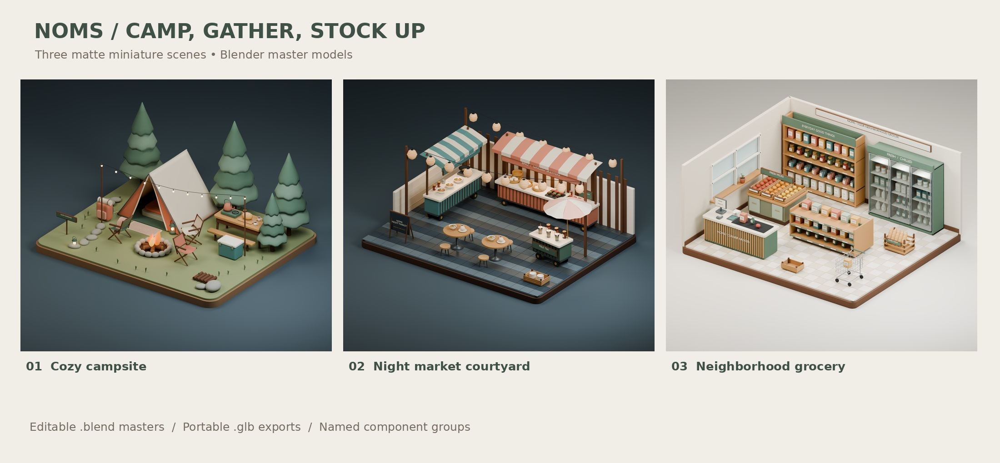

# Noms — Camp, Gather, Stock Up

Three original 3D dioramas with softened edges, matte materials and natural shadows, matching the Noms miniature style.



1. **Cozy campsite** — an open canvas tent with bedding, three folding chairs around a stone fire pit, a picnic cooking table, enamel coffee mugs, a lantern, festoon lights, a cooler and a backpack among pine trees.
2. **Lantern courtyard night market** — a new L-shaped layout with noodle and bao/skewer carts, a milk-tea cart under a parasol, paper lanterns and shared café seating.
3. **Neighborhood grocery store** — fresh produce bins, stocked pantry shelving, a double-sided grocery aisle, glass-door refrigerators, a bread basket, shopping trolley and checkout counter.

## Files

- `models/*.blend`: editable Blender 4.3.2 masters, including cameras and native lighting.
- `models/*.glb`: self-contained glTF 2.0 geometry and PBR materials; studio lights and background are excluded.
- `models/*-assemblies.json`: named component groups with suggested entrance offsets.
- `previews/*.png`: 1600 × 1400 Cycles renders, denoised with Open Image Denoise.
- `gallery.html`: an offline preview gallery and links to each model. Open the local file after cloning the repository or extracting a download bundle.
- `source/`: modeling, export, rendering and validation scripts.
- `validation.json`, `native-validation.json`, `import-validation.json`: export integrity, native-file and independent Blender import checks.

These are static review models. Major components have separate roots for future animation. Assembly manifests and custom node extras use Blender Z-up coordinates; glTF geometry is exported with its standard Y-up convention. Application integration and entrance animations are not included. Shadows are generated by lights and geometry; placement shadows are not painted onto walls or ground. GLB viewers must supply their own lighting. Procedural surface details and studio lighting are native Blender features. Web performance optimization has not been applied to these review exports. See the [production About loader contract](../../about/README.md) before integrating these standard glTF files into the app.

## Rebuild

Requires Blender 4.3.2. From the repository root, first run `cd assets/models/campsite-market-grocery`. Then:

```sh
blender -b --threads 2 --python source/build_scenes.py -- campsite
blender -b --threads 2 --python source/build_scenes.py -- night_market
blender -b --threads 2 --python source/build_scenes.py -- grocery_store
```

Append `--proof` for a smaller, faster preview. The saved Blender master retains full-resolution settings. To render an existing master without rebuilding its geometry:

```sh
blender -b models/cozy-campsite.blend --threads 2 --python source/render_final.py
```

Optional denoising requires `pyoidn`, `numpy` and `Pillow`:

```sh
python source/denoise_previews.py cozy-campsite night-market-lantern-courtyard neighborhood-grocery-store
```

To regenerate the contact sheet and gallery, run `python source/package_collection.py --gallery-only`. This optional step requires Pillow and the DejaVu Sans font files in `/usr/share/fonts/truetype/dejavu/`. Omit `--gallery-only` to also create a verified ZIP under the ignored `dist/` directory. The repository stores the unpacked assets so individual scenes can be reviewed and reused.

Repeat validation after rebuilding:

```sh
blender -b --threads 2 --python source/check_native_models.py
python source/validate_exports.py
blender -b --threads 2 --python source/check_glb_import.py
```

## Asset provenance

All layouts, signs, props and geometry were authored for this collection using shared Noms modeling primitives. No external photographs or third-party models are required. Blender uses its built-in Bfont and AgX color management. External font files and rendering libraries are not redistributed.
