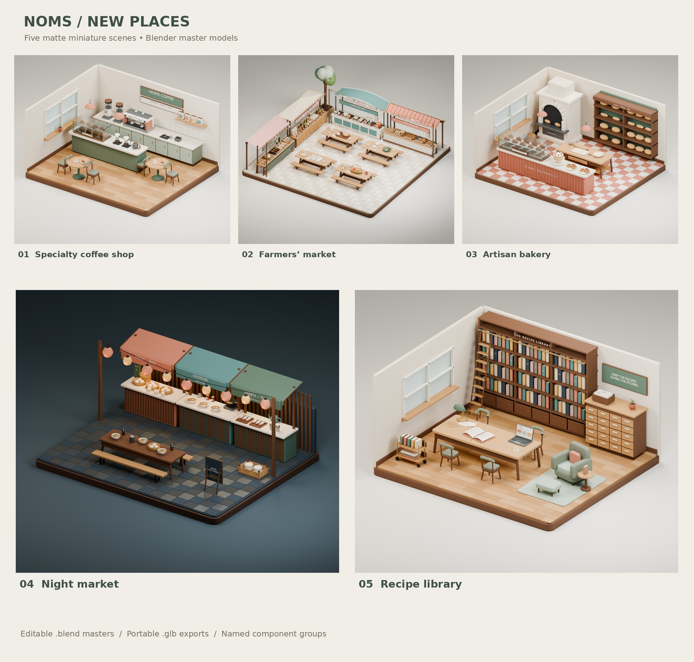

# Noms — Five New Dioramas

Five original, editable 3D scenes in the established Noms miniature style: warm colors, softened edges, matte surfaces and soft contact shadows.



1. **Specialty Coffee Shop** — a two-group espresso machine, grinders, pour-over equipment, a glazed pastry cabinet, retail coffee bags and café seating.
2. **Farmers’ Market — Corner Farmers’ Market (revision 9)** — four enlarged food carts (dairy, bakery, pantry and street food), two per edge around four picnic tables; a rear tree and corner bunting.
3. **Artisan Bakery** — an arched hearth oven, bread shelves, a working baker’s bench, proofing baskets, rolled croissants, fruit danishes and a cake display.
4. **Night Market** — three food kiosks serving bao, noodles, sweets and tea, ribbed paper lanterns and a communal dining table.
5. **Recipe Library** — individually bound cookbooks, an index-card catalog, an open recipe book, a laptop displaying an original Noms recipe layout, a rolling ladder and a reading nook.

## Files

- `models/*.blend`: editable Blender 4.3.2 master scenes, including camera and studio lighting. Images are packed.
- `models/*.glb`: self-contained glTF 2.0 geometry and PBR materials. Studio lights and background are excluded.
- `models/*-assemblies.json`: named component groups with suggested entrance offsets.
- `previews/*.png`: 1600 × 1400 Cycles review renders, denoised with Open Image Denoise.
- `gallery.html`: a local review gallery with model download links. Open the local file after cloning the repository or extracting a download bundle.
- `source/`: reproducible modeling, export and rendering scripts.
- `validation.json`: geometry and GLB integrity checks.
- `native-validation.json` and `import-validation.json`: native master checks and independent Blender import results.
- `source/assets/croissant-library.blend`: the local pastry geometry used by the café and bakery rebuilds.

These are **static review models**. Major components are grouped for animation; the review exports themselves contain no entrance animation. Separate optimized derivatives of the recipe library and revision 9 farmers’ market are integrated into the About tour. Native shadows come from lights and geometry, rather than shadows painted into the floor or walls. Blender procedural surface details and studio lighting are native render features; the GLBs use portable PBR materials and need lighting supplied by their viewer. This collection has not undergone a web performance optimization pass.

Assembly manifests and custom node extras use Blender Z-up coordinates; glTF geometry uses its standard Y-up convention. See the [production About loader contract](../../about/README.md) before integrating these standard glTF exports. This collection retains the original three-kiosk night market; the later courtyard design is in [Camp, Gather, Stock Up](../campsite-market-grocery/README.md).

## Rebuild

Requires Blender 4.3.2. From the repository root, first run `cd assets/models/community-spaces`. Then:

```sh
blender -b --threads 2 --python source/build_scenes.py -- coffee_shop --proof
blender -b models/specialty-coffee-shop.blend --threads 2 --python source/polish_and_render.py
```

Other build keys: `farmers_market`, `artisan_bakery`, `night_market`, `recipe_library`.
The second command applies final review adjustments, saves the master, exports the GLB and renders the full-size preview.
Optional image denoising requires `pyoidn`, `numpy` and `Pillow`; run `python source/denoise_previews.py specialty-coffee-shop` after rendering.
Use `python source/validate_exports.py` to repeat the structural export checks after rebuilding all five models.

To regenerate the contact sheet and gallery, run `python source/package_collection.py --gallery-only`. This optional step requires Pillow and the DejaVu Sans font files in `/usr/share/fonts/truetype/dejavu/`. Omit `--gallery-only` to also create a verified ZIP under the ignored `dist/` directory. The repository stores the unpacked assets so individual scenes can be reviewed and reused.

## Farmers’ market revision 9

The fruit and vegetable stands have been removed. Four 4.9 m wide carts (about 46% wider than the prior stalls) form an L shape with two on each side: dairy and bakery along the back, pantry and ready-to-eat bites along the left. Their curved canopy, gabled roof, peaked tent and scalloped cart designs remain distinct. The extended counters add bagels, cinnamon buns, goat cheese, gouda, flour, pulses, spring rolls and buns, without stretching the existing food geometry.

Four picnic tables retain their different lunches in the compact 13.0 × 12.8 m square. The building, front-right tree, welcome sign, sharing table and decorative flower pots remain absent. Eight assembly roots keep the paving, four carts, rear tree, picnic seating and bunting editable.

The review master remains intact. A separate optimized derivative now appears on “Free and accessible” in the About tour, with matte lighting, dynamic shadows and a three-second entrance. See [web export instructions](../../about/README.md#farmers-market). Rebuild with `blender -b --threads 6 --python source/build_scenes.py -- farmers_market`. The native camera is a three-quarter orthographic view. `previews/farmers-market-concepts.png` preserves the original proposal sheet; `farmers-market-layout-validation.json` records the current footprint checks.

## Asset provenance

All scene layouts, fittings, signs and artwork were created for this Noms collection. Shared modeling primitives and the previously approved rolled croissant mesh were reused from the existing Noms kitchen/potluck models. No external photographs or downloaded third-party models are required. Blender’s built-in Bfont and AgX color management are used by Blender; no external font files or color-management libraries are redistributed.
