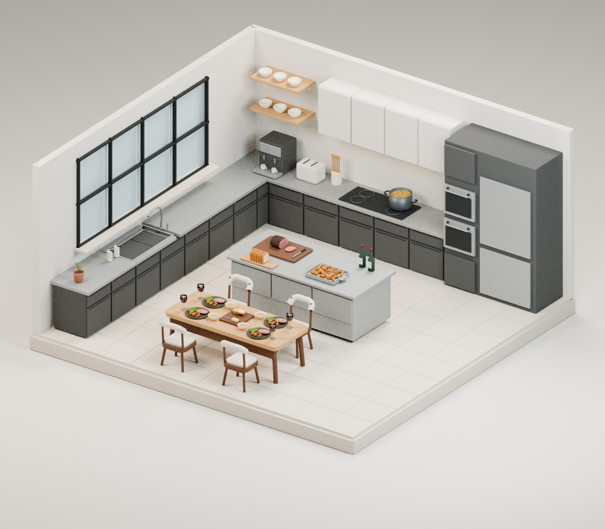
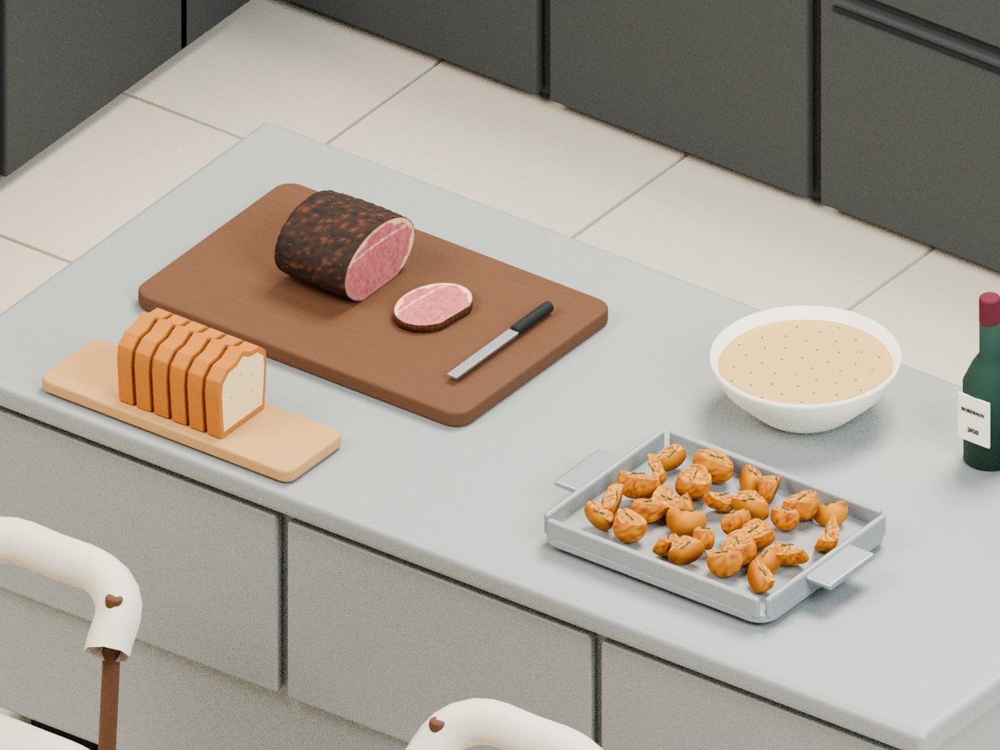
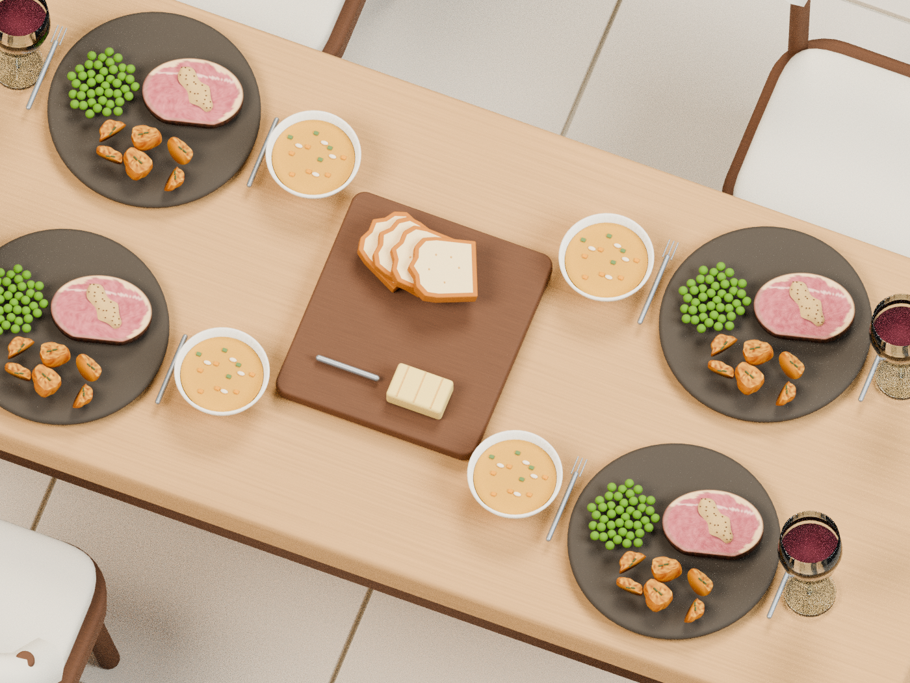
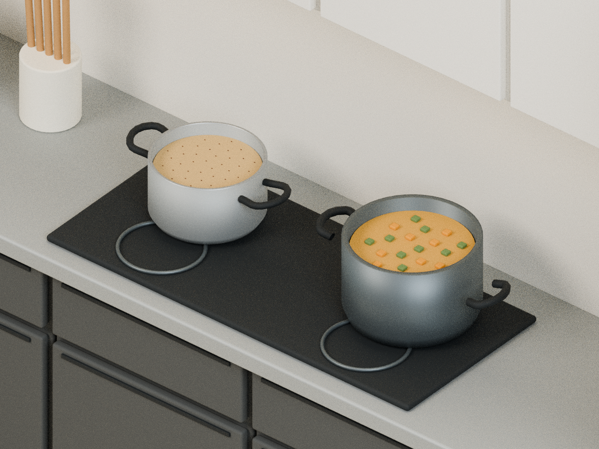

# L-shaped Social Kitchen

Intended About-tour section: **Without the disruptions.**

Revision 8 builds on the reconstruction from the approved design discussion. Earlier uncommitted workspace artifacts were lost; this is not a byte-identical recovery. The sources, native master, GLB, screenshots and download bundle are now versioned together in the repository.

Matte ivory and graphite L-shaped kitchen, steel island, four-seat oak dining table, prime rib with a dark crust and pink cut face, golden roast potatoes, four beef/peas/potato dinners with peppercorn sauce, fanned brioche and butter directly on the shared board, wine and four individual soup bowls.

Revision 5 reduces the island roast by 32% in each dimension, gives it an oval cross-section, and rotates it 90° so its cut face points right. One carved slice sits to its right. The tray now contains 30 smaller roast potatoes instead of 12.

Revision 6 adds a gently flattened base to the island roast, removes the second carving-board slice, and serves one slice of beef per dinner plate with the sauce repositioned on top.

Revision 7 gives all five slices the same oval shape with a flat edge and identical serving dimensions. The roast is another 30% smaller, and the carving board is reduced to 1.0 × 0.65 m with a shorter knife repositioned to fit.

Revision 8 adds a large ivory bowl of peppercorn steak sauce to the left of the island wine bottles and a separate open sauce pot on the stove. Both use the same sauce material and pepper flecks as the plated beef; the soup pot remains alongside the sauce pot.

## Files

- [Download complete version 8 bundle](downloads/monochrome-social-kitchen-v8.zip) (use GitHub’s **Download raw file** button).
- [Editable Blender 4.3 master](models/monochrome-social-kitchen.blend).
- [Standard GLB export](models/monochrome-social-kitchen.glb).
- [Assembly roots and bounds](models/monochrome-social-kitchen-assemblies.json).
- [Validation report](models/validation.json).
- [Rebuild source](source/build_scene.py).

The ZIP contains the model, source, previews, documentation, and SHA-256 checksums. Source is also embedded in the Blender master at build time. `downloads/` is excluded from the ZIP to avoid recursive archives.

## Rebuild and verify

From this directory:

```sh
blender -b --python-exit-code 1 --python source/build_scene.py -- --skip-render
blender -b --python-exit-code 1 --python source/render_review.py
blender -b --python-exit-code 1 --python source/validate_model.py
python source/package_model.py
```

`--proof` on the build command produces a smaller review render. Validation checks native scene intent, finite transforms, GLB structure and buffer bounds, and a fresh Blender import. The kitchen additionally checks food vertex colors and board/butter placement; the campsite checks its two storeys, wooden lounge, folded trees and absence of tent/fence.

These are static review assets, not production About-tour derivatives. Named assembly roots carry suggested entrance offsets. Lighting and shadows are dynamic in Blender; the web viewer supplies its own lights. Geometry, PBR materials and food vertex colors export to GLB; Blender procedural micro-bump textures do not. App integration and loader optimization are separate work.

## Actual Blender renders








