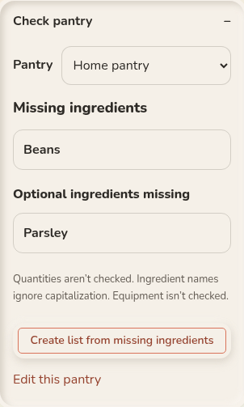
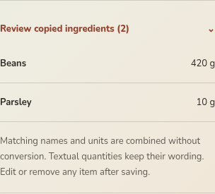
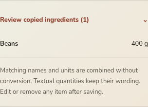
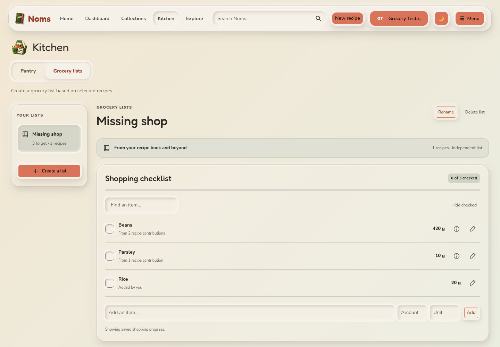
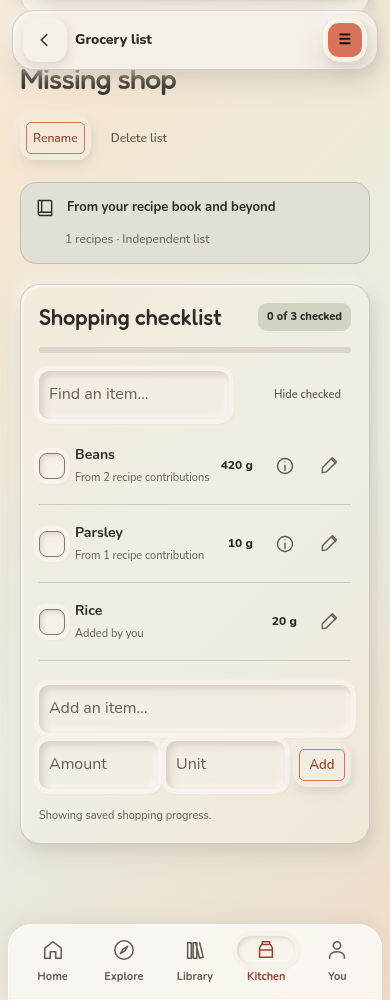
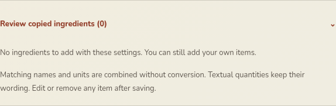

# Missing-ingredient grocery lists

Captured from the running app with synthetic local accounts on 2026-11-04.
These are real browser screenshots. The [browser regression script](../../../../scripts/tests/test-missing-groceries-browser.py)
verifies the same workflow, persistence, access checks and retry behavior.

## Recipe pantry check

Required and optional shortages are separate. The action opens grocery creation
with this recipe and pantry selected.

## Optional ingredients included (default)

At four servings, the preview contains 420 g Beans and 10 g Parsley. Rice is
already available in the selected pantry, so it is not copied.

## Optional ingredients excluded

Turning off “Include optional ingredients” removes Parsley and the optional
20 g Beans contribution. The required 400 g Beans remains.

## Saved list — desktop

The list persists after reloading and remains editable. Here, 20 g Rice was
explicitly added as a manual extra; manual extras are never filtered by pantry.

## Saved list — mobile

## All selected ingredients are available

The preview explains that there is nothing to add. Users can still add manual
items or turn off missing-only filtering.

