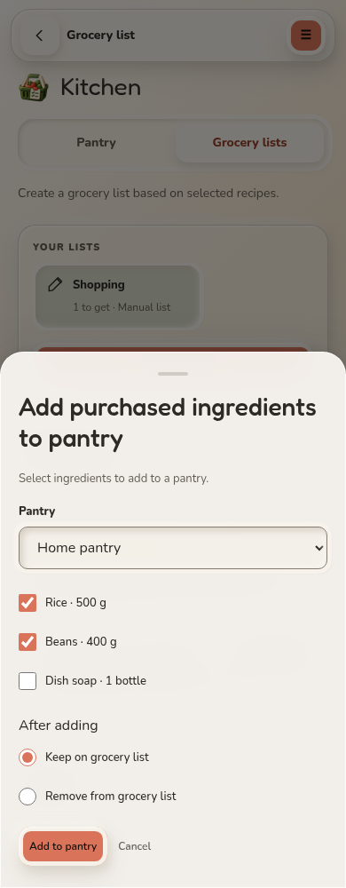
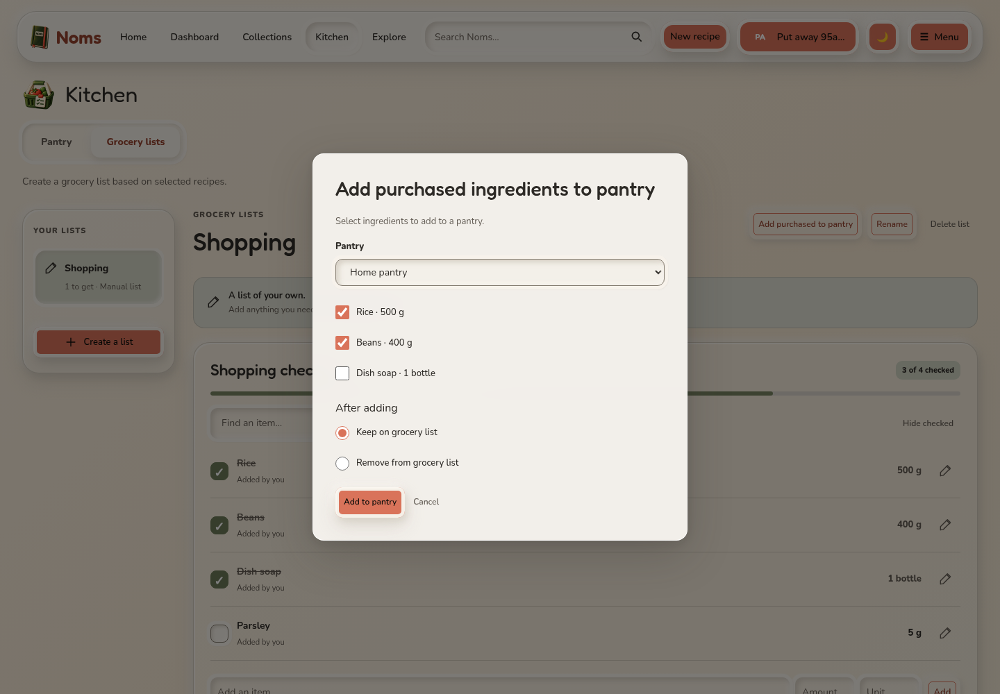
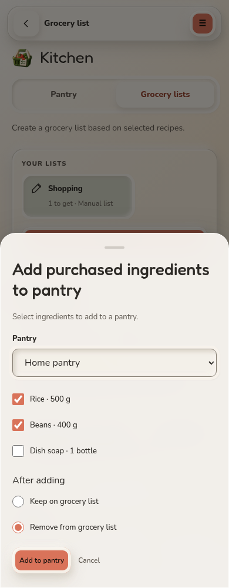

# Purchased groceries to pantry

Real browser captures using synthetic local accounts. Mark grocery items as
purchased, select **Add purchased to pantry**, choose the destination and exclude
household items before saving. Existing ingredient amounts are kept; new rows
copy grocery quantities and units. Choose to keep selected rows on the grocery list (default) or remove them after the pantry save.

## Mobile

## Desktop

The [browser regression](../../../../scripts/tests/test-purchased-pantry-browser.py)
verifies this flow, uncertain-response feedback, preserved quantities, persistence,
selection restrictions, ownership and stale-list rejection with no page errors.

## Remove after adding

Only selected purchased rows are removed. If the response is lost, the dialog
asks users to refresh the grocery list and pantry before retrying.

