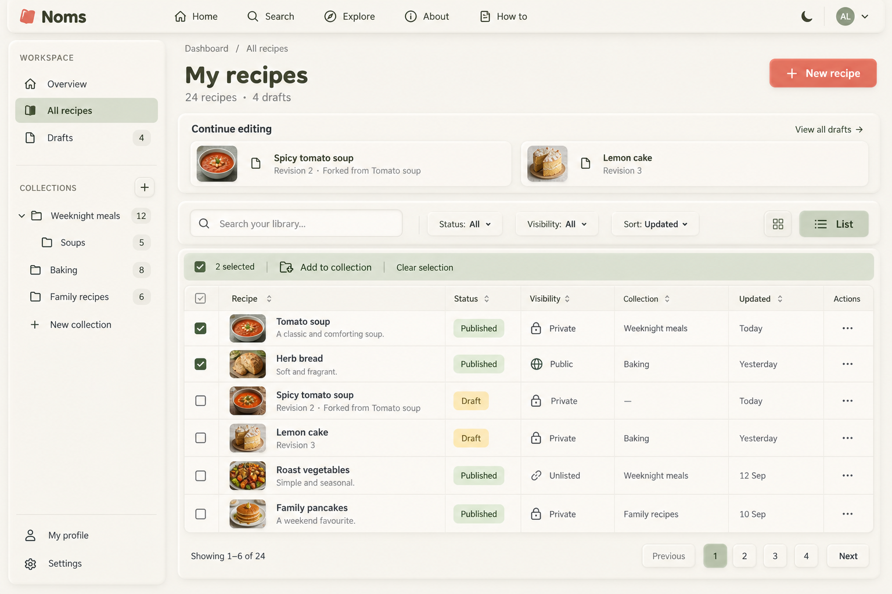

# Dashboard — Central Workspace v1

Preferred Dashboard design direction, selected by the user after reviewing this example. Built-in image generation via imagegen skill. No app code changed. Selection approves the direction, not every incidental generated control or unresolved behavior.

## Recorded decision

- Make Dashboard a central content-management workspace, not a marketing-style landing page.
- Keep a persistent raised left sidebar with Overview, All recipes, Drafts, a nested Collections tree, and Profile/Settings access.
- Use the main area for library search, publication-status and visibility filters, sorting, grid/list views, and bulk collection organization. Record these as planned functional expansion rather than existing capabilities.
- Retain a compact Continue editing area with private draft revision and fork-source metadata.
- Preserve clean cream neumorphic panels, inset fields, sage selection, coral primary actions and Fredoka/Nunito typography.
- No inspirational quotes, slogans, decorative people, handwriting or unrelated props. Functional food thumbnails and restrained UI icons are appropriate.
- Do not infer bulk deletion, bulk publication or visibility changes from this selection.

This supersedes the earlier D1/D2/D3 compositions as the preferred Dashboard baseline. Overview composition, precise filter/sort options, collection membership for drafts, selection scope/persistence, pagination and state/accessibility details remain to be specified. Next page exploration: Explore, one page at a time.



User direction: concentrate on Dashboard before other pages; central management of most user content, persistent side navigation, clean UI without inspirational quotes. This example shows All recipes rather than Overview.

Retains cream raised neumorphic panels, inset search, sage selection and coral primary action. Proposes library search, status/visibility filters, sorting, grid/list switch, bulk collection organization and numbered pagination. These require explicitly scoped implementation beyond current Dashboard behavior.

Review: clean sidebar and table, no quotes or decorative people; publication and visibility distinct, drafts private. Generated logo/font are approximations. Header checkbox should be indeterminate when only two rows are selected. Collection membership can be multiple, so the production column must accommodate that. Draft collection membership shown is conceptual and requires data-model review; do not infer support from this image. Counts/dates are sample data, and count semantics (whether totals include drafts) must be defined. Numbered pagination replaces existing Load more only if approved. Menus, keyboard navigation, selection persistence and loading/error/empty states still need specification.

## Exact prompt

```text
Use case: ui-mockup.
Create ONE high-fidelity desktop screenshot concept of NOMS's advanced central Dashboard, wide 1536x1024. This is a real working content-management UI, not a marketing page or mood board.
Style: clean cozy neumorphism, warm ivory page, softly raised cream panels with top-left highlights and subtle bottom-right shadows, inset fields, muted sage active states, muted coral red primary buttons, dark olive text. Fredoka rounded headings and Nunito body. Dense enough to be useful, generous consistent spacing, clear fine borders. No heavy textures.
Layout:
Slim top app bar: small tilted coral closed-book mark with white NOMS title label, Noms wordmark; Home, Search, Explore, About, How to; right avatar initials AL and theme icon. No tagline.
Below, persistent LEFT navigation panel 240px wide, separate raised rounded component extending almost full height. Label WORKSPACE; Overview, All recipes (selected sage inset), Drafts (4). Then COLLECTIONS with plus button, expandable Weeknight meals (12), indented Soups (5), Baking (8), Family recipes (6), and New collection link. Bottom My profile and Settings. Restrained simple line icons.
MAIN content area: breadcrumb Dashboard / All recipes. Heading My recipes, subtitle 24 recipes · 4 drafts. Top right coral + New recipe button. Compact raised Continue editing strip with two draft entries: Spicy tomato soup, Revision 2 · Forked from Tomato soup; Lemon cake, Revision 3. Small text View all drafts at right.
Below a library toolbar: inset Search your library... field; Status: All dropdown; Visibility: All dropdown; Sort: Updated dropdown; grid/list toggle with LIST selected.
Below toolbar show bulk selection bar: 2 selected / Add to collection / Clear selection. No bulk delete or publish.
Dominant raised table panel with functional columns checkbox, Recipe, Status, Visibility, Collection, Updated, actions. Six recipe rows with small food thumbnail, title, subtle metadata as useful. Row 1 checked Tomato soup / Published / Private lock / Weeknight meals / Today / ellipsis. Row2 checked Herb bread / Published / Public globe / Baking / Yesterday / ellipsis. Row3 Spicy tomato soup / Draft / Private lock / — / Today. Row4 Lemon cake / Draft / Private lock / Baking / Yesterday. Row5 Roast vegetables / Published / Unlisted link / Weeknight meals / 12 Sep. Row6 Family pancakes / Published / Private lock / Family recipes / 10 Sep. Draft metadata supports revision and fork origin, not a public draft. Publication and visibility are separate labels.
Table footer Showing 1–6 of 24 and restrained pagination Previous 1 2 3 4 Next.
Everything fits cleanly within frame. Central organization and quick navigation, no unrelated statistics or activity feed.
HARD AVOID: absolutely NO inspirational quotes, NO slogans, NO decorative handwriting, NO cartoon people, NO mascots, NO floating food props, NO plants, NO hearts, NO illustrated scene, NO decorative background objects. Only food thumbnails inside recipe rows and small actual UI icons. No giant welcome hero. Do not add random text. This is a proposed expanded dashboard, not a copy of the limited existing page.
```
