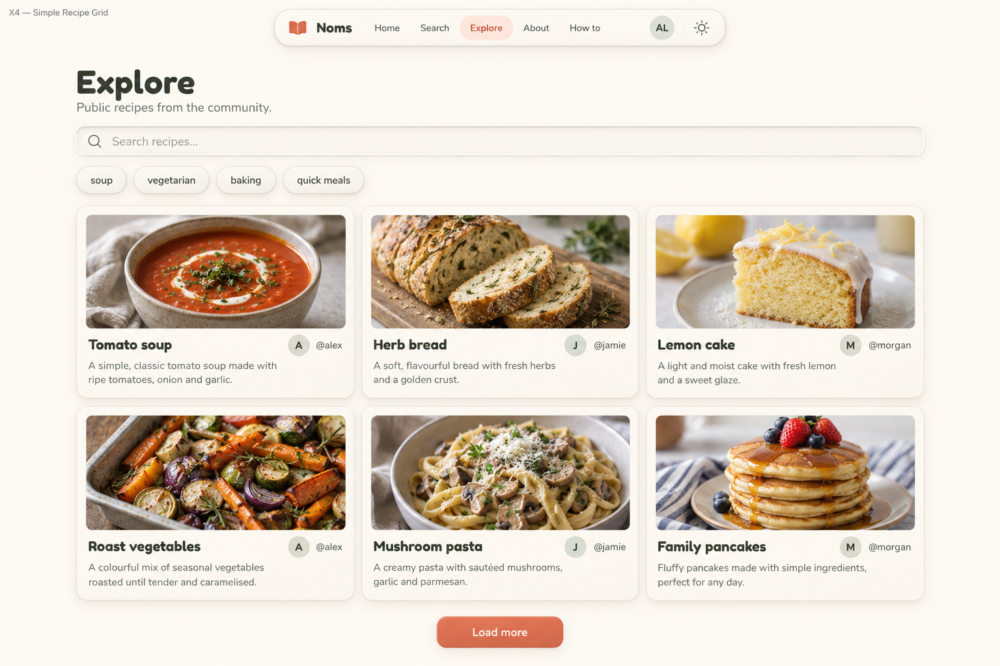
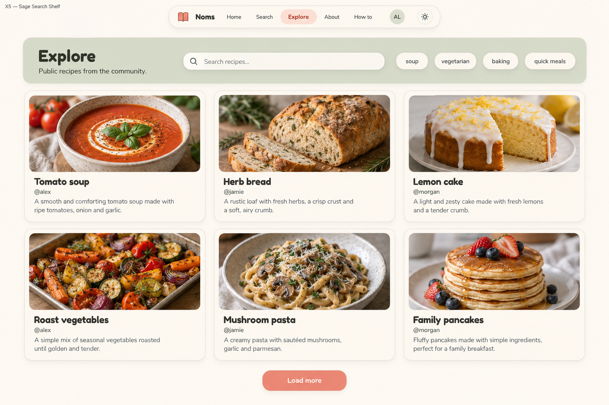
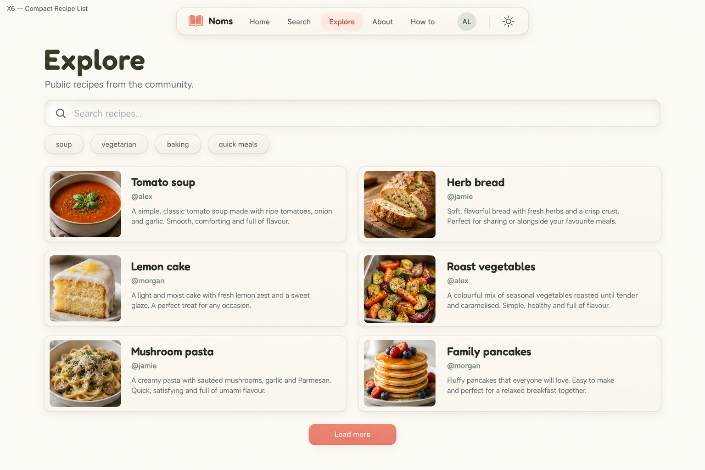

# Explore — Simple layouts v3

Unselected desktop proposals. User requested a simple layout without inspirational quotes or filler. Built-in image generation via imagegen skill; no application code changed.

## X4 — Simple Recipe Grid



Plain ivory page. Left-aligned title, then full-width inset search and separate slim tag row beneath. Below a three-column by two-row grid of compact raised recipe cards with medium landscape photos, title, description and small author line. Restrained card depth, clean alignment and good whitespace. Coral Load more. Simplest baseline, no large colored header.

## X5 — Sage Search Shelf



A compact low-height sage rounded panel groups left-aligned title Explore, supporting copy, wide inset search and tag chips. This is a toolbar panel, not a tall hero. Below, three-column by two-row photo-led raised cream cards on ivory background. Each card photo at top, title and brief description underneath, small author line. Coral Load more. Sage only in compact search panel; empty spaces remain ivory.

## X6 — Compact Recipe List



Left-aligned Explore heading on ivory, wide inset search with tag chips row below. Results form two columns by three rows of horizontal raised cream cards. Each horizontal card has square food thumbnail on left and title, short description and author on right. Broad clean whitespace beneath results, no invented content to fill it. Coral Load more below. Compact scanning alternative without table headers or management controls.

## Review and scope

All three preserve live recipe search, tag controls, public recipe cards and Load more without introducing dashboard management tools. No inspirational quotes, decorative characters or filler. Images use sample food/content; logo is a generated open-book approximation rather than the approved A3 asset, and fonts require actual Fredoka/Nunito in implementation. X5's single-line toolbar needs wrapping for long labels/many tags; X4 needs author/title wrapping; X6 has longer descriptions requiring truncation rules. Shared navigation/footer behavior must not be removed just because these studies omit parts of the shell. Existing tag-filter wiring caveat from the browser audit still applies; these images do not verify a functional fix. Empty/loading/error, missing-photo, dark and responsive states remain to be refined. No direction selected.

## Exact prompts

### X4

```text
Use case: ui-mockup. One high-fidelity desktop NOMS Explore page, wide 1536x1024. Simple clean cozy neumorphic interface: warm ivory background, raised cream rounded cards with soft highlights/shadows and fine borders, inset search, dark olive text, muted sage, muted coral interaction accents. Fredoka rounded headings, Nunito body. Compact floating top navigation: small coral closed book logo, Noms, Home, Search, Explore (only active item), About, How to, initials AL avatar, theme icon. Page title Explore. Only supporting copy allowed: Public recipes from the community. Live search placeholder Search recipes... (no submit button). Tag chips soup, vegetarian, baking, quick meals all unselected neutral raised buttons. Six public recipe entries, identical across alternatives: Tomato soup @alex, Herb bread @jamie, Lemon cake @morgan, Roast vegetables @alex, Mushroom pasta @jamie, Family pancakes @morgan. Each entry has food photograph, author, title, short factual recipe description. No ratings, bookmarks, timing, sorting, bulk management or sidebar. Bottom centered Load more button. No footer needed. ABSOLUTELY NO inspirational quotes, slogans, handwritten text, decorative people, mascots, plants, hearts, floating kitchen props, illustrations outside the logo, marketing hero, featured rankings, empty-state panels or filler. Blank space must stay blank. Render a single coherent populated page. Small top-left study label outside application content: X4 — Simple Recipe Grid. Plain ivory page. Left-aligned title, then full-width inset search and separate slim tag row beneath. Below a three-column by two-row grid of compact raised recipe cards with medium landscape photos, title, description and small author line. Restrained card depth, clean alignment and good whitespace. Coral Load more. Simplest baseline, no large colored header.
```

### X5

```text
Use case: ui-mockup. One high-fidelity desktop NOMS Explore page, wide 1536x1024. Simple clean cozy neumorphic interface: warm ivory background, raised cream rounded cards with soft highlights/shadows and fine borders, inset search, dark olive text, muted sage, muted coral interaction accents. Fredoka rounded headings, Nunito body. Compact floating top navigation: small coral closed book logo, Noms, Home, Search, Explore (only active item), About, How to, initials AL avatar, theme icon. Page title Explore. Only supporting copy allowed: Public recipes from the community. Live search placeholder Search recipes... (no submit button). Tag chips soup, vegetarian, baking, quick meals all unselected neutral raised buttons. Six public recipe entries, identical across alternatives: Tomato soup @alex, Herb bread @jamie, Lemon cake @morgan, Roast vegetables @alex, Mushroom pasta @jamie, Family pancakes @morgan. Each entry has food photograph, author, title, short factual recipe description. No ratings, bookmarks, timing, sorting, bulk management or sidebar. Bottom centered Load more button. No footer needed. ABSOLUTELY NO inspirational quotes, slogans, handwritten text, decorative people, mascots, plants, hearts, floating kitchen props, illustrations outside the logo, marketing hero, featured rankings, empty-state panels or filler. Blank space must stay blank. Render a single coherent populated page. Small top-left study label outside application content: X5 — Sage Search Shelf. A compact low-height sage rounded panel groups left-aligned title Explore, supporting copy, wide inset search and tag chips. This is a toolbar panel, not a tall hero. Below, three-column by two-row photo-led raised cream cards on ivory background. Each card photo at top, title and brief description underneath, small author line. Coral Load more. Sage only in compact search panel; empty spaces remain ivory.
```

### X6

```text
Use case: ui-mockup. One high-fidelity desktop NOMS Explore page, wide 1536x1024. Simple clean cozy neumorphic interface: warm ivory background, raised cream rounded cards with soft highlights/shadows and fine borders, inset search, dark olive text, muted sage, muted coral interaction accents. Fredoka rounded headings, Nunito body. Compact floating top navigation: small coral closed book logo, Noms, Home, Search, Explore (only active item), About, How to, initials AL avatar, theme icon. Page title Explore. Only supporting copy allowed: Public recipes from the community. Live search placeholder Search recipes... (no submit button). Tag chips soup, vegetarian, baking, quick meals all unselected neutral raised buttons. Six public recipe entries, identical across alternatives: Tomato soup @alex, Herb bread @jamie, Lemon cake @morgan, Roast vegetables @alex, Mushroom pasta @jamie, Family pancakes @morgan. Each entry has food photograph, author, title, short factual recipe description. No ratings, bookmarks, timing, sorting, bulk management or sidebar. Bottom centered Load more button. No footer needed. ABSOLUTELY NO inspirational quotes, slogans, handwritten text, decorative people, mascots, plants, hearts, floating kitchen props, illustrations outside the logo, marketing hero, featured rankings, empty-state panels or filler. Blank space must stay blank. Render a single coherent populated page. Small top-left study label outside application content: X6 — Compact Recipe List. Left-aligned Explore heading on ivory, wide inset search with tag chips row below. Results form two columns by three rows of horizontal raised cream cards. Each horizontal card has square food thumbnail on left and title, short description and author on right. Broad clean whitespace beneath results, no invented content to fill it. Coral Load more below. Compact scanning alternative without table headers or management controls.
```
