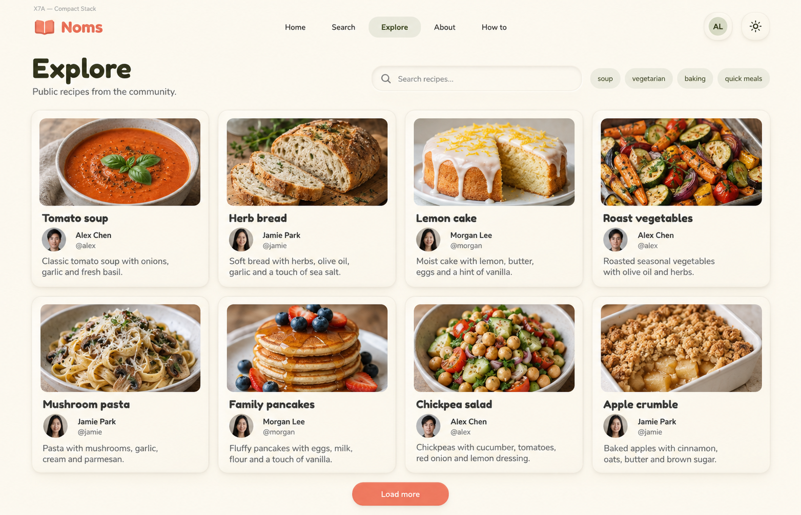
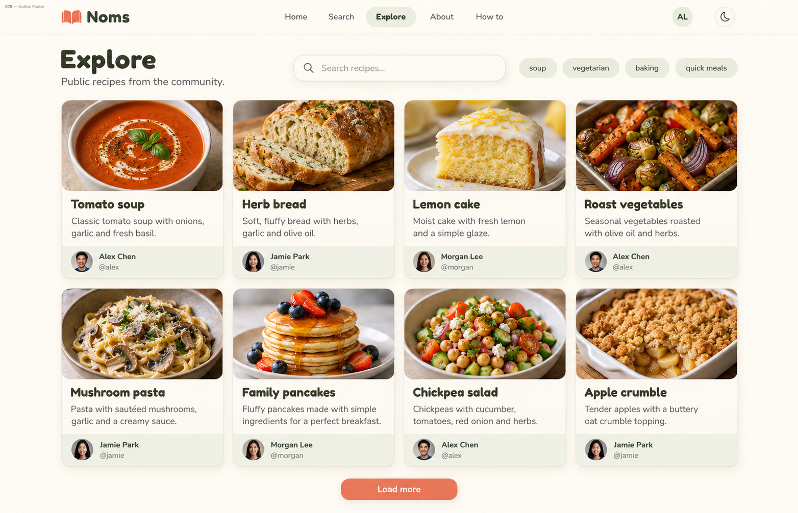
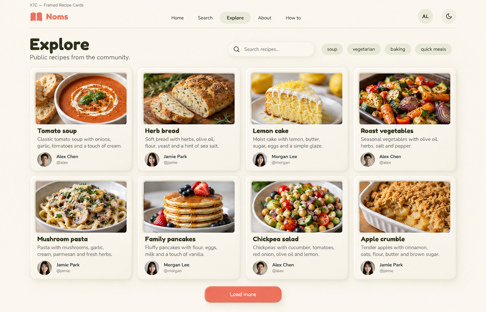

# Explore — Vertical cards v5

Three vertical-card alternatives following X6B. **X7C — Framed Recipe Cards is now the user-selected preferred Explore direction.** X7A/X7B remain alternatives. Built-in image generation via imagegen skill. No app code changes.

## Recorded selection

Retain X7C's raised cream frame and inset landscape photo, with vertically stacked title, short description and author avatar/display name/handle. Enforce 16:9 image crops in implementation. Grid columns adapt to available container width and readable card minimum width, rather than staying fixed at four. Keep the search/tag area simple and free of inspirational quotes or decorative filler. This supersedes X6/X6B as the preferred composition while retaining their author-detail and adaptive-layout requirements. Selection is not implementation readiness; the caveats below still apply.

User constraints: vertical cards, landscape 16:9 photos, author avatar/display name/handle, short description, adaptive columns based on available container width; simple layout without inspirational quotes or decorative filler.

## X7A — Compact Stack



Photo inset 12px inside raised card, rounded photo corners. Beneath photo bold title, then author avatar alongside display name with handle, then two-line description. Consistent compact padding. All-cream card with subtle neumo depth. Author information immediately under title, no footer separator. Most straightforward option.

## X7B — Author Footer



Photo flush to card top, rounded upper corners, strictly 16:9. Under photo title and short two-line description. At bottom a subtle divider and small dedicated author footer with avatar, display name and handle. Footer has extremely pale sage tint, not strong color. Align author footers across cards. Card itself raised cream, no extra badges. Strong separation of recipe content from author.

## X7C — Framed Recipe Cards



A more visibly neumorphic cream card with soft rounded raised outer rim. Landscape 16:9 photograph sits in shallow inset well at top with fine shadow. Below: title, concise description and a compact unboxed author row with avatar, display name and secondary handle. Keep shadows restrained and text crisp, no giant padding. Slightly richer tactile character without ornamental details. No nested raised author pills.

## Review and implementation caveats

All show vertical cards with wide top photos, supported metadata categories, no quotes/filler, and clear active Explore navigation. Four columns illustrate this desktop composition, not a fixed column limit. Enforce exact 16:9 in implementation; raster dimensions are approximate. Avatar identities, recipes, copy and handles are sample content. Replace generated open-book logo with approved A3 artwork and use actual Fredoka/Nunito fonts. All tag chips share neutral styling; selected states need explicit distinction and semantics. Existing tag-filter wiring caveat from the browser audit remains unresolved. Test long titles/author names, missing photos/avatars, description limits, tag wrapping, focus/link semantics and loading/empty/error states. X7C is preferred; no functional fix is implied by that selection.

## Exact prompts

### X7A

```text
Use case: ui-mockup. Create ONE high-fidelity desktop NOMS Explore UI screenshot, wide landscape 1792x1152. Clean cozy neumorphism: warm ivory background, raised cream rounded cards with fine visible borders, top-left soft highlights and bottom-right soft shadows, inset search, sage accents, coral primary action, dark olive text. Fredoka rounded headings, Nunito body. Small top-left external study label: X7A — Compact Stack.
Compact shared top navigation Noms coral book logo, Home, Search, Explore active, About, How to, AL avatar, theme icon. Page heading Explore, subtitle Public recipes from the community. Compact search placeholder Search recipes... followed by tag chips soup, vegetarian, baking, quick meals. No sidebar, no large hero.
MAIN CONTENT: FOUR columns by TWO rows of VERTICALLY ORIENTED recipe cards. Each card about 370px wide and 360px tall. At the top of each card a LANDSCAPE 16:9 food photo about 336x189px; vertical card does NOT mean portrait photo. Below the image, stack recipe title, author avatar/display name/secondary handle, two-line short description, as specified in variation. Same data across all alternatives: Tomato soup / Alex Chen @alex; Herb bread / Jamie Park @jamie; Lemon cake / Morgan Lee @morgan; Roast vegetables / Alex Chen @alex; Mushroom pasta / Jamie Park @jamie; Family pancakes / Morgan Lee @morgan; Chickpea salad / Alex Chen @alex; Apple crumble / Jamie Park @jamie. Brief factual ingredient descriptions. All photos match recipe names. All cards aligned, readable and compact. Four columns represent this wide viewport only; intended grid adapts to fit readable cards at other container widths. Centered coral Load more below cards.
STRICT: no inspirational quotes, no slogans, no decorative filler, no handwriting, no cartoon people, no plants or props outside photos, no ratings, stars, hearts, save buttons, sorting or management tools. No other pages, no breakpoint diagram. Leave blank spaces blank. Only functional card content, no fake metadata.
Variation: Photo inset 12px inside raised card, rounded photo corners. Beneath photo bold title, then author avatar alongside display name with handle, then two-line description. Consistent compact padding. All-cream card with subtle neumo depth. Author information immediately under title, no footer separator. Most straightforward option.
```

### X7B

```text
Use case: ui-mockup. Create ONE high-fidelity desktop NOMS Explore UI screenshot, wide landscape 1792x1152. Clean cozy neumorphism: warm ivory background, raised cream rounded cards with fine visible borders, top-left soft highlights and bottom-right soft shadows, inset search, sage accents, coral primary action, dark olive text. Fredoka rounded headings, Nunito body. Small top-left external study label: X7B — Author Footer.
Compact shared top navigation Noms coral book logo, Home, Search, Explore active, About, How to, AL avatar, theme icon. Page heading Explore, subtitle Public recipes from the community. Compact search placeholder Search recipes... followed by tag chips soup, vegetarian, baking, quick meals. No sidebar, no large hero.
MAIN CONTENT: FOUR columns by TWO rows of VERTICALLY ORIENTED recipe cards. Each card about 370px wide and 360px tall. At the top of each card a LANDSCAPE 16:9 food photo about 336x189px; vertical card does NOT mean portrait photo. Below the image, stack recipe title, author avatar/display name/secondary handle, two-line short description, as specified in variation. Same data across all alternatives: Tomato soup / Alex Chen @alex; Herb bread / Jamie Park @jamie; Lemon cake / Morgan Lee @morgan; Roast vegetables / Alex Chen @alex; Mushroom pasta / Jamie Park @jamie; Family pancakes / Morgan Lee @morgan; Chickpea salad / Alex Chen @alex; Apple crumble / Jamie Park @jamie. Brief factual ingredient descriptions. All photos match recipe names. All cards aligned, readable and compact. Four columns represent this wide viewport only; intended grid adapts to fit readable cards at other container widths. Centered coral Load more below cards.
STRICT: no inspirational quotes, no slogans, no decorative filler, no handwriting, no cartoon people, no plants or props outside photos, no ratings, stars, hearts, save buttons, sorting or management tools. No other pages, no breakpoint diagram. Leave blank spaces blank. Only functional card content, no fake metadata.
Variation: Photo flush to card top, rounded upper corners, strictly 16:9. Under photo title and short two-line description. At bottom a subtle divider and small dedicated author footer with avatar, display name and handle. Footer has extremely pale sage tint, not strong color. Align author footers across cards. Card itself raised cream, no extra badges. Strong separation of recipe content from author.
```

### X7C

```text
Use case: ui-mockup. Create ONE high-fidelity desktop NOMS Explore UI screenshot, wide landscape 1792x1152. Clean cozy neumorphism: warm ivory background, raised cream rounded cards with fine visible borders, top-left soft highlights and bottom-right soft shadows, inset search, sage accents, coral primary action, dark olive text. Fredoka rounded headings, Nunito body. Small top-left external study label: X7C — Framed Recipe Cards.
Compact shared top navigation Noms coral book logo, Home, Search, Explore active, About, How to, AL avatar, theme icon. Page heading Explore, subtitle Public recipes from the community. Compact search placeholder Search recipes... followed by tag chips soup, vegetarian, baking, quick meals. No sidebar, no large hero.
MAIN CONTENT: FOUR columns by TWO rows of VERTICALLY ORIENTED recipe cards. Each card about 370px wide and 360px tall. At the top of each card a LANDSCAPE 16:9 food photo about 336x189px; vertical card does NOT mean portrait photo. Below the image, stack recipe title, author avatar/display name/secondary handle, two-line short description, as specified in variation. Same data across all alternatives: Tomato soup / Alex Chen @alex; Herb bread / Jamie Park @jamie; Lemon cake / Morgan Lee @morgan; Roast vegetables / Alex Chen @alex; Mushroom pasta / Jamie Park @jamie; Family pancakes / Morgan Lee @morgan; Chickpea salad / Alex Chen @alex; Apple crumble / Jamie Park @jamie. Brief factual ingredient descriptions. All photos match recipe names. All cards aligned, readable and compact. Four columns represent this wide viewport only; intended grid adapts to fit readable cards at other container widths. Centered coral Load more below cards.
STRICT: no inspirational quotes, no slogans, no decorative filler, no handwriting, no cartoon people, no plants or props outside photos, no ratings, stars, hearts, save buttons, sorting or management tools. No other pages, no breakpoint diagram. Leave blank spaces blank. Only functional card content, no fake metadata.
Variation: A more visibly neumorphic cream card with soft rounded raised outer rim. Landscape 16:9 photograph sits in shallow inset well at top with fine shadow. Below: title, concise description and a compact unboxed author row with avatar, display name and secondary handle. Keep shadows restrained and text crisp, no giant padding. Slightly richer tactile character without ornamental details. No nested raised author pills.
```
