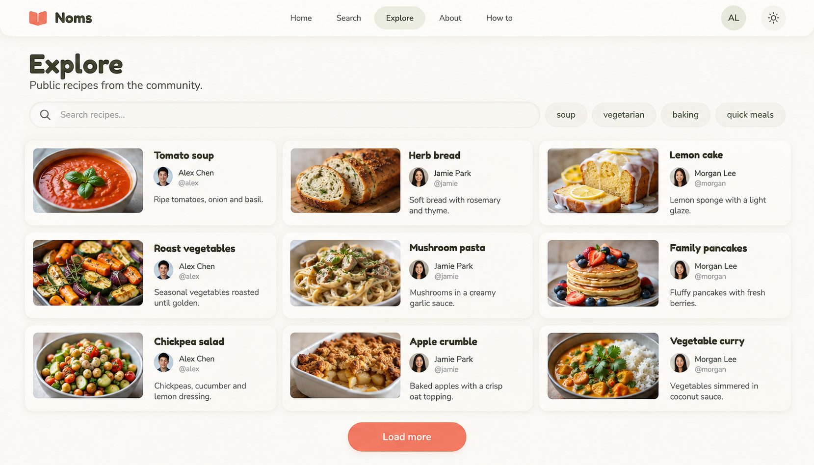

# X6B — Adaptive compact cards

Refinement of user-preferred X6. New image awaits review. Built-in image generation via imagegen skill; no application code changes.



## Direction

Retain horizontal compact raised cards, with landscape 16:9 thumbnails, title, avatar, author display name/handle and brief description. Grid column count follows available container width and minimum readable card width, not a fixed two- or three-column rule. The screenshot illustrates three columns at a wide desktop size; it does not implement or validate responsiveness. No inspirational quotes or decorative filler.

## Review

Nine readable cards and richer author metadata shown; blank spaces remain clean. Raster thumbnail ratios approximate the requested 16:9; production must enforce exact aspect ratio. Study label omitted by generator. Logo is an approximation, not approved A3 artwork. Use actual Fredoka/Nunito and data-backed display-name/handle fallbacks. Define long-text wrapping, no-photo fallback, minimum card width and tag wrapping during implementation. Existing Explore tag-filter wiring caveat still applies. This image does not authorize unrelated controls or behavior changes.

## Exact prompt

```text
Use case: ui-mockup. Generate ONE high-fidelity wide desktop screenshot concept for NOMS Explore, study label "X6B — Adaptive compact cards". Wide landscape 1792x1024 composition. Clean cozy neumorphic app: ivory background, softly raised rounded cream cards, inset search, muted coral actions, sage highlights, dark olive text, Fredoka headings and Nunito body. No heavy texture.
Compact top nav: coral book mark, Noms, Home, Search, Explore active, About, How to, AL avatar and theme icon.
Left-aligned Explore heading and small "Public recipes from the community." subtitle. Under that an inset search field placeholder "Search recipes..." then simple tags soup, vegetarian, baking, quick meals. No giant hero, no sidebar.
MAIN: adaptive grid illustrated with THREE columns of horizontal compact cards and THREE rows, nine cards total. Three columns represent what fits this wide viewport, NOT a fixed layout rule. Each card about 530px wide and 185px tall. Within every card: LEFT compact LANDSCAPE food thumbnail of exactly 16:9 proportions (approximately 176px wide x 99px high), vertically centered. NOT SQUARE, NOT PORTRAIT, NOT full-width top photo. RIGHT a roomy text block: bold recipe title, small circular author avatar followed by readable author DISPLAY NAME and secondary @handle, then two short lines of description. Maintain horizontal X6 composition with richer author metadata, not oversized photo tiles. All three columns comfortably readable, consistent alignment, generous gaps.
Nine entries:
Tomato soup / Alex Chen / @alex / Ripe tomatoes, onion and basil.
Herb bread / Jamie Park / @jamie / Soft bread with rosemary and thyme.
Lemon cake / Morgan Lee / @morgan / Lemon sponge with a light glaze.
Roast vegetables / Alex Chen / @alex / Seasonal vegetables roasted until golden.
Mushroom pasta / Jamie Park / @jamie / Mushrooms in a creamy garlic sauce.
Family pancakes / Morgan Lee / @morgan / Fluffy pancakes with fresh berries.
Chickpea salad / Alex Chen / @alex / Chickpeas, cucumber and lemon dressing.
Apple crumble / Jamie Park / @jamie / Baked apples with a crisp oat topping.
Vegetable curry / Morgan Lee / @morgan / Vegetables simmered in coconut sauce.
Centered coral Load more button below grid. Blank spaces stay blank.
STRICT: no inspirational quotes, no slogans, no decorative handwriting, no people illustrations, no mascots, no kitchen props, no hearts, no plants or decorations outside food photographs. No ratings, bookmarks, fake statistics, sort controls or management actions. Only functional UI and recipe metadata. Thumbnail landscape 16:9 ratio is critical, retain image left and text right on all cards. This is one proposed static screenshot, not a diagram of breakpoints.
```
