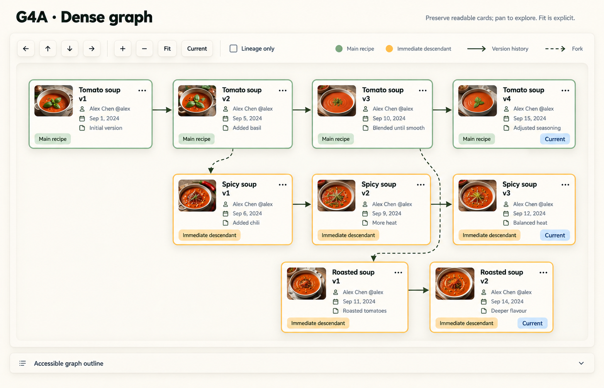
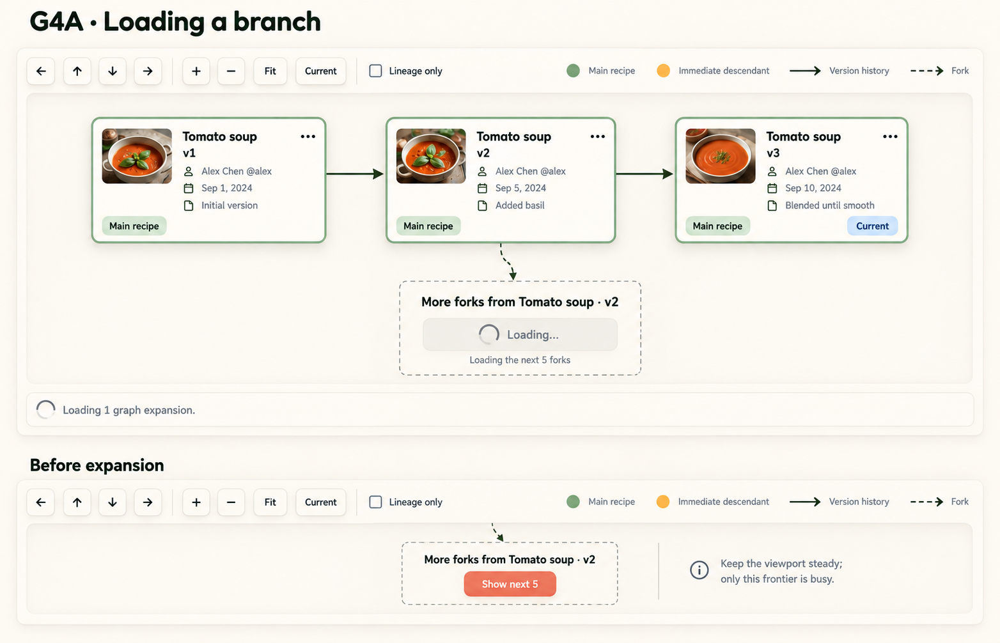
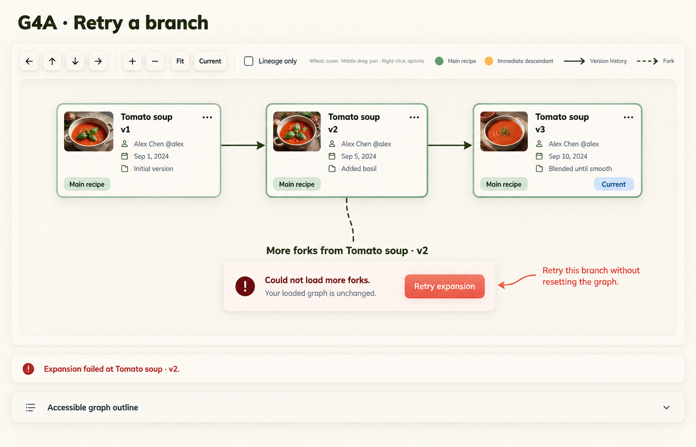

# G4A dense graph and expansion studies v1

Status: user-selected dense-graph and expansion direction. All three studies are accepted as the visual baseline, retaining the behavior requirements and limitations below, including connector-crossing clarification. G4A remains the selected full-page direction. Selection does not mark behavior tested or implementation-ready. Built-in image generation with the imagegen skill, using version-graph-g4a-v4.png as style reference. No application code changed.

## Examples

### Dense graph



### Branch loading



### Branch retry




## Proposed behavior

- Preserve readable cards and explicit pan/zoom/Fit/Current controls. Do not automatically zoom out after each expansion. Preserve the user's viewport and anchor position as far as layout permits; exact relayout behavior needs implementation validation.
- Keep pending expansion local to its frontier. Disable duplicate requests for that frontier only, retaining loaded content and navigation.
- Failed expansion retains loaded content, counts and comparison selections; offer retry for the same frontier. Scope state/request identity by anchor and direction, not merely the displayed recipe title.
- Announce loading/completion and failure without stealing focus. Keep equivalent expansion/retry reachable through the accessible outline. Decide post-success focus placement if the frontier disappears.
- Frontier direction, remaining count and eligibility must come from actual graph data. “Next 5” means up to five available results, not a guaranteed five. The sample's fork wording must not replace other supported expansion directions.
- Retry is a discoverability proposal for existing expansion behavior, not a new graph operation. Preserve existing snapshot/background menus, comparison controls and lineage filtering even when absent in a crop.
- Full graphs still require ancestor and other supported relationship categories. No merge edges or private drafts are proposed.

## Visual review / limitations

The dense image has nine cards: Tomato v1–v4, Spicy v1–v3, Roasted v1–v2. Solid edges connect consecutive versions within each recipe. Dashed edges link Tomato v2 to Spicy v1 and Tomato v3 to Roasted v1. Current appears on the latest snapshot of each recipe only. The long Roasted fork connector crosses the Spicy version connector: this is NOT a junction or merge. Production routing should avoid that crossing or distinguish it clearly.

Loading and failure studies preserve the three loaded main-recipe versions. The loading board's lower crop is the alternative pre-expansion state, not simultaneous page content. Loading artwork omits the accessible-outline footer; retain it in the actual layout. Design annotations about keeping the viewport steady or retrying without resetting are not app copy.

These static images do not verify pan/zoom, dense-layout scalability, remaining-count semantics, concurrent expansion, live-region behavior, focus handling, dark mode or measured contrast. Generated fonts/colors/thumbnails remain illustrative; use actual Fredoka/Nunito and approved tokens/assets. Full-page integration follows direction review. New mobile/tablet work remains deferred.

## Exact prompts

### 1

```text
Use case: ui-mockup. Desktop NOMS G4A graph component study, high fidelity, wide image. Attached image is style reference only. Cream/ivory raised neumorphic cards, inset graph canvas, olive text, sage main recipe and ochre descendant labels, coral actions. Fredoka headings Nunito text. Compact thumbnails, author, version, change summary and ellipsis on every card. No full site navigation, no quotes, no decorative props, no merge edges, no drafts, no inspector. Toolbar always visible above canvas with four pan arrows, +/- zoom, Fit, Current, unchecked Lineage only. Legend solid arrow Version history and dashed arrow Fork. Keep connectors clear of cards. Footer Accessible graph outline. This is a component design proposal, not code. Title "G4A · Dense graph". Large canvas with NINE readable medium cards in three rows. Top row Tomato soup v1 → v2 → v3 → v4, all sage Main recipe, only v4 Current. Second row Spicy soup v1 → v2 → v3, ochre Immediate descendant, only v3 Current. Third row Roasted soup v1 → v2, ochre Immediate descendant, only v2 Current. SOLID edges only between consecutive versions of the SAME recipe. Exactly TWO dashed fork edges: Tomato soup v2 to Spicy soup v1, Tomato soup v3 to Roasted soup v1. Layout branches below/right of their origin, allocate routing corridors so no lines run behind cards; stagger rows as necessary. No cross-recipe solid arrows. Small photos and metadata stay readable, ample canvas height. No fake count badges. Small external design annotation "Preserve readable cards; pan to explore. Fit is explicit." No comparison selection in this example.
```

### 2

```text
Use case: ui-mockup. Desktop NOMS G4A graph component study, high fidelity, wide image. Attached image is style reference only. Cream/ivory raised neumorphic cards, inset graph canvas, olive text, sage main recipe and ochre descendant labels, coral actions. Fredoka headings Nunito text. Compact thumbnails, author, version, change summary and ellipsis on every card. No full site navigation, no quotes, no decorative props, no merge edges, no drafts, no inspector. Toolbar always visible above canvas with four pan arrows, +/- zoom, Fit, Current, unchecked Lineage only. Legend solid arrow Version history and dashed arrow Fork. Keep connectors clear of cards. Footer Accessible graph outline. This is a component design proposal, not code. Title "G4A · Loading a branch". Focused canvas with three existing cards left-to-right Tomato soup v1 → v2 → v3 solid arrows, all Main recipe, only v3 Current. Below v2 a local expansion frontier attached by a short dashed connector, not a recipe card. Frontier heading "More forks from Tomato soup · v2". Recessed disabled control with spinner "Loading…" and text "Loading the next 5 forks". Existing three cards full contrast, no dimming, no skeleton replacement, no imaginary newly loaded recipes. Beneath canvas polite compact status "Loading 1 graph expansion." Below separated small explanatory alternative-state crop titled "Before expansion": same frontier heading, coral button "Show next 5", no spinner. No invented total remaining count. Small external annotation "Keep the viewport steady; only this frontier is busy."
```

### 3

```text
Use case: ui-mockup. Desktop NOMS G4A graph component study, high fidelity, wide image. Attached image is style reference only. Cream/ivory raised neumorphic cards, inset graph canvas, olive text, sage main recipe and ochre descendant labels, coral actions. Fredoka headings Nunito text. Compact thumbnails, author, version, change summary and ellipsis on every card. No full site navigation, no quotes, no decorative props, no merge edges, no drafts, no inspector. Toolbar always visible above canvas with four pan arrows, +/- zoom, Fit, Current, unchecked Lineage only. Legend solid arrow Version history and dashed arrow Fork. Keep connectors clear of cards. Footer Accessible graph outline. This is a component design proposal, not code. Title "G4A · Retry a branch". Same focused canvas three existing cards Tomato soup v1 → v2 → v3, solid edges, Main recipe badges, only v3 Current. Below v2 local expansion frontier connected by short dashed line heading "More forks from Tomato soup · v2". Compact raised feedback panel at frontier with dark red warning icon, text "Could not load more forks." helper "Your loaded graph is unchanged." Coral "Retry expansion" button. Error only at frontier, not a blocking modal/banner, existing cards full contrast and toolbar enabled. Under canvas slim textual status "Expansion failed at Tomato soup · v2." Small external annotation "Retry this branch without resetting the graph." Keep error red distinct from muted coral action. No new nodes or fabricated remaining counts.
```
