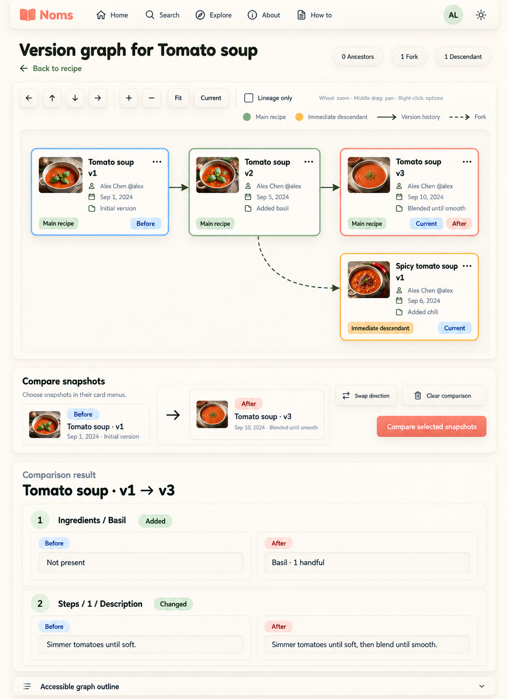

# G4A integrated desktop page — light v1

Status: user-selected integrated G4A light-mode desktop composition, combining the selected graph and comparison components. Retain the composition and review requirements below; selection does not validate scrolling, accessibility or implementation behavior, nor approve incidental generated assets. Generated using the built-in image tool and imagegen skill. No application code changed.



## Composition and review

Navigation → page heading/counts → graph toolbar/canvas → comparison selection/actions → inline results → accessible outline. This is a full-scroll desktop-page capture, not a portrait tablet proposal or a claim that all content fits within one screen. Results remain in normal document flow rather than overlaying or shrinking the graph.

The four-node topology is correct: solid Tomato v1 → v2 → v3; dashed fork from Tomato v2 to Spicy v1. Main recipe, Current, Before and After labels remain independent. Selected pair is consistently v1 → v3. Two illustrative changes reflect the sample summaries (basil added, step changed). No simultaneous error/loading states or branch frontier are needed for this fully loaded sample.

The rendered comparison summary tiles are vertically offset; align their content and arrow more consistently in implementation. Read-only diff wells must not imply editable form fields. Exact field paths, missing-value text and structured values must follow actual comparison data; Ingredients / Basil is illustrative, not a new data contract. Numeric circles enumerate displayed changes, not steps.

Generated open-book logo is not the approved A3 logo; production must use the actual asset and Fredoka/Nunito fonts. Colors are not final accessible tokens. Preserve all actual navigation/footer destinations even if omitted in this composition. Ancestor legend, menu actions, expansion, status handling and other contracts remain applicable when relevant.

Still to validate: real desktop viewport height and page scrolling, long results and text, keyboard flow, contrast, toolbar wrapping, graph pan versus document scrolling, and dark-mode parity. No live-browser validation performed this turn. Mobile/tablet remains deferred.

## Exact prompt

References: version-graph-g4a-v4.png (page/style); g4a-comparison-results-v1.png (result component).

```text
Use case: ui-mockup. Generate ONE polished FULL DESKTOP PAGE screenshot for NOMS version graph, light mode. Reference 1 is selected G4A page layout/style; reference 2 is selected comparison-result component. Combine into one coherent page, NOT a collage or state board. Wide desktop content on a taller full-scroll capture, approximately 1536x1408. Warm ivory canvas, soft neumorphic raised cream cards, inset graph, dark olive text, muted coral buttons, sage relationships, Fredoka headings and Nunito body. Clean cozy interface, no quotes or props.

Top raised navigation Noms wordmark, Home, Search, Explore, About, How to, avatar AL, theme button. Heading "Version graph for Tomato soup", Back to recipe, counts "0 Ancestors", "1 Fork", "1 Descendant".

Graph raised frame top half, toolbar with four pan arrows, +, −, Fit, Current, unchecked Lineage only. Legend Main recipe sage, Immediate descendant ochre, solid Version history, dashed Fork. Small mouse hints. Inset canvas exactly four readable medium cards: top row Tomato soup v1 → v2 → v3 with solid arrows. Below/right Spicy tomato soup v1; exactly one dashed fork from Tomato soup v2 to Spicy tomato soup v1. No crossing lines, no merges. Each card small landscape soup thumbnail, ellipsis button, Alex Chen @alex, date, summary. v1 "Initial version", v2 "Added basil", v3 "Blended until smooth", Spicy v1 "Added chili". All Tomato nodes Main recipe. v1 Before badge and blue outline; v3 Current plus After badges and muted coral outline. Spicy node Immediate descendant ochre plus Current badge. No selected badge on v2 or Spicy. Preserve text labels independent of color. No open menus, no errors, no loading or expansion frontier because this small graph is fully loaded.

Below graph separate raised Compare snapshots panel: read-only inset Before "Tomato soup · v2" IS WRONG; it MUST read Before "Tomato soup · v1", After "Tomato soup · v3". Arrow between. Buttons Swap direction, Clear comparison, coral Compare selected snapshots. Helper "Choose snapshots in their card menus." No dropdown arrows or editable selectors.

Below selector a separate raised panel "Comparison result" and subtitle "Tomato soup · v1 → v3". TWO compact change articles to match the sample data:
1 "Ingredients / Basil", badge "Added". Read-only two columns Before "Not present" and After "Basil · 1 handful".
2 "Steps / 1 / Description", badge "Changed". Before "Simmer tomatoes until soft." After "Simmer tomatoes until soft, then blend until smooth."
Retain exact field heading, labels and values. These are read-only diff values, not forms. No merge/apply controls, no tabs or invented stats.
Bottom collapsed row "Accessible graph outline". Complete page content visible in a full-scroll screenshot; DO NOT squeeze into a short viewport or shrink text excessively. No design annotations in the app. No alternative-state panels. No inspirational quotes. Consistent rhythm, compact results, clear hierarchy.
```
