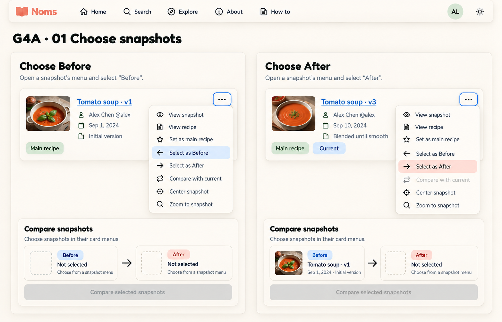
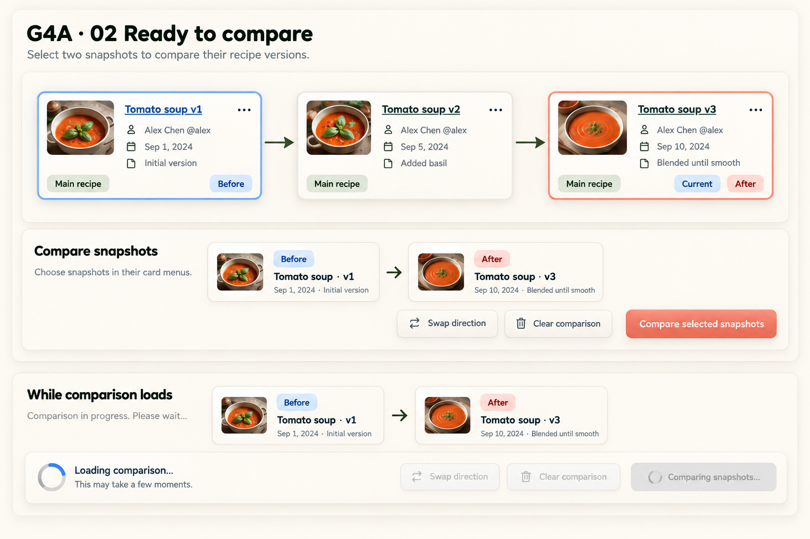
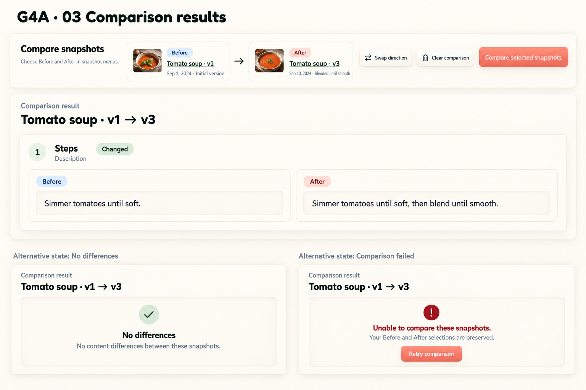

# G4A selection and comparison interaction studies v1

Status: user-selected interaction design direction. All three component-focused studies are approved as the G4A selection/comparison baseline: snapshot menus and partial selection, ready/loading, and results/no-difference/recoverable failure. G4A remains the full-page layout; alternative states shown together are not simultaneous page content. Selection retains the behavior requirements and artwork limitations below, and does not imply implementation readiness or approval of incidental generated assets/colors. Generated with the built-in image tool using the imagegen skill and G4A as a style reference. No application code changes.

## Studies

### 1. Choose snapshots



### 2. Ready and loading



### 3. Results and alternative outcomes



## Proposed interaction contract

- Keep snapshot links distinct from the visible menu button. Preserve all existing snapshot actions and the accessible outline; these focused studies do not replace the full graph layout.
- Before and After are ordered roles, independent of Current and main/ancestor/descendant relationships. Text labels are required in addition to color.
- Compare is disabled when either slot is empty, both slots identify the same snapshot, or a comparison is loading. Explain missing or identical selections in nearby text.
- Swap requires both slots. Clear is available with even one selection; Swap/Clear are disabled while loading as in current source. The first board omits these actions for space: do not implement that omission.
- Clear or selection changes invalidate old results. Results must be associated with the exact requested pair; stale async responses must never appear beneath a different pair. Resolve how snapshot-menu selection behaves during loading before implementation (disable comparison selection temporarily or guard requests by pair/request identity).
- Keep comparison loading and recoverable errors local to its panel. Preserve selected snapshots on failure. Retry is a proposed explicit affordance for the existing comparison request, not a new endpoint.
- Results retain the existing field path, Added/Removed/Changed operation, and read-only Before/After values. Preserve whitespace and support long/structured values; no merge/apply workflow is proposed.
- Keyboard proposal: menu opens from its button, arrow keys traverse actions, Escape closes and restores focus; selecting a role closes the menu, restores focus, and announces the updated slot. Maintain a distinguishable focus outline independent of selection. Validate against existing keyboard behavior before implementation.
- Loading/status announcements should be polite; errors actionable without stealing focus. Graph navigation remains available. Avoid automatic scroll/focus jumps when results arrive.

## Visual review and limitations

All three images retain the G4A cream raised/inset surfaces and readable labelled comparison roles. Ready-state solid v1 → v2 → v3 connections are correct. The menu study includes all eight actions and disables Compare with current for the current snapshot. The results board clearly separates mutually exclusive outcomes.

Generated blue link/focus styling, badge colors, fonts and logos are illustrative, not approved design tokens or production assets. Use actual Fredoka/Nunito and approved A3 logo. Before and Current share similar blue in these images: retain text labels and refine distinction in token work. Results are illustrative data, not a complete diff of the earlier basil-changing sample. The no-difference alternative reuses the pair label for layout only; real outcomes must reflect actual data. The stylized Steps/1/Description heading must not lose the exact source field path. Read-only values should not look editable in implementation.

Not yet covered: dense/expanded graph, added/removed/structured values, same-snapshot feedback, cross-recipe comparison, long titles, short desktop viewports, dark parity, measured contrast or tested keyboard behavior. Phone/tablet remains deferred. Source-reviewed this turn; no new live-browser validation performed.

## Exact prompts

Reference for all: version-graph-g4a-v4.png (style reference, not replacement target).

### Study 1

```text
Use case: ui-mockup. Create a polished desktop NOMS interaction design study, not code. Use attached G4A as STYLE REFERENCE: warm ivory neumorphic raised panels, softly inset wells, olive ink, sage relationship labels, muted coral primary action. Fredoka headings and Nunito body. Crisp legible text, restrained soft shadows, no quotes/props/mascots. Focused UI crops, not a whole page; generous readable size. Snapshot titles are links, ellipsis menus choose Before/After. Current badge independent. Before muted blue labelled badge, After muted coral labelled badge. Do not introduce dropdown selectors, merge/apply actions, inspector, or editable comparison values. Study title "G4A · 01 Choose snapshots". Two large equal side-by-side state panels. LEFT caption "Choose Before": one raised Tomato soup v1 card, tiny soup thumbnail, Alex Chen @alex, Main recipe badge. Ellipsis focused with strong outline, anchored menu FULL list: View snapshot; View recipe; Set as main recipe; Select as Before; Select as After; Compare with current; Center snapshot; Zoom to snapshot. Select as Before visibly highlighted. Below compact comparison panel Before Not selected → After Not selected, disabled Compare selected snapshots, helper Choose snapshots in their card menus. RIGHT caption "Choose After": Tomato soup v3 card, Main recipe and Current badges, ellipsis menu same full list with Select as After highlighted, Compare with current disabled because v3 current. Below Before Tomato soup · v1 → After Not selected; disabled Compare selected snapshots. Card shows no After badge until chosen. No graph edges needed in these focused crops.
```

### Study 2

```text
Use case: ui-mockup. Create a polished desktop NOMS interaction design study, not code. Use attached G4A as STYLE REFERENCE: warm ivory neumorphic raised panels, softly inset wells, olive ink, sage relationship labels, muted coral primary action. Fredoka headings and Nunito body. Crisp legible text, restrained soft shadows, no quotes/props/mascots. Focused UI crops, not a whole page; generous readable size. Snapshot titles are links, ellipsis menus choose Before/After. Current badge independent. Before muted blue labelled badge, After muted coral labelled badge. Do not introduce dropdown selectors, merge/apply actions, inspector, or editable comparison values. Study title "G4A · 02 Ready to compare". Main focused inset canvas with exactly three medium raised snapshot cards Tomato soup v1 → v2 → v3, two solid arrows. v1 Main recipe and Before badges, v2 Main recipe, v3 Main recipe Current and After badges. Subtle blue selection outline on v1, coral outline v3; badge text reinforces color. Small soup thumbnails. Beneath canvas a generous raised Compare snapshots panel: two read-only inset summary tiles Before Tomato soup · v1 / Initial version and After Tomato soup · v3 / Blended until smooth, arrow between. Separate buttons Swap direction, Clear comparison, coral Compare selected snapshots. Helper "Choose snapshots in their card menus." Below separated small alternative-state crop explicitly titled "While comparison loads": same selected pair in one row, disabled Comparing snapshots… button, inline spinner Loading comparison…, Swap direction and Clear comparison disabled. This is an alternate state, not simultaneous page content.
```

### Study 3

```text
Use case: ui-mockup. Create a polished desktop NOMS interaction design study, not code. Use attached G4A as STYLE REFERENCE: warm ivory neumorphic raised panels, softly inset wells, olive ink, sage relationship labels, muted coral primary action. Fredoka headings and Nunito body. Crisp legible text, restrained soft shadows, no quotes/props/mascots. Focused UI crops, not a whole page; generous readable size. Snapshot titles are links, ellipsis menus choose Before/After. Current badge independent. Before muted blue labelled badge, After muted coral labelled badge. Do not introduce dropdown selectors, merge/apply actions, inspector, or editable comparison values. Study title "G4A · 03 Comparison results". Focus on comparison area, not graph. Raised Compare snapshots panel top with read-only Before Tomato soup · v1 → After Tomato soup · v3; Swap direction, Clear comparison, Compare selected snapshots buttons. Underneath raised Comparison result panel heading "Tomato soup · v1 → v3". One change article title "Steps / 1 / Description" with Changed badge. Two inset columns Before "Simmer tomatoes until soft." and After "Simmer tomatoes until soft, then blend until smooth." Read-only values with whitespace preserved, not editable. Below outside main panel, TWO clearly labelled alternative-state crops side by side. Left "No differences" and exact "No content differences between these snapshots." Right "Comparison failed" message "Unable to compare these snapshots." helper "Your Before and After selections are preserved." Retry comparison button. Error uses distinct dark red icon/text, coral reserved action. Do not put failure and success in same actual result; clearly separate as alternative states. No invented statistics or grouping controls.
```
