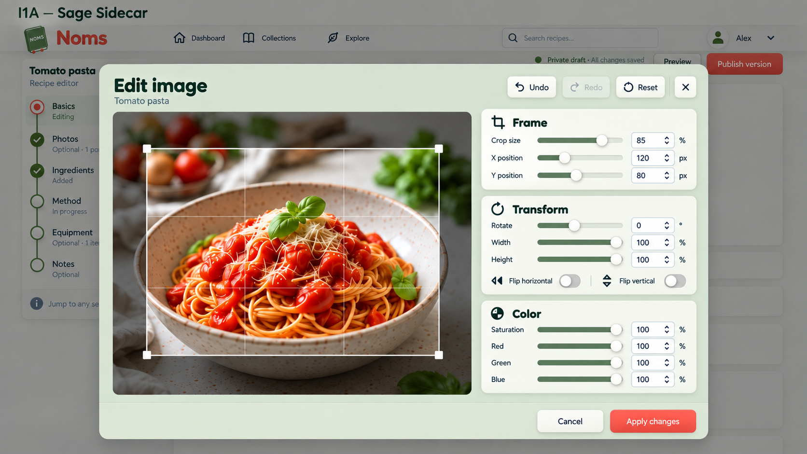
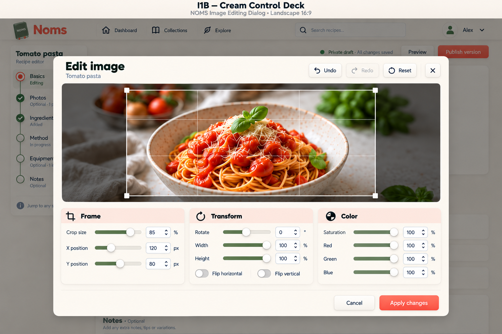
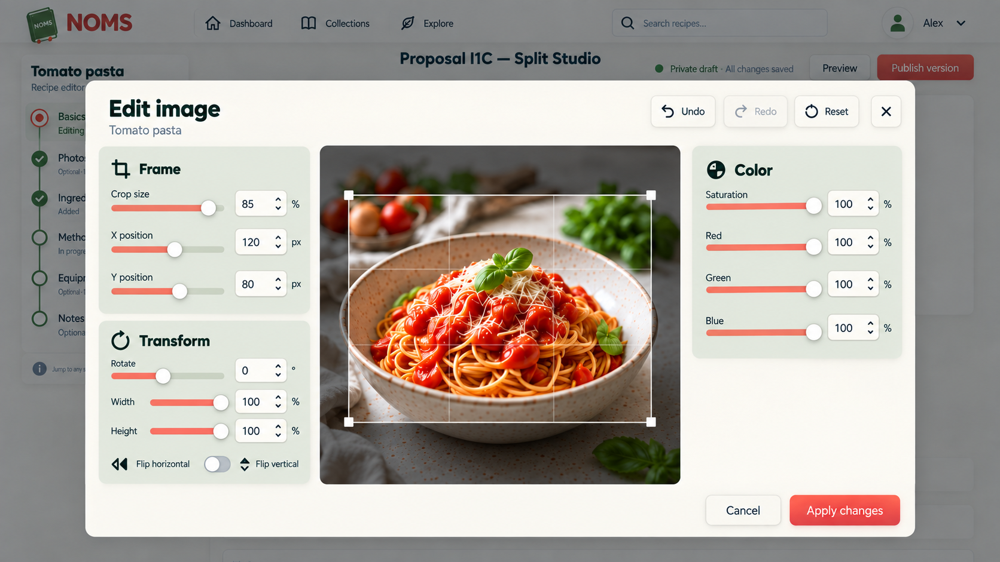
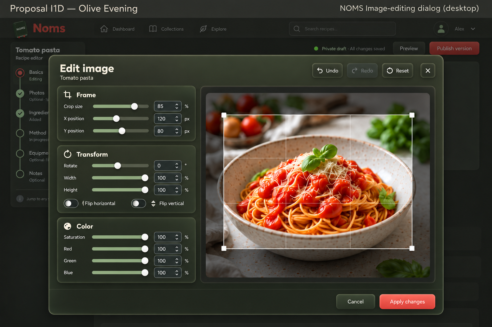

# Image editor — all controls visible

2026-09-14. Built-in image generation using I1 as style reference. User requested all controls remain visible, with varied placement and colors. No individual variant selected; no app code changes.

## I1A — Sage Sidecar

Photo LEFT 62%, ALL THREE control cards stacked RIGHT. Pale sage modal background, warm ivory raised cards with deep olive section headings, sage slider fills, coral Apply. Most familiar arrangement, stronger sage frame than original.

### Prompt

Use case: ui-mockup. Create one high-fidelity desktop NOMS image-editing dialog concept based on reference's cozy neumorphic character. Landscape 1536x1024. Print proposal ID and name clearly at TOP outside modal. REQUIRE EVERY CONTROL VISIBLE SIMULTANEOUSLY: NO tabs, accordion, collapsed groups, overflow menu, clipped controls or scrollbars. Frame card: Crop size 85%, X 120px, Y 80px. Transform card: Rotate 0°, Width 100%, Height 100%, two labelled toggle buttons Flip horizontal and Flip vertical. Color card: Saturation 100%, Red 100%, Green 100%, Blue 100%. All ten numeric controls each have a label slider and inset numeric input. Header Edit image, subtitle Tomato pasta; Undo, disabled Redo, Reset, close X. Footer Cancel and Apply changes. Don't add features. Large neutral-color photo of tomato spaghetti in speckled cream bowl with basil, clear WIDE 16:9 crop rectangle and handles with dimmed excluded area. Do not recolor food. Fredoka rounded headings, Nunito body approximation, soft raised cards and inset wells, clear borders and legible text. Maintain space between separate raised panels; no excessive layer nesting. Background dimmed recipe app. Distinct layout and palette: I1A — Sage Sidecar. Photo LEFT 62%, ALL THREE control cards stacked RIGHT. Pale sage modal background, warm ivory raised cards with deep olive section headings, sage slider fills, coral Apply. Most familiar arrangement, stronger sage frame than original.

## I1B — Cream Control Deck

Wide landscape photo TOP center. Under it THREE raised cards side-by-side in ONE ROW: Frame, Transform, Color, every control expanded. Ivory modal on warm oat background, pale coral header strips on cards, olive sliders and coral Apply. Photo and control deck each take about half body height. No right inspector.

### Prompt

Use case: ui-mockup. Create one high-fidelity desktop NOMS image-editing dialog concept based on reference's cozy neumorphic character. Landscape 1536x1024. Print proposal ID and name clearly at TOP outside modal. REQUIRE EVERY CONTROL VISIBLE SIMULTANEOUSLY: NO tabs, accordion, collapsed groups, overflow menu, clipped controls or scrollbars. Frame card: Crop size 85%, X 120px, Y 80px. Transform card: Rotate 0°, Width 100%, Height 100%, two labelled toggle buttons Flip horizontal and Flip vertical. Color card: Saturation 100%, Red 100%, Green 100%, Blue 100%. All ten numeric controls each have a label slider and inset numeric input. Header Edit image, subtitle Tomato pasta; Undo, disabled Redo, Reset, close X. Footer Cancel and Apply changes. Don't add features. Large neutral-color photo of tomato spaghetti in speckled cream bowl with basil, clear WIDE 16:9 crop rectangle and handles with dimmed excluded area. Do not recolor food. Fredoka rounded headings, Nunito body approximation, soft raised cards and inset wells, clear borders and legible text. Maintain space between separate raised panels; no excessive layer nesting. Background dimmed recipe app. Distinct layout and palette: I1B — Cream Control Deck. Wide landscape photo TOP center. Under it THREE raised cards side-by-side in ONE ROW: Frame, Transform, Color, every control expanded. Ivory modal on warm oat background, pale coral header strips on cards, olive sliders and coral Apply. Photo and control deck each take about half body height. No right inspector.

## I1C — Split Studio

Photo CENTER. LEFT column two stacked raised cards Frame then Transform. RIGHT column Color raised card with all four sliders, leaving calm space below. Cream modal, muted sage-green side cards with cream inset inputs, restrained coral sliders and Apply. Clearly three columns; photo largest. Undo/redo/reset top above image. No bottom control deck.

### Prompt

Use case: ui-mockup. Create one high-fidelity desktop NOMS image-editing dialog concept based on reference's cozy neumorphic character. Landscape 1536x1024. Print proposal ID and name clearly at TOP outside modal. REQUIRE EVERY CONTROL VISIBLE SIMULTANEOUSLY: NO tabs, accordion, collapsed groups, overflow menu, clipped controls or scrollbars. Frame card: Crop size 85%, X 120px, Y 80px. Transform card: Rotate 0°, Width 100%, Height 100%, two labelled toggle buttons Flip horizontal and Flip vertical. Color card: Saturation 100%, Red 100%, Green 100%, Blue 100%. All ten numeric controls each have a label slider and inset numeric input. Header Edit image, subtitle Tomato pasta; Undo, disabled Redo, Reset, close X. Footer Cancel and Apply changes. Don't add features. Large neutral-color photo of tomato spaghetti in speckled cream bowl with basil, clear WIDE 16:9 crop rectangle and handles with dimmed excluded area. Do not recolor food. Fredoka rounded headings, Nunito body approximation, soft raised cards and inset wells, clear borders and legible text. Maintain space between separate raised panels; no excessive layer nesting. Background dimmed recipe app. Distinct layout and palette: I1C — Split Studio. Photo CENTER. LEFT column two stacked raised cards Frame then Transform. RIGHT column Color raised card with all four sliders, leaving calm space below. Cream modal, muted sage-green side cards with cream inset inputs, restrained coral sliders and Apply. Clearly three columns; photo largest. Undo/redo/reset top above image. No bottom control deck.

## I1D — Olive Evening

DARK MODE variation: charcoal-olive modal with raised dark olive panels, warm ivory labels, muted sage slider fills and soft coral Apply. Photo RIGHT 62%, three control cards stacked LEFT all visible. Neutral dark gray preview well so no green tint on photo. Visible borders and subtle highlights maintain depth, not pure black, no neon.

### Prompt

Use case: ui-mockup. Create one high-fidelity desktop NOMS image-editing dialog concept based on reference's cozy neumorphic character. Landscape 1536x1024. Print proposal ID and name clearly at TOP outside modal. REQUIRE EVERY CONTROL VISIBLE SIMULTANEOUSLY: NO tabs, accordion, collapsed groups, overflow menu, clipped controls or scrollbars. Frame card: Crop size 85%, X 120px, Y 80px. Transform card: Rotate 0°, Width 100%, Height 100%, two labelled toggle buttons Flip horizontal and Flip vertical. Color card: Saturation 100%, Red 100%, Green 100%, Blue 100%. All ten numeric controls each have a label slider and inset numeric input. Header Edit image, subtitle Tomato pasta; Undo, disabled Redo, Reset, close X. Footer Cancel and Apply changes. Don't add features. Large neutral-color photo of tomato spaghetti in speckled cream bowl with basil, clear WIDE 16:9 crop rectangle and handles with dimmed excluded area. Do not recolor food. Fredoka rounded headings, Nunito body approximation, soft raised cards and inset wells, clear borders and legible text. Maintain space between separate raised panels; no excessive layer nesting. Background dimmed recipe app. Distinct layout and palette: I1D — Olive Evening. DARK MODE variation: charcoal-olive modal with raised dark olive panels, warm ivory labels, muted sage slider fills and soft coral Apply. Photo RIGHT 62%, three control cards stacked LEFT all visible. Neutral dark gray preview well so no green tint on photo. Visible borders and subtle highlights maintain depth, not pure black, no neon.

## Review

All variants expose Frame, Transform and Color without tabs/disclosure. I1C's vertical flip label/icon lacks an obvious separate toggle boundary; render it as an independently operable labelled toggle in implementation. Numeric controls and slider fills are illustrative. Crop rectangles still do not consistently reflect requested 16:9 geometry; preserve actual crop constraints. I1D depth is stronger/glossier than the other boards; soften edge highlights if adopted. Preserve numeric entry, focus, undo/redo/reset and cancel/apply semantics. Actual Fredoka/Nunito and A3 assets replace approximations. Short viewport layout must keep controls accessible without hiding groups or shrinking targets excessively. Desktop proposals, not mobile/tablet specifications.
