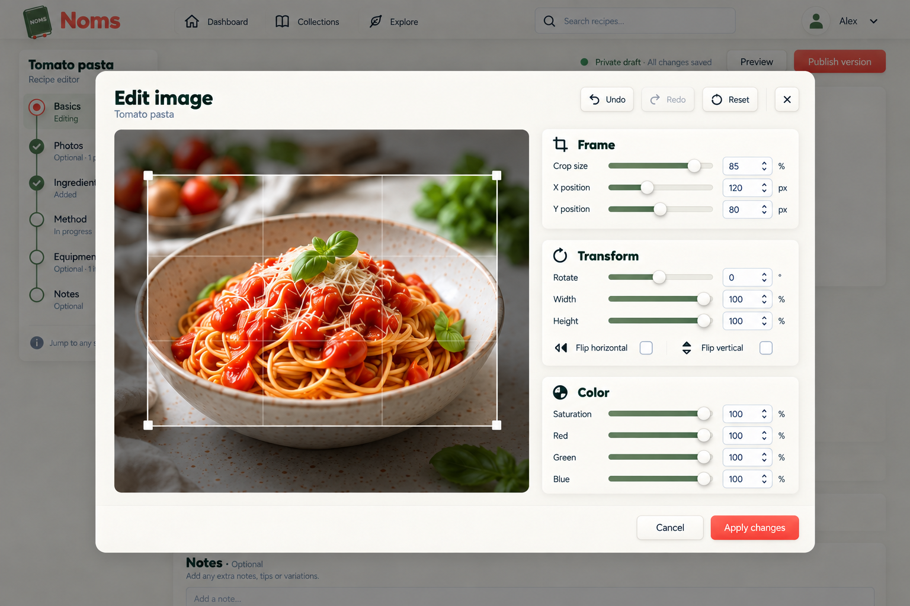
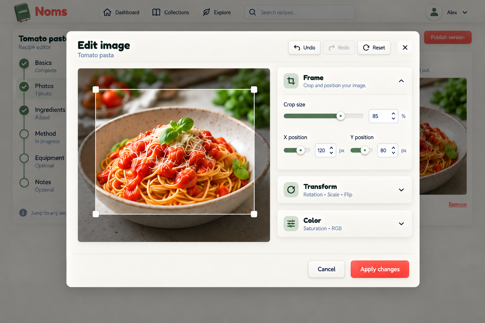
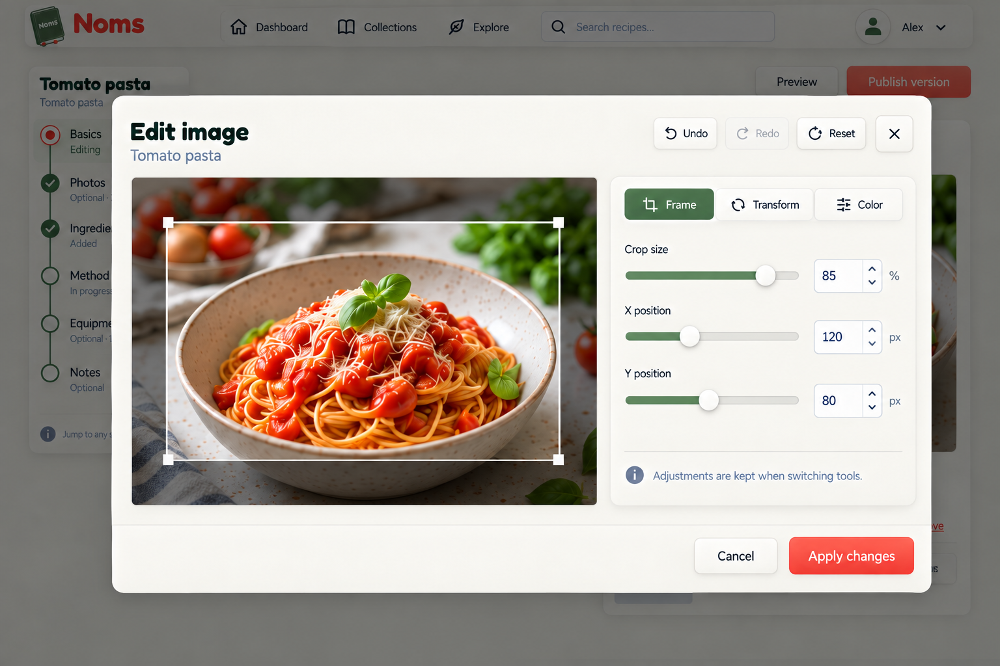
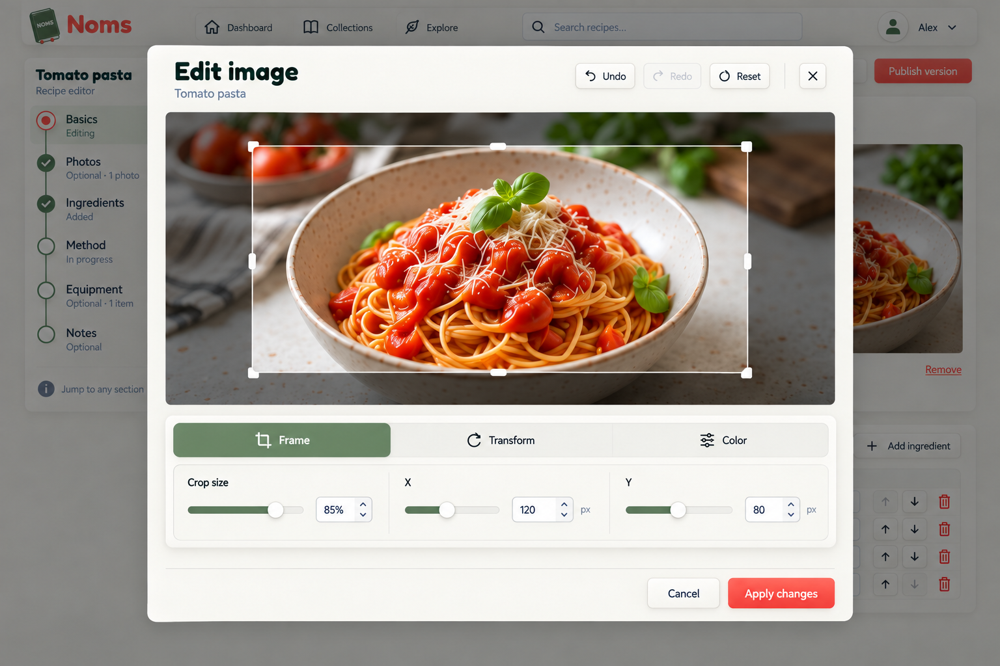
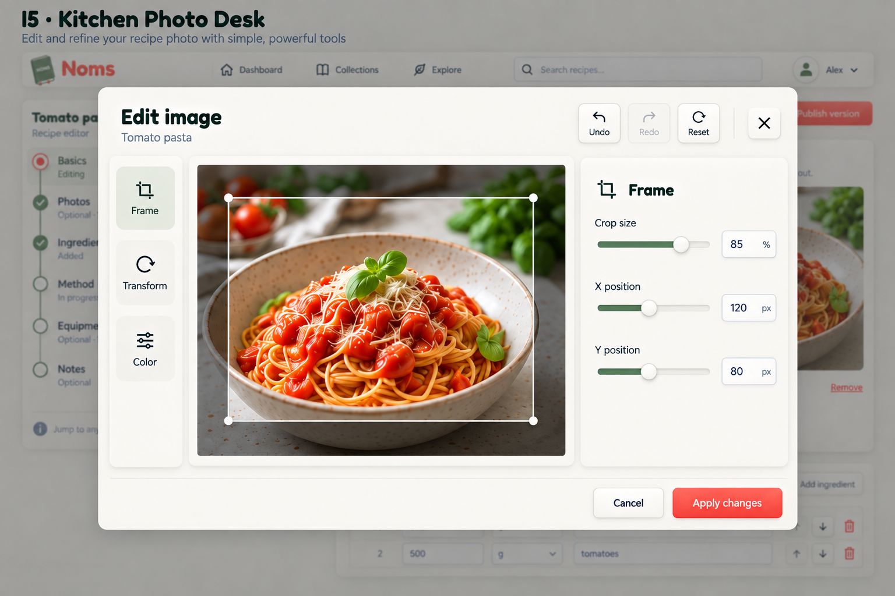

# Image editor design directions

2026-09-14. Five desktop proposals generated with the built-in image tool. No direction selected; no app code changes. Style reference: recipe-editor-e3t1-panels-v5.png. Current upload editor inspected live on September 13: preview above shallow scrolling Frame/Transform/Color area, undo/redo/reset, Cancel/OK.

## I1 — Soft Photo Workbench

Large inset photo preview LEFT occupying 65%, three individually raised cream cards stacked RIGHT, ALL expanded: Frame, Transform, Color. Fit all controls legibly using compact comfortable rows. No tabs or accordion. Strong continuity with separate raised recipe-editor sections.

### Prompt

Use case: ui-mockup. Generate one high-fidelity desktop NOMS image editor dialog design exploration. Provided image is STYLE REFERENCE ONLY for warm cream raised panels, sage/olive, restrained coral, gentle neumorphism, Fredoka rounded headings and Nunito body; DO NOT reproduce recipe form or timeline. Landscape 1536x1024, straight-on polished screenshot, not perspective. A large modal on subtly dimmed recipe editor background. Put proposal name outside dialog at top. Dialog title "Edit image", subtitle "Tomato pasta". Header right Undo, Redo (disabled), Reset, close X. Footer bottom right Cancel and coral "Apply changes" always visible. Same subject: realistic bowl of tomato spaghetti with basil, neutral faithful photo colors. Visible rectangular 16:9 crop outline and handles, outside-crop dimming; inset neutral preview well without color tint. Existing controls: Frame: Crop size 85%, X 120 px, Y 80 px. Transform: Rotate 0°, Width 100%, Height 100%, Flip horizontal and vertical. Color: Saturation 100%, Red 100%, Green 100%, Blue 100%. RGB means channel contrast, not color picking. Use raised slider thumbs, inset tracks and numeric inputs, dark readable labels and subtle visible borders. No new AI effects, filters, brightness, aspect ratio presets or upload/publish actions. Collapsed or unselected tool controls remain conceptually available, don't cram them elsewhere. Cozy restrained tactile UI not glassmorphism or inflated toys. Exact layout direction: I1 — Soft Photo Workbench. Large inset photo preview LEFT occupying 65%, three individually raised cream cards stacked RIGHT, ALL expanded: Frame, Transform, Color. Fit all controls legibly using compact comfortable rows. No tabs or accordion. Strong continuity with separate raised recipe-editor sections.

## I2 — Cozy Tool Accordion

Large inset photo preview LEFT, raised accordion stack RIGHT. Frame expanded showing Crop size,X,Y controls. Transform and Color are collapsed raised headers with chevrons and summaries 'Rotation · Scale · Flip' and 'Saturation · RGB'. Clear spacious composition, no tabs. Controls retained behind disclosure, not removed.

### Prompt

Use case: ui-mockup. Generate one high-fidelity desktop NOMS image editor dialog design exploration. Provided image is STYLE REFERENCE ONLY for warm cream raised panels, sage/olive, restrained coral, gentle neumorphism, Fredoka rounded headings and Nunito body; DO NOT reproduce recipe form or timeline. Landscape 1536x1024, straight-on polished screenshot, not perspective. A large modal on subtly dimmed recipe editor background. Put proposal name outside dialog at top. Dialog title "Edit image", subtitle "Tomato pasta". Header right Undo, Redo (disabled), Reset, close X. Footer bottom right Cancel and coral "Apply changes" always visible. Same subject: realistic bowl of tomato spaghetti with basil, neutral faithful photo colors. Visible rectangular 16:9 crop outline and handles, outside-crop dimming; inset neutral preview well without color tint. Existing controls: Frame: Crop size 85%, X 120 px, Y 80 px. Transform: Rotate 0°, Width 100%, Height 100%, Flip horizontal and vertical. Color: Saturation 100%, Red 100%, Green 100%, Blue 100%. RGB means channel contrast, not color picking. Use raised slider thumbs, inset tracks and numeric inputs, dark readable labels and subtle visible borders. No new AI effects, filters, brightness, aspect ratio presets or upload/publish actions. Collapsed or unselected tool controls remain conceptually available, don't cram them elsewhere. Cozy restrained tactile UI not glassmorphism or inflated toys. Exact layout direction: I2 — Cozy Tool Accordion. Large inset photo preview LEFT, raised accordion stack RIGHT. Frame expanded showing Crop size,X,Y controls. Transform and Color are collapsed raised headers with chevrons and summaries 'Rotation · Scale · Flip' and 'Saturation · RGB'. Clear spacious composition, no tabs. Controls retained behind disclosure, not removed.

## I3 — Photo Studio Tabs

Large preview LEFT, a SINGLE detached raised inspector RIGHT with horizontal segmented tabs Frame / Transform / Color. Frame selected inset sage; show Crop size,X,Y numeric sliders. Below a quiet helper 'Adjustments are kept when switching tools'. No accordion or stacked cards. Strong compact inspector.

### Prompt

Use case: ui-mockup. Generate one high-fidelity desktop NOMS image editor dialog design exploration. Provided image is STYLE REFERENCE ONLY for warm cream raised panels, sage/olive, restrained coral, gentle neumorphism, Fredoka rounded headings and Nunito body; DO NOT reproduce recipe form or timeline. Landscape 1536x1024, straight-on polished screenshot, not perspective. A large modal on subtly dimmed recipe editor background. Put proposal name outside dialog at top. Dialog title "Edit image", subtitle "Tomato pasta". Header right Undo, Redo (disabled), Reset, close X. Footer bottom right Cancel and coral "Apply changes" always visible. Same subject: realistic bowl of tomato spaghetti with basil, neutral faithful photo colors. Visible rectangular 16:9 crop outline and handles, outside-crop dimming; inset neutral preview well without color tint. Existing controls: Frame: Crop size 85%, X 120 px, Y 80 px. Transform: Rotate 0°, Width 100%, Height 100%, Flip horizontal and vertical. Color: Saturation 100%, Red 100%, Green 100%, Blue 100%. RGB means channel contrast, not color picking. Use raised slider thumbs, inset tracks and numeric inputs, dark readable labels and subtle visible borders. No new AI effects, filters, brightness, aspect ratio presets or upload/publish actions. Collapsed or unselected tool controls remain conceptually available, don't cram them elsewhere. Cozy restrained tactile UI not glassmorphism or inflated toys. Exact layout direction: I3 — Photo Studio Tabs. Large preview LEFT, a SINGLE detached raised inspector RIGHT with horizontal segmented tabs Frame / Transform / Color. Frame selected inset sage; show Crop size,X,Y numeric sliders. Below a quiet helper 'Adjustments are kept when switching tools'. No accordion or stacked cards. Strong compact inspector.

## I4 — Floating Tool Tray

Photo preview spans almost full modal width ABOVE a spacious detached raised horizontal tray BELOW it. Tray has Frame / Transform / Color selectors, Frame active sage. Crop size, X and Y controls arranged horizontally in three columns, enough height for labels sliders and numeric inputs. No right inspector and no left rail. Do not overlay tray on image. Footer below tray remains visible.

### Prompt

Use case: ui-mockup. Generate one high-fidelity desktop NOMS image editor dialog design exploration. Provided image is STYLE REFERENCE ONLY for warm cream raised panels, sage/olive, restrained coral, gentle neumorphism, Fredoka rounded headings and Nunito body; DO NOT reproduce recipe form or timeline. Landscape 1536x1024, straight-on polished screenshot, not perspective. A large modal on subtly dimmed recipe editor background. Put proposal name outside dialog at top. Dialog title "Edit image", subtitle "Tomato pasta". Header right Undo, Redo (disabled), Reset, close X. Footer bottom right Cancel and coral "Apply changes" always visible. Same subject: realistic bowl of tomato spaghetti with basil, neutral faithful photo colors. Visible rectangular 16:9 crop outline and handles, outside-crop dimming; inset neutral preview well without color tint. Existing controls: Frame: Crop size 85%, X 120 px, Y 80 px. Transform: Rotate 0°, Width 100%, Height 100%, Flip horizontal and vertical. Color: Saturation 100%, Red 100%, Green 100%, Blue 100%. RGB means channel contrast, not color picking. Use raised slider thumbs, inset tracks and numeric inputs, dark readable labels and subtle visible borders. No new AI effects, filters, brightness, aspect ratio presets or upload/publish actions. Collapsed or unselected tool controls remain conceptually available, don't cram them elsewhere. Cozy restrained tactile UI not glassmorphism or inflated toys. Exact layout direction: I4 — Floating Tool Tray. Photo preview spans almost full modal width ABOVE a spacious detached raised horizontal tray BELOW it. Tray has Frame / Transform / Color selectors, Frame active sage. Crop size, X and Y controls arranged horizontally in three columns, enough height for labels sliders and numeric inputs. No right inspector and no left rail. Do not overlay tray on image. Footer below tray remains visible.

## I5 — Kitchen Photo Desk

Three-column studio layout: slim detached raised labelled vertical tool rail LEFT (Frame active, Transform, Color), large inset photo CENTER, detached raised adjustment card RIGHT showing Frame controls Crop size,X,Y. Rail is local editing tools not global navigation. Spacious studio with clear separation, no tabs above inspector.

### Prompt

Use case: ui-mockup. Generate one high-fidelity desktop NOMS image editor dialog design exploration. Provided image is STYLE REFERENCE ONLY for warm cream raised panels, sage/olive, restrained coral, gentle neumorphism, Fredoka rounded headings and Nunito body; DO NOT reproduce recipe form or timeline. Landscape 1536x1024, straight-on polished screenshot, not perspective. A large modal on subtly dimmed recipe editor background. Put proposal name outside dialog at top. Dialog title "Edit image", subtitle "Tomato pasta". Header right Undo, Redo (disabled), Reset, close X. Footer bottom right Cancel and coral "Apply changes" always visible. Same subject: realistic bowl of tomato spaghetti with basil, neutral faithful photo colors. Visible rectangular 16:9 crop outline and handles, outside-crop dimming; inset neutral preview well without color tint. Existing controls: Frame: Crop size 85%, X 120 px, Y 80 px. Transform: Rotate 0°, Width 100%, Height 100%, Flip horizontal and vertical. Color: Saturation 100%, Red 100%, Green 100%, Blue 100%. RGB means channel contrast, not color picking. Use raised slider thumbs, inset tracks and numeric inputs, dark readable labels and subtle visible borders. No new AI effects, filters, brightness, aspect ratio presets or upload/publish actions. Collapsed or unselected tool controls remain conceptually available, don't cram them elsewhere. Cozy restrained tactile UI not glassmorphism or inflated toys. Exact layout direction: I5 — Kitchen Photo Desk. Three-column studio layout: slim detached raised labelled vertical tool rail LEFT (Frame active, Transform, Color), large inset photo CENTER, detached raised adjustment card RIGHT showing Frame controls Crop size,X,Y. Rail is local editing tools not global navigation. Spacious studio with clear separation, no tabs above inspector.

## Review caveats

- I1–I4 omit their requested on-image proposal titles; identify by order/file links. I5 includes its title.
- The crop rectangles are not consistently 16:9 despite the prompt. Production must preserve actual crop-mode constraints and accurate geometry; these are composition mockups, not crop specifications.
- Photographs vary slightly across outputs. Numeric offsets/slider fills are illustrative, not geometrically validated.
- I1 exposes every group; I2 hides Transform/Color behind disclosures; I3/I4/I5 show Frame with other groups accessed through selectors. Those layouts must retain all current controls and adjustments on switching.
- Generated I1 flips resemble checkboxes rather than existing toggle buttons. Exact interaction and keyboard states need refinement.
- Preserve numeric entry, undo/redo/reset and cancel/apply behavior. Apply changes is proposed clearer copy for OK, not a recipe publish action.
- Keep modal focus contained and background inert, footer reachable, controls usable on short desktop viewports. Mobile/tablet and dark variants remain future refinements.
- Use actual Fredoka/Nunito and approved A3 logo. Avoid copying raster text/spacing or incidental background data as requirements.
