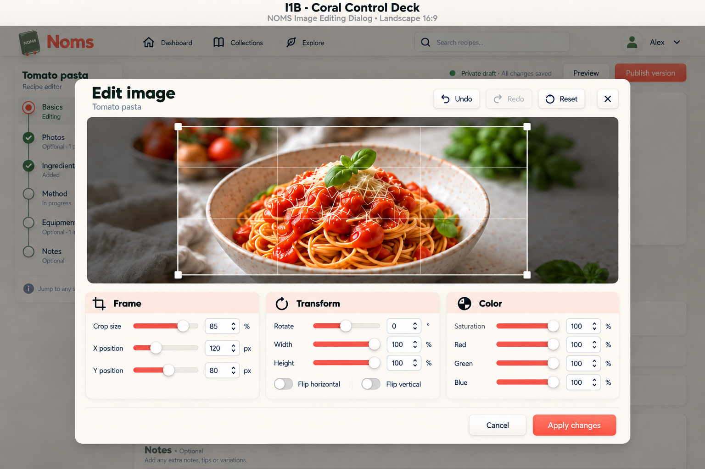

# I1B — Coral Control Deck

2026-09-14. Built-in image generation. **Preferred direction confirmed by the user:** I1B's landscape control deck with primary coral slider fills instead of green. This v3 refinement supersedes the earlier green-slider I1B as the preferred reference. See the [canonical implementation plan](../../implementation-plans/NOMS-020-visual-design-refinement.md#preferred-image-editor-direction--i1b-coral-control-deck) for constraints and remaining refinement scope. No app code changes.

## Review

Retains wide preview above three side-by-side raised control panels, all ten numeric sliders and both flips visible. Coral fills with ivory thumbs and neutral remaining tracks. Apply remains the only large solid coral action. Validate contrast and focus in implementation; coral here is a normal interaction accent, not an error indicator. Geometry and slider fills remain illustrative; actual crop constraints, Fredoka/Nunito and A3 artwork apply.

## Prompt

Edit the reference NOMS image editor mockup. Preserve exact landscape composition: wide photo above three side-by-side raised panels Frame, Transform, Color, every control visible, no tabs or collapsed groups. Change ALL ten green slider filled tracks to primary tomato-coral red matching the Apply changes button; unfilled tracks remain neutral warm gray and raised circular thumbs remain ivory. Keep cream cards, subtle pale coral header strips, dark olive text, soft neumorphism, inset numeric fields, photo and crop unchanged. Retain all labels and values: Crop size85%,X120px,Y80px; Rotate0°,Width100%,Height100%, separate Flip horizontal/Flip vertical toggles; Saturation100%,Red100%,Green100%,Blue100%. Header Undo Redo Reset close and footer Cancel Apply changes unchanged. Change board title to "I1B · Coral Control Deck". Typography Fredoka headings and Nunito body. No other layout, feature, image color or control changes. High fidelity desktop UI mockup.
