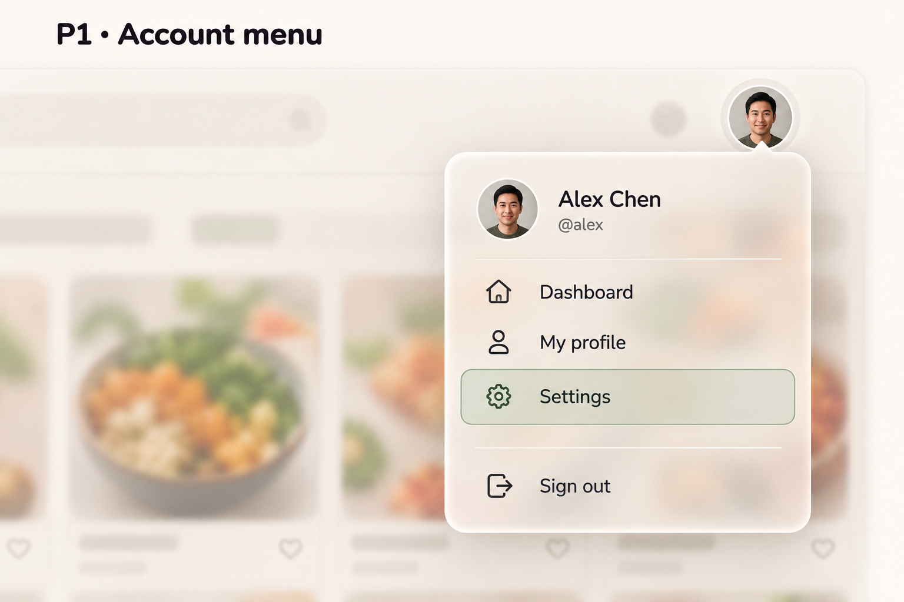
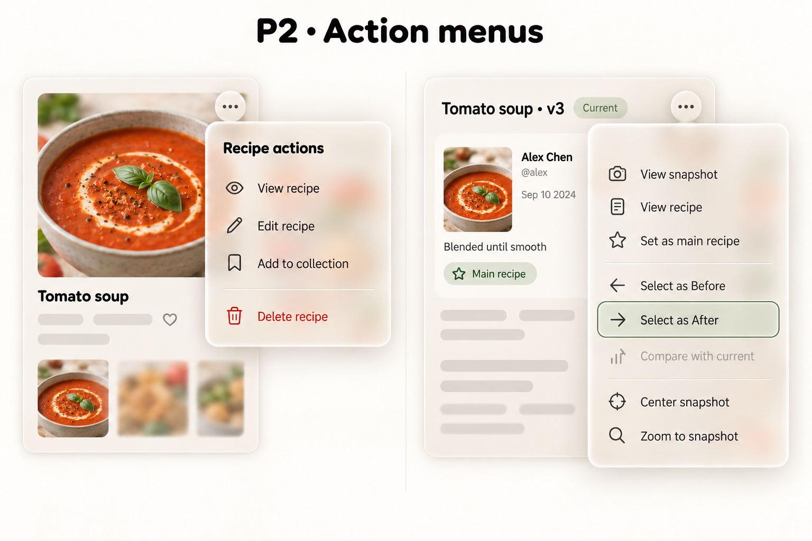
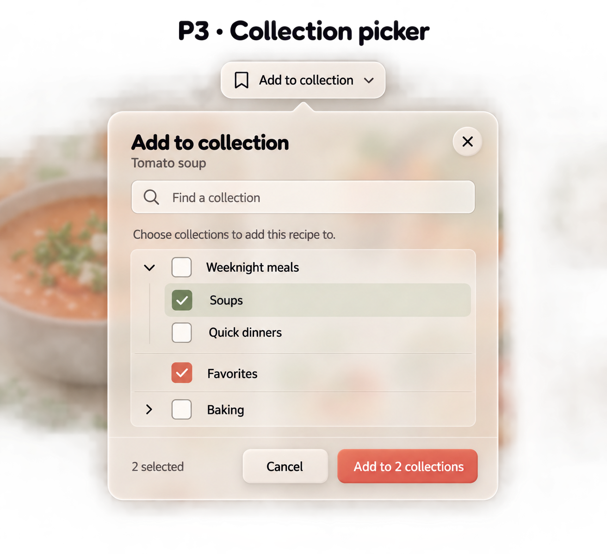

# Menus and collection popover examples v1

Status: user-selected overlay compositions, confirmed 2026-09-17: P1 Account menu, P2 Action menus and P3 Collection picker. All three retain M4 warm glass and softer T2-inspired shapes. Preserve the documented permission, behavior and accessibility requirements below; visual selection does not resolve implementation details or approve incidental generated assets. Built-in image generation using imagegen skill; no code changes. P1–P3 here identify overlay studies, not the earlier profile/settings P-series.

## P1 — Account menu

Implementation contract (2026-09-20): desktop P1 uses actual avatar/name/handle, Dashboard, My profile, Settings and neutral Sign Out. The panel stays mounted to preserve native logout POST. Named menu-button semantics, arrow/Home/End/typeahead navigation, Escape focus return, Tab exit, outside dismissal and bounded scrolling/positioning are defined in [foundation slice 7](../../implementation-plans/NOMS-020-checkpoint-1-foundations.md). Mobile drawer and broader navbar redesign are unchanged; P2/P3 are still separate work.



## P2 — Action menus

Implementation contract (2026-09-21): [foundation slice 9](../../implementation-plans/NOMS-020-checkpoint-1-foundations.md) adapts this illustrative board to existing routes. Recipe detail groups View version graph, Fork and owner-only Edit/Delete; its authenticated collection picker remains separate pending P3. Graph retains its eight snapshot actions plus the existing background navigation menu. Shared Rust menu handling, warm glass, viewport-bounded top-layer presentation and internal scrolling replace neither server permissions nor deletion confirmation. See slice 9 for validation status and limitations.



## P3 — Collection picker



Implementation contract (2026-09-22): [foundation slice 10](../../implementation-plans/NOMS-020-checkpoint-1-foundations.md) implements the picker in Rust as an anchored nonmodal dialog with native search, independent disclosure buttons and checkboxes. Owned collections only; published recipes only. Existing memberships are checked/disabled, path search finds collapsed descendants, and staged additions require explicit confirmation. Cancel before submission writes nothing. Partial success is retained, memberships are reconciled after errors, and explicit retry submits only remaining selections. Removal stays on collection pages. Coral is the consistent checkbox accent; no new backend features or mobile redesign are included. Slice 10 supersedes the open implementation questions below and records validation and limitations.

## Review / boundaries

Account menu includes identity, Dashboard, My profile, Settings and neutral Sign out. Generated portrait replaces requested initials; use actual user avatar/fallback, not generated imagery. Exact route list remains subject to current navigation inventory.

Action menu board has separate recipe and graph examples. Corrected the initial generated line chart to snapshot metadata and removed menu close buttons. All eight graph actions remain; Compare with current is disabled for the current snapshot. Recipe edit/delete are ownership/permission-dependent, not universally available. Preserve existing confirmation and server-side safeguards. The background cards are illustrative, not new detail or graph layouts.

Picker proposes additive selection with explicit confirmation, not immediate membership editing/removal. Parent expansion and selection are separate; Soups and Favorites selected while parent Weeknight meals remains unchecked. Favorites is a sample collection name, not a built-in favorites feature. Existing membership display, partial success, idempotency, search behavior and eligible collections/drafts must be specified before implementation. Cancel/close must not apply pending choices. Checked colors differ in artwork; production must use one consistent checked treatment. P3's dark/transparent-looking surround and oversized presentation are artifacts, not a modal scrim or actual viewport dimensions.

Use actual app fonts/tokens, validate contrast and opaque fallback. Background blur beyond surfaces is not an approved page effect. These are enlarged nonmodal components, not full-page designs or mobile/tablet proposals.

## Interaction requirements to refine

- Anchor to trigger, avoid clipping at viewport edges, limit height with usable scrolling and preserve focus visibility.
- Menus: keyboard opening/navigation, Escape dismissal and focus return, disabled-action semantics, appropriate dismissal on action/outside interaction; no modal backdrop or universal focus trap.
- Picker: use semantics suitable for a search field plus hierarchical independent checkboxes, not an action-menu role on the entire form. Define keyboard expand/collapse separately from selection.
- Loading/empty/no-match/error/pending states, long names, existing memberships and multi-add failure handling remain open. No new backend features are implicitly approved.
- Only palette/material direction inherited from M4/T2; exact iconography, dimensions and state colors are not final tokens.

## Exact prompts

Reference for all: modals-m4-warm-glass-v1.png, material only.

### P1

```text
Use case: ui-mockup. NOMS desktop overlay component study, high fidelity, enlarged focused crop NOT full page. Reference is M4 material only. Warm frosted ivory translucent shell, fine illuminated border, soft floating shadow, subtly rounded 22px corners and round-ended menu highlights inspired by T2. Actual typography Nunito menu/body, Fredoka external study heading only. Palette bg #FAF7F2 surface #F5F0E8 text #2D2A26 coral #D9735A sage and semantic danger #C4504A. Enough opaque frost for readability; background food-card colors visible through glass. Minimal abstract app context, no readable invented nav or slogans, no props. NONMODAL: no full-page scrim/dimming/blur. Only blur through glass. Crisp text, realistic desktop menu proportions shown enlarged, not huge modal buttons. Title "P1 · Account menu". One small avatar AL trigger above and right-aligned with an anchored glass dropdown. Dropdown identity header small avatar, "Alex Chen", "@alex", no email. Divider. Rows with simple icons: "Dashboard", "My profile", "Settings". Settings has soft sage rounded hover/focus background and separate thin visible focus outline. Divider, "Sign out" neutral dark text with exit icon, not danger red. No chevrons on simple links, no close X or footer buttons, no badges or fake keyboard shortcuts. Show trigger anchor and complete menu.
```

### P2

```text
Use case: ui-mockup. NOMS desktop overlay component study, high fidelity, enlarged focused crop NOT full page. Reference is M4 material only. Warm frosted ivory translucent shell, fine illuminated border, soft floating shadow, subtly rounded 22px corners and round-ended menu highlights inspired by T2. Actual typography Nunito menu/body, Fredoka external study heading only. Palette bg #FAF7F2 surface #F5F0E8 text #2D2A26 coral #D9735A sage and semantic danger #C4504A. Enough opaque frost for readability; background food-card colors visible through glass. Minimal abstract app context, no readable invented nav or slogans, no props. NONMODAL: no full-page scrim/dimming/blur. Only blur through glass. Crisp text, realistic desktop menu proportions shown enlarged, not huge modal buttons. Title "P2 · Action menus". Two clearly separate detail scenes side by side. LEFT small recipe card title Tomato soup and ellipsis trigger, anchored compact menu heading "Recipe actions", rows View recipe, Edit recipe, Add to collection; separator; Delete recipe with semantic danger icon/text. RIGHT graph card title Tomato soup · v3 with Current badge and ellipsis trigger. Glass menu ALL eight rows grouped: View snapshot; View recipe; Set as main recipe; separator; Select as Before; Select as After; Compare with current (disabled muted); separator; Center snapshot; Zoom to snapshot. Select as After with rounded pale sage highlight and distinct focus outline. No Delete in graph menu, no merge action. Normal legible row density. These are separate examples, not two menus simultaneously on one page. No extra actions.
```

### P3

```text
Use case: ui-mockup. NOMS desktop overlay component study, high fidelity, enlarged focused crop NOT full page. Reference is M4 material only. Warm frosted ivory translucent shell, fine illuminated border, soft floating shadow, subtly rounded 22px corners and round-ended menu highlights inspired by T2. Actual typography Nunito menu/body, Fredoka external study heading only. Palette bg #FAF7F2 surface #F5F0E8 text #2D2A26 coral #D9735A sage and semantic danger #C4504A. Enough opaque frost for readability; background food-card colors visible through glass. Minimal abstract app context, no readable invented nav or slogans, no props. NONMODAL: no full-page scrim/dimming/blur. Only blur through glass. Crisp text, realistic desktop menu proportions shown enlarged, not huge modal buttons. Title "P3 · Collection picker". Single anchored glass selection popover beneath small "Add to collection" trigger. Header "Add to collection" and contextual subtitle "Tomato soup". Search input magnifier with placeholder "Find a collection". Small helper "Choose collections to add this recipe to." Tree list with independent square checkboxes and separate expand chevrons. Expanded unchecked parent "Weeknight meals"; indented checked child "Soups"; indented unchecked child "Quick dinners". Root "Favorites" checked. Root "Baking" unchecked and collapsed chevron. No implicit parent cascade or partial parent check. Sage selected row fills, coral/sage checks with visible symbols. Footer label "2 selected", buttons Cancel and coral "Add to 2 collections". No Remove, no new collection action, no instant save claim. Fine separators, enough space for nested labels, action footer part of same glass shell. All visible no scroll clipping. This is an additive multi-select proposal, not existing membership editor.
```


### P2 corrective edit

```text
Edit this P2 action-menu board. Keep both foreground glass menus, all eight graph menu labels and their states, left recipe scene, typography and colors unchanged. Replace ONLY the right background card's entire line-chart/axes/legend with a small tomato-soup thumbnail and snapshot metadata Alex Chen @alex, Sep 10 2024, Blended until smooth, Main recipe badge. Retain title Tomato soup · v3, Current badge and ellipsis trigger. This is a recipe version snapshot, NOT an analytics chart. No axes, plotted lines, statistics or charts anywhere. Also remove close X buttons from the two action menus, preserving all action rows and menus' anchored appearance. Nothing else changed.
```
