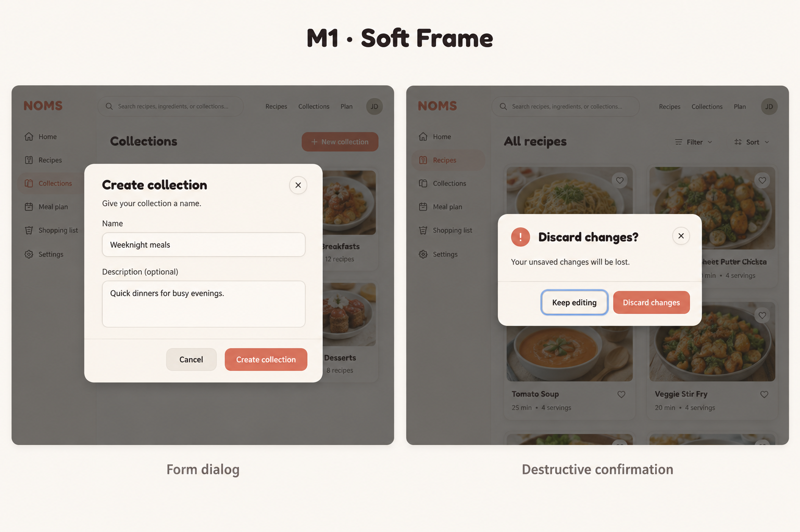
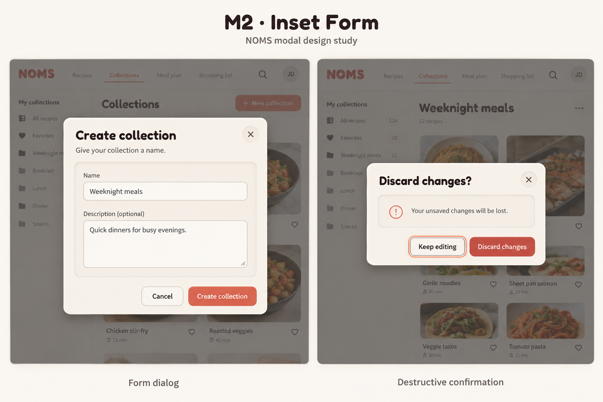
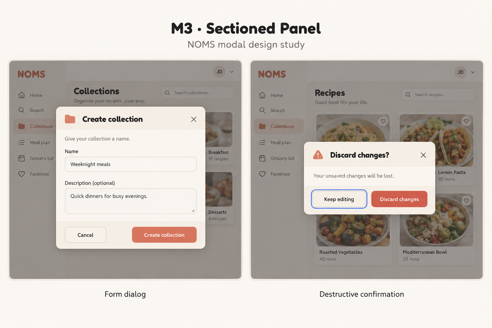

# Shared modal directions v1

Status: historical M1–M3 explorations, including the later [enhanced M2](modals-m2-enhanced-v2.md), are superseded by selected [M4 Warm Frosted Glass](modals-m4-warm-glass-v1.md). Retain the behavior safeguards below. Built-in image generation using the imagegen skill. No code changes. Three designs each show a form dialog and a separate destructive confirmation scene, not simultaneous modals.

## Directions

### M1 — Soft Frame



Single raised shell, direct fields, subtle footer divider; recommended starting point for a general-purpose modal.

### M2 — Inset Form



Raised outer shell with a recessed content well; stronger tactile distinction, with risk of excessive nesting for complex forms.

### M3 — Sectioned Panel



Tinted cream header and distinct action footer; clearer sections for longer forms.


## Identity and review

Prompts use actual current root assets/main.css values: background #FAF7F2, surface #F5F0E8, shadow-light #FAF7F1, shadow-dark #C8C1B4, text #2D2A26, secondary #7A756D, accent #D9735A, error #C4504A, Fredoka display and Nunito body. Raster output approximates these, not a guarantee of exact font/color or contrast. Reuse actual tokens and validate contrast in implementation.

All three show the requested fields and labelled actions with initial focus illustrated on Keep editing. M1/M3 use a blue focus ring while M2 uses coral: neither creates a new approved focus token. M1's destructive color is insufficiently distinct from primary; use the actual semantic danger token plus explicit wording. M2's close control is raised despite the flat-control prompt; this is incidental.

Generated backdrops are illustrative only and contain invented navigation, favorite controls and copy (including M3's slogan). These are NOT proposed app changes and do not supersede N1/N4 or other selected pages. Only modal surfaces/layouts are under review. Confirmation appears over generic content; actual usage must retain the correct underlying editing context. No new collection fields or discard behavior is authorized by these samples.

## Shared behavior requirements for refinement

- Use a named modal dialog with background inert, contained focus, scroll locking and focus restoration to the trigger or sensible successor.
- Put initial focus in the first relevant field for simple forms; focus the safe Keep editing action for this destructive confirmation. Escape/close must never activate discard.
- Define dirty-form close, backdrop-click and pending-close behavior against each workflow. Do not silently discard edits. Autosaved recipe drafts need accurate copy; “unsaved changes” is a generic example, not a replacement for draft-discard semantics.
- Keep actions reachable on short desktops; allow body scrolling for long content. No new phone/tablet or dark-mode compositions in this study.
- Field errors should be associated with fields; failed submission preserves input and offers retry. Pending submission prevents duplicates and announces progress. Do not claim cancellation aborts a server mutation unless supported.
- Preserve existing collection/auth/visibility/destructive safeguards. Verify actual form fields and deletion impact from current source before implementation.
- Next after selection: validation, submitting/failure, dirty-close and long-content states using the selected shell. Current images do not test keyboard, semantics, contrast or behavior.

## Exact prompts

### M1

```text
Use case: ui-mockup. High fidelity desktop NOMS modal design study, landscape 1536x1024. TWO separate example scenes side by side, each on its own subtly dimmed app backdrop; never two stacked modals in one app. Above scenes small external study title. Preserve existing NOMS identity: Fredoka rounded display headings, Nunito body, bg #FAF7F2, surface #F5F0E8, shadows #FAF7F1/#C8C1B4, dark warm text #2D2A26, secondary #7A756D, primary coral #D9735A, destructive #C4504A. Cozy neumorphism, rounded corners, fine visible boundaries, restrained depth. No new palette, no glass, no quotes, mascots or decorative props. Large legible controls. LEFT modal title "Create collection", top-right close X, subtitle "Give your collection a name.", label "Name", inset input with "Weeknight meals", label "Description (optional)", textarea with "Quick dinners for busy evenings.", footer Cancel then coral Create collection. RIGHT modal narrower and shorter title "Discard changes?", close X, small warning icon, body "Your unsaved changes will be lost.", two buttons Keep editing then destructive Discard changes. Keep editing has a clear keyboard focus outline. No typed confirmation, no collection deletion implications, no extra fields. Scene captions "Form dialog" and "Destructive confirmation". Both centered in their own scene, show entire dialogs without cropping. External title "M1 · Soft Frame". Single smooth raised shell, compact left-aligned title/body, fields directly on cream surface, no nested form wrapper, light divider above action row. Moderate radius around 20px. Close is a small circular softly raised icon button. Actions aligned right. Restrained shadow, cozy but mature. Confirmation uses small warning icon beside title, not huge illustration.
```

### M2

```text
Use case: ui-mockup. High fidelity desktop NOMS modal design study, landscape 1536x1024. TWO separate example scenes side by side, each on its own subtly dimmed app backdrop; never two stacked modals in one app. Above scenes small external study title. Preserve existing NOMS identity: Fredoka rounded display headings, Nunito body, bg #FAF7F2, surface #F5F0E8, shadows #FAF7F1/#C8C1B4, dark warm text #2D2A26, secondary #7A756D, primary coral #D9735A, destructive #C4504A. Cozy neumorphism, rounded corners, fine visible boundaries, restrained depth. No new palette, no glass, no quotes, mascots or decorative props. Large legible controls. LEFT modal title "Create collection", top-right close X, subtitle "Give your collection a name.", label "Name", inset input with "Weeknight meals", label "Description (optional)", textarea with "Quick dinners for busy evenings.", footer Cancel then coral Create collection. RIGHT modal narrower and shorter title "Discard changes?", close X, small warning icon, body "Your unsaved changes will be lost.", two buttons Keep editing then destructive Discard changes. Keep editing has a clear keyboard focus outline. No typed confirmation, no collection deletion implications, no extra fields. Scene captions "Form dialog" and "Destructive confirmation". Both centered in their own scene, show entire dialogs without cropping. External title "M2 · Inset Form". Distinct outer softly raised rim with header outside a shallow recessed rounded form well, fields within the well use fine borders and minimal extra shadows to avoid depth overload. Footer outside well on outer shell. Confirmation message in matching inset well, small warning icon at start of message. Rounded 24px shell. Close subtle flat icon button. Action buttons aligned right. Clear tactile outer/inner distinction.
```

### M3

```text
Use case: ui-mockup. High fidelity desktop NOMS modal design study, landscape 1536x1024. TWO separate example scenes side by side, each on its own subtly dimmed app backdrop; never two stacked modals in one app. Above scenes small external study title. Preserve existing NOMS identity: Fredoka rounded display headings, Nunito body, bg #FAF7F2, surface #F5F0E8, shadows #FAF7F1/#C8C1B4, dark warm text #2D2A26, secondary #7A756D, primary coral #D9735A, destructive #C4504A. Cozy neumorphism, rounded corners, fine visible boundaries, restrained depth. No new palette, no glass, no quotes, mascots or decorative props. Large legible controls. LEFT modal title "Create collection", top-right close X, subtitle "Give your collection a name.", label "Name", inset input with "Weeknight meals", label "Description (optional)", textarea with "Quick dinners for busy evenings.", footer Cancel then coral Create collection. RIGHT modal narrower and shorter title "Discard changes?", close X, small warning icon, body "Your unsaved changes will be lost.", two buttons Keep editing then destructive Discard changes. Keep editing has a clear keyboard focus outline. No typed confirmation, no collection deletion implications, no extra fields. Scene captions "Form dialog" and "Destructive confirmation". Both centered in their own scene, show entire dialogs without cropping. External title "M3 · Sectioned Panel". Softly raised 20px rounded shell with warm slightly darker cream header band, flat cream body with inset fields, and separate subtly raised footer strip. Compact small coral folder icon beside create title, muted destructive warning icon beside discard title. Close flat X at far right header. Action footer Cancel on left and primary Create collection on right; confirmation Keep editing left and Discard changes right. No bold colored header, retain original warm palette. Strong section hierarchy but not a wizard.
```
