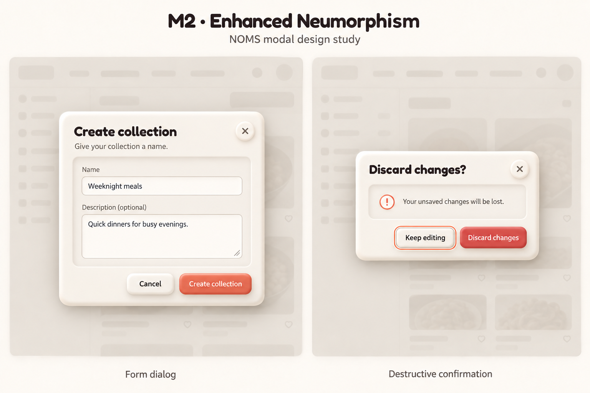

# M2 — Enhanced neumorphism v2

Historical M2 refinement, superseded by the selected [M4 Warm Frosted Glass](modals-m4-warm-glass-v1.md) overlay direction. Built-in image generation with the imagegen skill; edited modals-m2-inset-form-v1.png non-destructively. No application code changes.



Retain M2's shell/header, inset form well and outside actions. This version strengthens upper-left highlights, lower-right shadows, recessed wells and raised buttons/close controls. Form and confirmation content are preserved. Background labels are removed to avoid suggesting new navigation.

Review: noticeably stronger depth and clear field boundaries. Buttons are somewhat glossier and more saturated than the requested matte current-app palette; production should use actual tokens rather than sample pixels. The lighter backdrop is illustrative, not a selected change to overlay behavior. Maintain sufficient modal/background separation, readable contrast and an independent focus ring. Do not interpret the soft silhouette background as a loading state. All behavior safeguards and unresolved states in [original notes](modal-directions-v1.md) still apply. Dark/mobile/tablet remain deferred.

## Exact prompt

```text
Edit the attached M2 modal study into "M2 · Enhanced Neumorphism". Preserve the two separate scenes, modal layouts, exact dialog texts, all form fields and action labels, Fredoka headings and Nunito body. Enhance the neumorphism noticeably but tastefully: thicker softly rounded cream outer rim with luminous upper-left highlight and warm lower-right shadow; deeper recessed content wells with soft inset top/left shading and lower-right highlight; fields gently inset within wells with thin readable borders; secondary buttons and close buttons distinctly raised cushion-like cream controls; coral primary button and dark red destructive button have restrained raised edge highlights and soft cast shadows. No glossy plastic, no metallic finish, no heavy textures, no new decorations. Retain palette bg #FAF7F2 surface #F5F0E8 shadows #FAF7F1 and #C8C1B4 text #2D2A26 secondary #7A756D accent #D9735A destructive #C4504A. Keep crisp high-contrast labels and visible keyboard focus around Keep editing independent of shadow. Do not add layered wrappers or more fields. Replace the invented background navigation/text with very faint generic dimmed cream app silhouettes without readable labels; modal components are the only UI proposals. Header study title above, captions Form dialog and Destructive confirmation below. Full dialogs visible. This is a light-mode desktop component study, not a real app screenshot.
```
