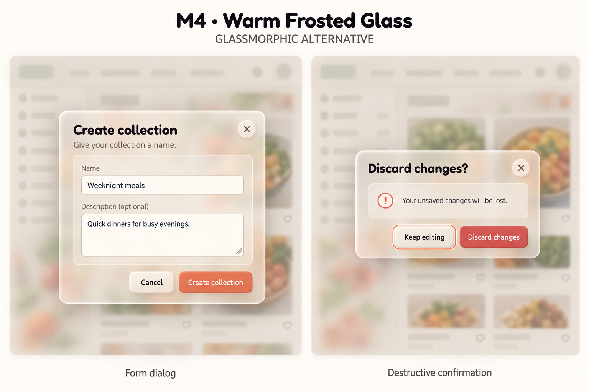

# M4 — Warm Frosted Glass

User-selected finalized modal direction, superseding M1–M3 and enhanced M2. The user also selected warm glassmorphism as the surface language for overlay components generally (menus, popovers, tooltips, toasts and other existing overlays). Their individual layouts and behaviors still require refinement; regular page surfaces retain neumorphism. Built-in image generation using the imagegen skill, with modals-m2-enhanced-v2.png as edit target. No code changes.



Preserves M2 layout and copy while replacing opaque raised shells with warm translucent frosted panels, thin light borders and floating shadows. Mostly opaque input fields retain readability. Review: background colors visibly filter through the shells; text and actions remain distinct in this illustrative scene. Some button depth remains, making this a restrained glass alternative rather than a completely flat glass system.

Raster colors/fonts are approximate. Validate contrast over varied content, overlay separation and an opaque fallback if explored in implementation; do not rely on blur alone for readability or inert background behavior. Backgrounds are illustrative, not proposed navigation/features. All [modal behavior safeguards](modal-directions-v1.md) remain applicable. No dark/mobile/tablet design scope added.

## Exact prompt

```text
Edit the reference modal study to create "M4 · Warm Frosted Glass", a GLASSMORPHIC ALTERNATIVE, not enhanced neumorphism. Preserve two separate scenes, same modal sizes and position, exact Create collection form text and fields, Discard changes confirmation and all action labels; Fredoka headings Nunito body. Replace thick opaque cream shells and heavy cushion shadows with thinner translucent warm-ivory frosted glass panels, clearly visible blurred underlying food-card colors THROUGH the glass, subtle luminous 1px edges and soft floating shadows. Glass must be visibly translucent but sufficiently milky behind text for strong readability. Inner form well a slightly more opaque frosted inset, fields mostly opaque warm cream with fine borders. Buttons mostly opaque matte coral #D9735A and destructive #C4504A, secondary frosted ivory. No pillowy bevels, no rainbow gradients, no chrome, no blue futuristic palette, no shiny red plastic. Preserve warm bg #FAF7F2 and dark #2D2A26 text. Show a muted dimmed app backdrop with softly blurred sage/coral/food thumbnail shapes so translucency is discernible; no readable invented navigation, slogans or logos. Keep modal foreground sharper than backdrop. Independent thin focus ring on Keep editing. Outside title M4 · Warm Frosted Glass; captions Form dialog and Destructive confirmation. Complete dialogs, no crop. Desktop light component study only.
```
