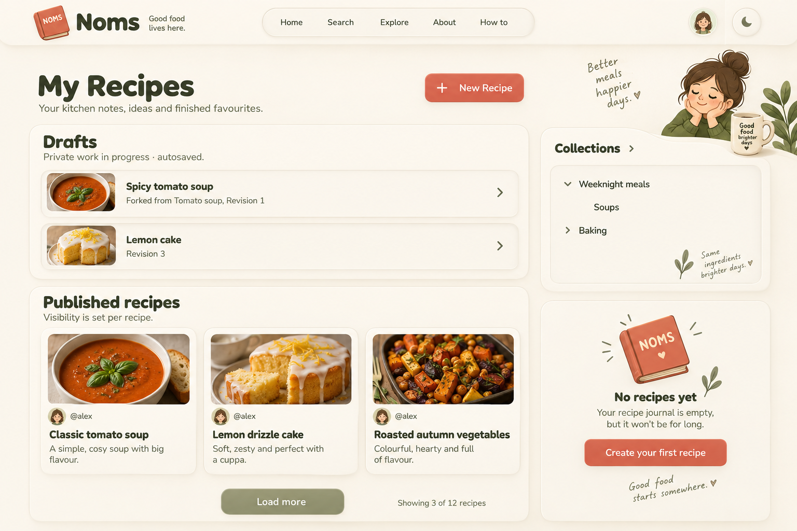
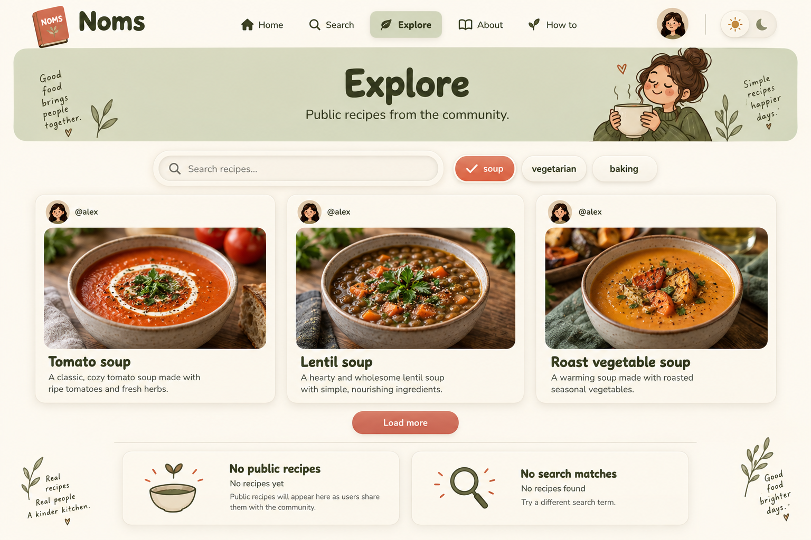
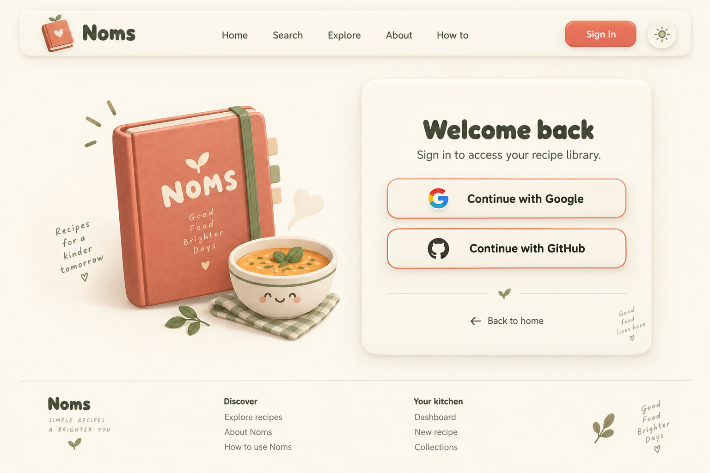
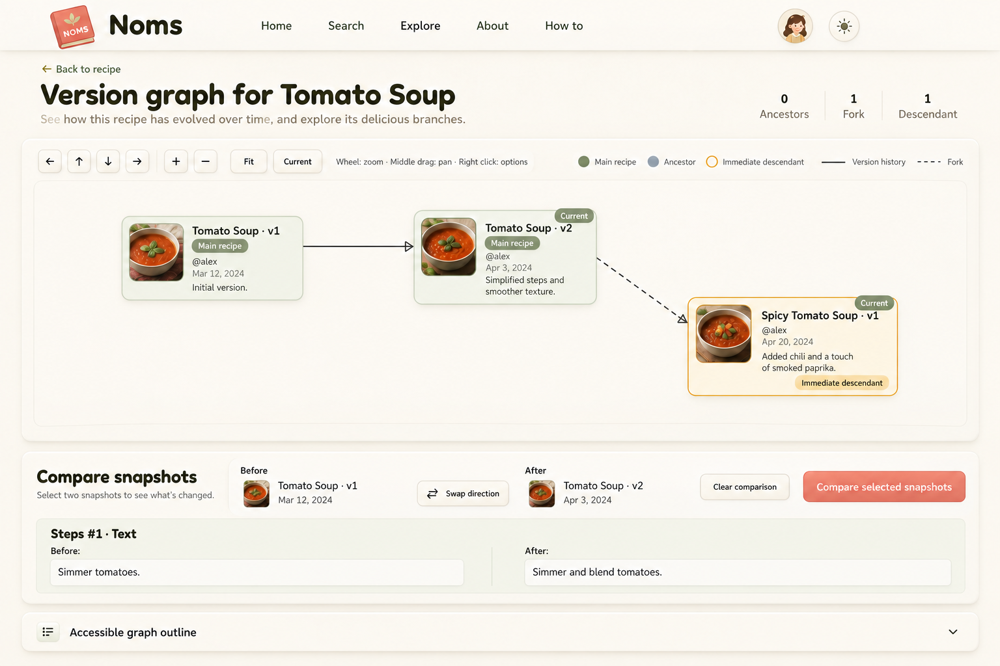

# Dashboard, Explore, sign-in and graph — browser audit and revised proposals

2026-09-15. Planning only. No application code changed. None of these four directions has been selected by the user.

## Evidence and scope

Restarted the existing isolated `noms-noms020-image-audit` Docker deployment at http://127.0.0.1:32773. Source reviewed on main at `ce080b4` (with existing unrelated working-tree changes preserved). Used the browser, not just source inspection.

- Sign-in: inspected signed-out layout, Google/GitHub links, shared navigation and footer; completed mock Google login into Dashboard. Visiting /login while authenticated redirected to Dashboard.
- Dashboard: observed initial loading, empty library, populated draft plus published recipe, and populated published-only state. Draft card showed private/autosaved explanation, revision, and fork source. Shared sidebar opened successfully.
- Explore: observed no-public-content, live-search loading, no-match message, populated cards and tag click. Actual cards contain author, image/fallback, title and description; star/bookmark controls are disabled placeholders, not working features.
- Graph: published a local recipe with two versions and a fork; inspected the actual solid version edge and dashed fork edge, current labels on both recipes, counts, snapshot context menu and background navigation menu. Selected Before v1 and After v2, ran comparison, observed Steps #1 · Text result; expanded the accessible outline and read the relationship text.

Local fixtures retained for repeatable testing: **Audit Tomato Soup** (two published snapshots, id `1c570426-0d3b-4296-b0d8-4cab4010ce84`) and **Audit Spicy Tomato Soup** (fork from source v2, id `a7f25599-6e5e-4839-b311-df884f42bb12`). These are public only inside the loopback test deployment; no external publication. The fork was inspected as a draft before publishing.

Saved baseline screenshots: [Dashboard](old-designs/audit-dashboard-current-v1.png), [Explore](old-designs/audit-explore-current-v1.png), [version graph](old-designs/audit-graph-current-v1.png). Sign-in and intermediate draft/empty/comparison states were visually inspected inline but not saved as separate files.

### Audit limits

Not a complete regression or accessibility test. Dense graphs, Show next 5 expansion, cross-recipe comparison, auth cancellation/failure, forced network errors, populated collection tree and multi-page loading were source-reviewed where relevant but not exercised end-to-end. Mobile/tablet remain deferred. Do not label these states browser-verified.

## What changes in the proposals

| Page | Keep | Correct or retain explicitly |
| --- | --- | --- |
| Dashboard D1 | Raised draft workspace, separate recipe cards, compact collection area | My Recipes/New Recipe; private draft revision and fork source; published does not mean public; preserve collection nesting, counts and creation actions from CollectionSidebar; no invented sort or card menus |
| Explore X2 | Sage search area and photo-led neumo cards | Explore active navigation; live recipe search, not Search-page scopes; one active tag state; author/title/description and no-photo fallback; no invented ratings or enabled bookmarks |
| Sign-in L2 | Cozy book illustration beside raised provider card | Equal Google/GitHub prominence, Back to home, shared public links/footer, no Home active highlight; preserve return destination and authenticated redirect; no new auth methods |
| Graph G1 | Calm inset canvas and compact raised cards | Full pan/zoom/Fit/Current toolbar, counts, direct snapshot links, context menus, exact fork endpoints, ordered Before/After selection with Swap/Clear/Compare, readonly results, accessible outline |

The former persistent graph inspector would change the interaction contract. It is not part of this corrected baseline. G2 recipe lanes remain an optional layout exploration, and G3 must truly filter side branches according to existing lineage behavior, not merely fade them. No merges or private draft nodes.

### Existing functional caveats (not fixed here)

- **Explore tag selection is not connected to result filtering in this source revision.** `selected_tag` updates chip state, but `get_public_recipes(off, PAGE_SIZE, query)` does not receive the tag and `filtered_recipes` is an unchanged clone of loaded results. Browser tag click was exercised, but both fixtures share tags, so the source is the decisive evidence of the missing filter. The selected chip in the revised artwork illustrates intended UI state, not verified working filtering. Track behavior repair separately from visual implementation.
- Dashboard's Load more increases an offset and displays the returned page; it does not accumulate cards like Explore. Count text is currently conditional on offset > 0. Preserve this unless explicitly approving a pagination change; the board's 3-of-12 count is illustrative, not an exact first-page specification.
- CollectionSidebar supports recipe counts, nesting, new collection/subcollection access. The simplified revised artwork omits some actions and counts; it must not remove them from implementation.
- Existing disabled star/bookmark buttons must not become active features through visual work. Their final placeholder treatment needs a decision.
- Error/retry and auth feedback proposed in earlier briefs are requirements to resolve, not proof of existing rendered states.

## Revised examples

These correct the main composition/behavior mismatches while retaining the cozy neumo direction. Use the written contract above over incidental generated artwork.

### D1 — Kitchen Desk, audit revision



Draft revision/source and publication visibility copy corrected. **The right-hand empty-state card is a separate state study, not concurrent dashboard content.** Added woman/mug, slogans and decorative handwriting are generator embellishments, not approved brand assets or copy. Keep them out of the implementation baseline.

### X2 — Sage Discovery Shelf, audit revision



Recipe-search placeholder, single active chip, correct active nav and supported card content. Bottom empty-state examples are mutually exclusive alternatives to results, not live panels beneath results. Tag filtering caveat above applies. Decorative person/slogans are optional exploration, not new branding.

### L2 — Cozy Welcome, audit revision



Equal provider buttons and restrained functional content retained. Illustration is still larger than the brief's modest treatment; scale it down if needed. Generated book logos, provider marks and slogans are not production assets. Reuse approved A3 and official provider assets, and existing app copy.

### G1 — Soft Lineage Canvas, corrected audit revision



Correct version/fork endpoints, both main-recipe nodes sage, current status on each recipe's latest snapshot, counts, navigation, ordered comparison and accessible outline. No persistent inspector or dropdown selection invented. Comparison result boxes are readonly content, not editable inputs. Snapshot menus, background lineage toggle and expansion/status regions remain required even though not all are open in this composition. Preserve visible Before/After selection markers on graph nodes during implementation.

The intermediate [G1 v2](page-study-g1-audit-v2.png) is superseded: it incorrectly colored the main recipe's v1 as an ancestor and drew dropdown chevrons on readonly comparison summaries. v3 fixes those points. Sample dates/change descriptions are illustrative, not fixture output.

## Generation provenance and review

Built-in image-generation mode via imagegen skill; no fallback CLI. Four new page mockups, followed by one targeted graph correction. Exact typography and approved logo fidelity still require implementation assets; imagegen approximations are not font/logo files. Existing v1 assets were preserved.

### Prompt set

#### D1

```text
Use case: ui-mockup. Create one polished desktop NOMS application page design, not a moodboard. Cozy cute grown-up recipe journal character, warm ivory background, soft raised neumorphic cream cards, inset inputs, sage olive accents and restrained muted coral primary buttons. Fredoka rounded display headings, Nunito body text. Fine borders and readable dark olive text; minimal texture, no photoreal props outside food thumbnails. Wide 1536x1024 composition. Shared rounded floating navigation: small tilted closed coral recipe book logo with cream NOMS label, Noms wordmark, Home, Search, Explore, About, How to, account avatar and theme button (sign-in page uses Sign In instead of avatar). Do not invent ratings, save/bookmark actions, sort menus or extra features. D1 revised — Kitchen Desk. Main heading My Recipes with New Recipe coral button. Two columns: main 75%, compact collection tree panel 25% with Collections link, nested Weeknight meals > Soups, Baking links, not album counts. Raised Drafts section with exact subtitle Private work in progress · autosaved. Two compact clickable draft rows: Spicy tomato soup, Forked from Tomato soup, Revision 1; Lemon cake, Revision 3. No ellipsis actions. Below separate Published recipes section, subtitle Visibility is set per recipe. Three raised cards with author @alex, food photo or graceful no-photo book placeholder, title and short description. No metadata unsupported by actual cards. Bottom Load more and Showing 3 of 12 recipes. No wrong public visibility claim. Small clearly separate first-use state inset bottom: No recipes yet / Create your first recipe. Preserve clear recipe title hierarchy and cozy neumo.
```

#### X2

```text
Use case: ui-mockup. Create one polished desktop NOMS application page design, not a moodboard. Cozy cute grown-up recipe journal character, warm ivory background, soft raised neumorphic cream cards, inset inputs, sage olive accents and restrained muted coral primary buttons. Fredoka rounded display headings, Nunito body text. Fine borders and readable dark olive text; minimal texture, no photoreal props outside food thumbnails. Wide 1536x1024 composition. Shared rounded floating navigation: small tilted closed coral recipe book logo with cream NOMS label, Noms wordmark, Home, Search, Explore, About, How to, account avatar and theme button (sign-in page uses Sign In instead of avatar). Do not invent ratings, save/bookmark actions, sort menus or extra features. X2 revised — Sage Discovery Shelf. Highlight Explore navigation only. Main heading Explore in sage header band, subtitle Public recipes from the community. Inset search field placeholder Search recipes... with NO submit button: live search. Tag chips soup (only selected, coral inset with check), vegetarian, baking (unselected cream raised). Three large raised recipe cards below, each author avatar @alex top, food image, name and one-line description below. Names Tomato soup, Lentil soup, Roast vegetable soup. No ratings, timing, tags on cards, save buttons or favorite controls. Bottom centered Load more. At very bottom separate small state examples labelled No public recipes: No recipes yet / Public recipes will appear here as users share them with the community. And No search matches: No recipes found / Try a different search term. Lots of warmth but compact header.
```

#### L2

```text
Use case: ui-mockup. Create one polished desktop NOMS application page design, not a moodboard. Cozy cute grown-up recipe journal character, warm ivory background, soft raised neumorphic cream cards, inset inputs, sage olive accents and restrained muted coral primary buttons. Fredoka rounded display headings, Nunito body text. Fine borders and readable dark olive text; minimal texture, no photoreal props outside food thumbnails. Wide 1536x1024 composition. Shared rounded floating navigation: small tilted closed coral recipe book logo with cream NOMS label, Noms wordmark, Home, Search, Explore, About, How to, account avatar and theme button (sign-in page uses Sign In instead of avatar). Do not invent ratings, save/bookmark actions, sort menus or extra features. L2 revised — Cozy Welcome. No Home active highlight; Sign In is active. Centered broad two-column welcome composition, left a modest cute stylized closed recipe book and a little soup bowl illustration, NOT photography, NOT a large marketing slogan. Right raised cream card: Welcome back / Sign in to access your recipe library. Two equally prominent full-width cream raised buttons with coral outlines: Continue with Google / Continue with GitHub. No passwords, email registration, consent, security claims or spurious ticket IDs. Back to home link below. Small quiet footer Noms / Discover: Explore recipes, About Noms, How to use Noms / Your kitchen: Dashboard, New recipe, Collections. Focus on simplicity and original cute neumo character.
```

#### G1

```text
Use case: ui-mockup. Create one polished desktop NOMS application page design, not a moodboard. Cozy cute grown-up recipe journal character, warm ivory background, soft raised neumorphic cream cards, inset inputs, sage olive accents and restrained muted coral primary buttons. Fredoka rounded display headings, Nunito body text. Fine borders and readable dark olive text; minimal texture, no photoreal props outside food thumbnails. Wide 1536x1024 composition. Shared rounded floating navigation: small tilted closed coral recipe book logo with cream NOMS label, Noms wordmark, Home, Search, Explore, About, How to, account avatar and theme button (sign-in page uses Sign In instead of avatar). Do not invent ratings, save/bookmark actions, sort menus or extra features. G1 revised — Soft Lineage Canvas. Heading Version graph for Tomato Soup, Back to recipe link. Small counts 0 Ancestors / 1 Fork / 1 Descendant. Compact toolbar with four arrow pan buttons, +, −, Fit, Current. Mouse instruction Wheel: zoom · Middle drag: pan · Right click: options. Legend Main recipe (sage), Ancestor (muted blue), Immediate descendant (ochre outline), solid Version history, dashed Fork. Inset graph canvas spanning full width, NO persistent inspector. Exactly THREE nodes: Tomato Soup v1 at left, Tomato Soup v2 at center with Current badge; solid directional connector v1 to v2. Spicy Tomato Soup v1 lower-right with Current badge and Immediate descendant label; a dashed fork connector FROM Tomato Soup v2 TO Spicy Tomato Soup v1. Compact node food thumbnail, @alex, publication date, change summary. Below canvas separate raised Compare snapshots panel with exact ordered Before Tomato Soup · v1 and After Tomato Soup · v2, Swap direction, Clear comparison, coral Compare selected snapshots button. Small comparison result Steps #1 · Text / Before: Simmer tomatoes. / After: Simmer and blend tomatoes. Below visible collapsed Accessible graph outline. No A/B semantics, no merges, no draft nodes, no selected inspector. Add small visual hint Right-click a snapshot for actions. Only 3 nodes, exact connector topology.
```

#### G1 targeted edit

Input: page-study-g1-audit-v2.png (edit target).

```text
Edit this NOMS graph UI mockup with only these corrections; preserve layout, typography, three-node topology, all core controls and cozy cream neumo appearance. Tomato Soup v1 must be SAGE GREEN like Tomato Soup v2, since both belong to the Main recipe, and add a small Main recipe label on BOTH. Keep Spicy Tomato Soup v1 ochre Immediate descendant and keep Current on both recipes' latest versions. Before and After are READ-ONLY selection summaries, NOT dropdown inputs: remove their downward chevrons and input styling, use calm text blocks. Comparison result Before/After is read-only prose, not editable text boxes. Remove all decorative handwritten slogans and sprigs within the graph canvas and header. Nothing else. The solid v1->v2 edge and dashed v2->Spicy v1 edge must remain exactly intact.
```
