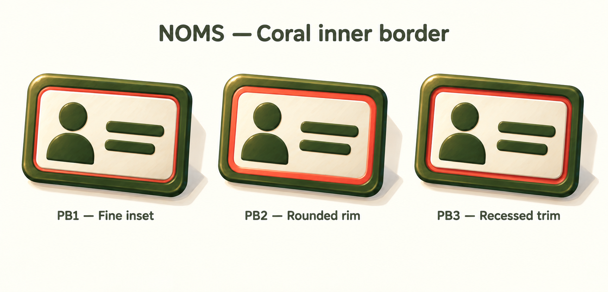

# Profile coral inner border — PB1–PB3

Generated 2026-09-18 using the built-in image generator (imagegen skill).
**PB2 — Rounded rim selected 2026-09-18** as the Profile icon direction (center in the sheet), refining the earlier PR2A preference. PB1, PB3 and the earlier scattered-accent variants remain intermediate explorations.

Preserve PB2's continuous, medium-width coral inner rim, rounded olive outer frame, cream face, olive portrait silhouette and two information strokes, gentle tilt and painted dimensional finish. No separate coral tabs, ribbons or corner decorations. This selection does not change the Profile page layout; standalone production assets, small-size testing and integration remain pending.

Replaces scattered coral tabs and ribbons with a continuous inner border. Preserves the olive outer frame, cream face, silhouette, information strokes and painted dimensional finish.

- PB1: fine inset, the most restrained accent.
- PB2: wider rounded rim, strongest coral presence.
- PB3: recessed trim, more depth around the cream face.

Reference: `profile-pr2a-refinements-v2.png`.
Review: all three have continuous coral borders with no separate coral decorations. Production exports and small-size testing remain pending.

## Generation prompt

Use case: precise-object-edit. Create one comparison sheet refining the attached NOMS profile identity-card icon reference. Show three large landscape identity cards in a clean horizontal row on warm ivory, labelled PB1 — Fine inset, PB2 — Rounded rim, PB3 — Recessed trim. Preserve the reference's olive rounded outer frame, cream face, olive generic head-and-shoulders silhouette on left and two olive information strokes on right, gentle clockwise tilt, visible right/bottom thickness, painterly matte surfaces, crisp warm upper-left light and soft shadow. PRIMARY CHANGE: remove ALL scattered coral tabs, ribbons, badges, corner wraps and side strips. Instead place a single continuous coral-red rounded rectangular inner border around all four sides of the cream face, BETWEEN the cream face and the olive outer frame. Border must form a complete uninterrupted loop including rounded corners. Coral exists ONLY in this inner border. PB1 has a fine coral inset keyline, PB2 a medium-width softly rounded coral rim, PB3 a coral groove recessed into the inner edge. Same card proportions, angle, internal layout and scale for all three for useful comparison. Keep generous cream face space, legible simple silhouette, subtle broad brushwork, dimensional but not glossy plastic. No extra props, no personal details, no decorative marks. Heading: NOMS — Coral inner border.
