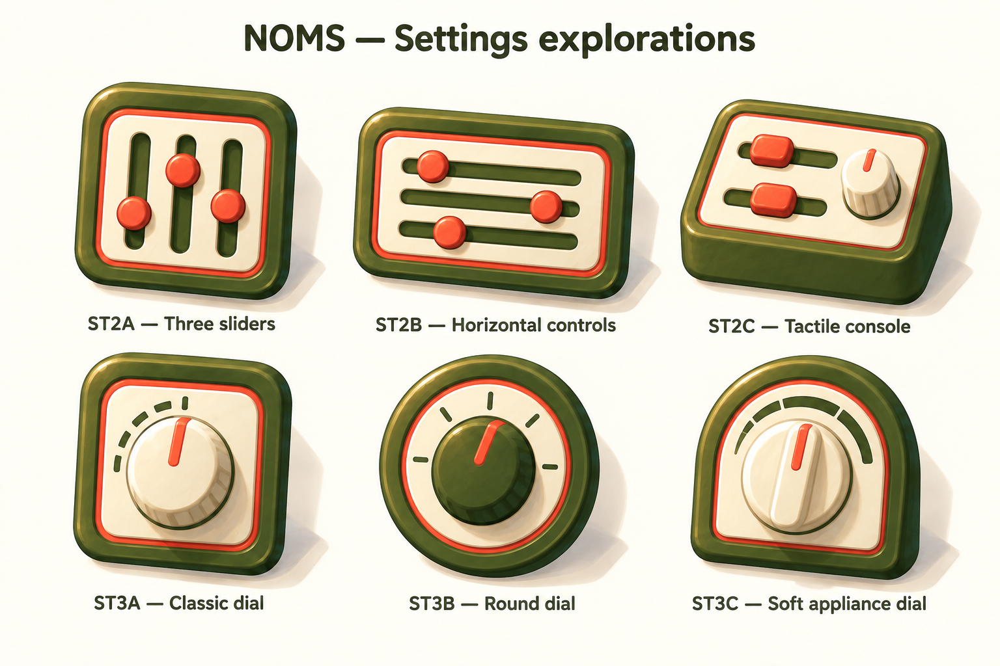

# Settings — control panels and adjustment dials

Generated 2026-09-18 with the built-in image generator using the imagegen skill. Exploration only; no selected variant, production assets or integration.

## Directions

- ST2A — Three sliders: compact upright control panel.
- ST2B — Horizontal controls: landscape slider panel.
- ST2C — Tactile console: sloping panel combining sliders and a rotary knob.
- ST3A — Classic dial: cream rotary knob in a rounded square housing.
- ST3B — Round dial: olive knob in a circular enclosure.
- ST3C — Soft appliance dial: cream grip in an arched housing.

Style reference: selected Profile PB2 in `profile-coral-inner-border-v3.png`. Retains olive/cream/coral, gentle perspective, painted surfaces and sculpted lighting. Output also carries the reference's coral inset trim throughout; this is exploratory, not a new requirement for every icon.

Review: all six concepts are legible at presentation scale. ST2A has the clearest settings metaphor; ST3C has a distinctive cozy appliance character. Small-size simplification remains untested. These are page-icon proposals, not functional Settings page layouts.

## Generation prompt

Use case: stylized-concept. Generate a single cohesive NOMS settings icon exploration board, 3 columns by 2 rows, six large painted dimensional icon concepts on warm ivory with ample spacing. Reference image is STYLE AND PALETTE ONLY: keep its rounded olive housings, cream inset surfaces, coral accents, gentle tilt, broad restrained matte brushwork, bevels, warm crisp upper-left lighting and soft shadows. Do not reproduce the identity portrait. Top row explore CONTROL PANELS: ST2A — Three sliders: compact rounded square olive housing, cream face, three vertical recessed olive tracks with coral rounded knobs at staggered heights; ST2B — Horizontal controls: landscape olive housing, cream inset, three horizontal olive slider grooves with coral circular knobs at different positions; ST2C — Tactile console: squat olive control block, cream sloping top, two coral slider knobs plus one small cream rotary knob with coral pointer. Bottom row explore ADJUSTMENT DIALS: ST3A — Classic dial: rounded square olive housing, cream face, one large cream rotary knob with a coral indicator stripe and sparse olive arc ticks; ST3B — Round dial: circular olive enclosure, cream inner ring with sparse tick marks, olive central rotary knob and one coral pointer stripe; ST3C — Soft appliance dial: softly arched olive housing, cream inset and broad cream rotary grip with coral indicator, simple olive arc markings. Dials MUST be single rotary controls not clocks, no clock hands, no compass needles or cardinal letters, no hanging loops. Keep coral intentional and functional on adjustment handles/indicators, not scattered decorative tabs or patches. No gears, no books, no portrait icons, no extra props, no tiny text, no metallic chrome, no glossy plastic. All icons same visual weight and mild three-quarter viewing angle, cozy tactile stylized illustration suitable as a page-header emblem. Labels below each exactly as specified, heading 'NOMS — Settings explorations'.
