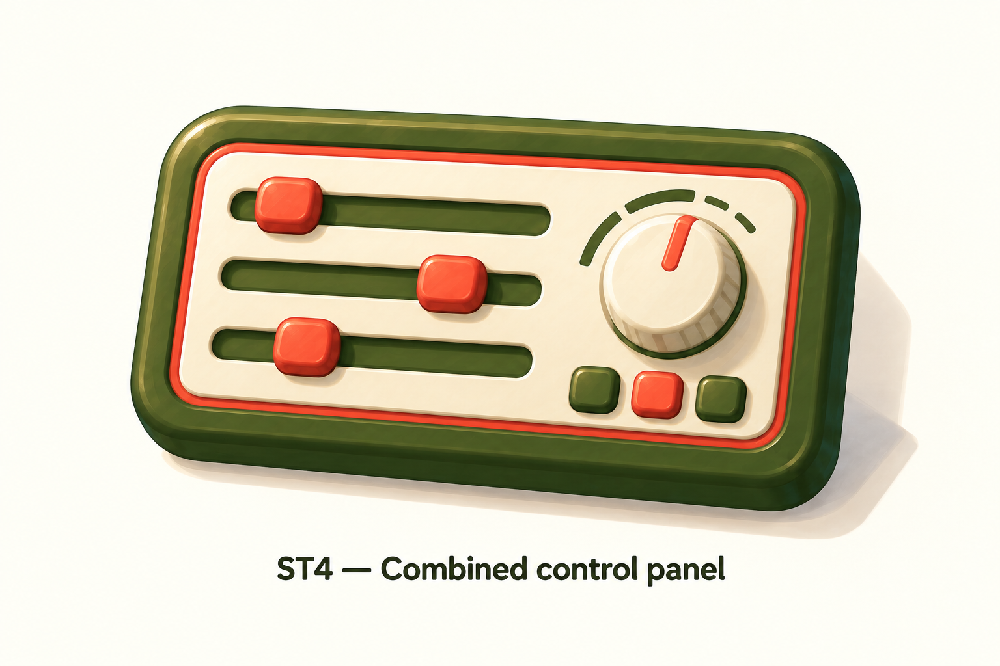

# ST4 — Combined control panel

Generated 2026-09-18 using the built-in image generator and imagegen skill. Proposal only; user selection pending.

Combines three horizontal sliders on the left, one rotary knob on the right and three buttons beneath it. Retains the olive housing, cream face, coral inner rim, gentle perspective and painted dimensional finish.

Reference: `settings-controls-dials-v1.png`, especially ST2B and ST2C.

Review: output contains the requested three horizontal sliders, one knob and additional buttons with clear separation. Detailed page illustration only; small-size simplification, production exports and integration remain pending.

## Generation prompt

Use case: stylized-concept. Create one polished NOMS Settings page-icon proposal labelled 'ST4 — Combined control panel' below the object on a warm ivory background. Use the attached settings sheet as style and material reference, especially ST2B horizontal controls and ST2C tactile console. One single landscape rounded olive control console with a cream inset face, continuous restrained coral inner border, slightly sloping face and gently tilted three-quarter view showing right and bottom thickness. Layout: LEFT two-thirds contains EXACTLY THREE horizontal recessed olive slider tracks stacked vertically with three chunky coral slider handles at different positions. RIGHT third contains ONE large cream rotary knob with shallow side ridges, one coral indicator stripe and a few sparse olive arc ticks. BELOW the knob a neat row of THREE small rounded-square push buttons, two olive and one coral. Each control separate with generous breathing room; no overlapping or extra tracks. Cute tactile painted dimensional style, rounded bevels, subtle broad brush texture, smooth matte surfaces, crisp warm upper-left light and soft olive shading matching reference. Icon remains visually simple and cohesive, not a complex real mixing desk. No display screens, no text on the device, no wires, no screws, no decorative tabs, no clock hands. Large centered isolated object and clear readable label, no comparison sheet.
