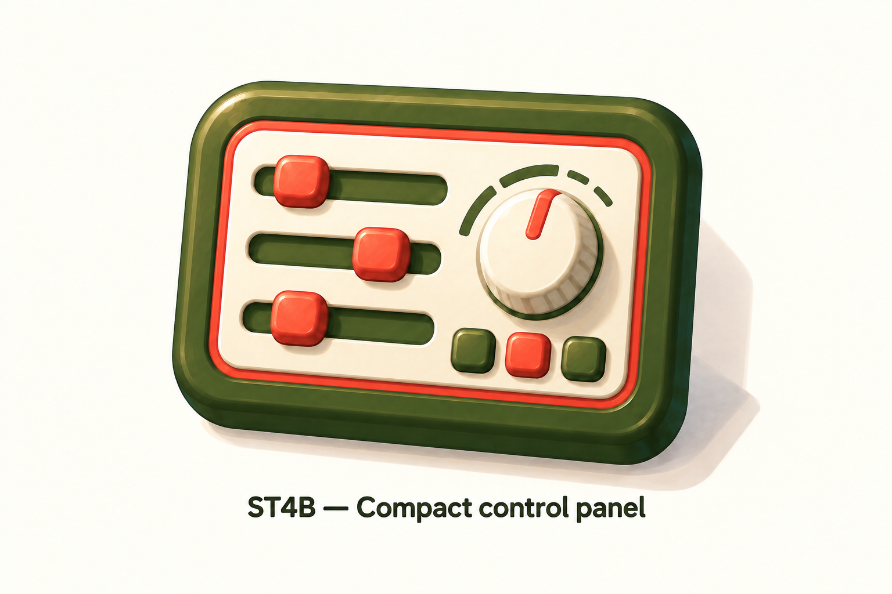

# ST4B — Compact control panel

Generated 2026-09-18 with the built-in image generator and imagegen skill. **Selected 2026-09-18 as the Settings icon direction.** ST4B supersedes the wider ST4 proposal; earlier panels and dials remain intermediate explorations.

Preserve the compact landscape proportions, three horizontal sliders, single rotary knob and three buttons, along with the olive/cream/coral palette and painted dimensional finish. This approval is for the page icon, not a change to the Settings page layout. Production assets and integration remain pending.

User-requested taller, narrower refinement of ST4. Retains three horizontal sliders, one rotary knob and three buttons, olive housing, cream face, coral inner rim and painted dimensional finish. Original ST4 remains preserved in `settings-st4-combined-v2.png`.

Review: visibly less elongated, controls remain separate with the requested counts. Production exports, small-size validation and integration remain pending.

## Generation prompt

Use case: precise-object-edit. Edit the attached ST4 NOMS combined control panel illustration. Change ONLY the housing proportions and necessary control spacing: make the panel about 12 percent narrower and 12 percent taller, still landscape but more compact and less elongated, approximate front-face width:height 1.5:1. Preserve exactly THREE horizontal olive slider grooves with coral rounded square handles on the left, ONE cream rotary knob with coral indicator on the upper right, and THREE buttons (olive, coral, olive) in a row beneath the knob. Shorten slider tracks to fit and increase vertical spacing slightly; do not stretch the round knob or distort controls. Preserve olive rounded housing, cream inset face, continuous coral inner rim, gentle three-quarter tilt, subtle painted texture, warm directional lighting, soft shadow and ivory background. No new objects or controls. One large centered icon, label below 'ST4B — Compact control panel'.
