# Dashboard, Explore, sign-in and graph examples

2026-09-15. Twelve desktop raster concepts generated with the built-in image tool from the [briefs](dashboard-explore-signin-graph-briefs-v1.md). None selected. Style reference: recipe-editor-e3t1-panels-v5.png. No application code changes.

## D1 — Kitchen Desk

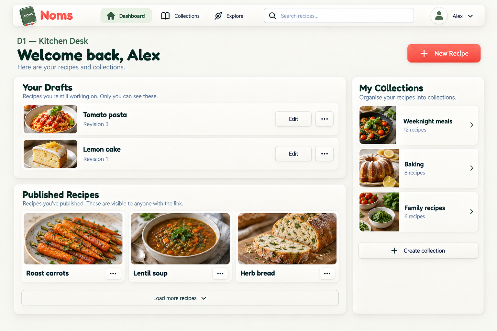

### Prompt

Use case: ui-mockup. One high-fidelity NOMS desktop UI design exploration, landscape. Reference image is STYLE ONLY: cozy cream, sage/olive, restrained coral, Fredoka rounded headings and Nunito body, gentle neumorphic raised cards and inset fields. Use small tilted olive NOMS book logo and floating cream horizontal navigation. Not a recipe editor. Print proposal ID/name clearly above screenshot. No invented metrics, ratings, AI, meal plans or social features. Legible realistic controls, spacious adult cozy aesthetic, no decorative clutter. D1 — Kitchen Desk. Authenticated nav Dashboard Collections Explore, inset Search recipes, Alex account. Dashboard My Recipes, coral New Recipe. Two private drafts Tomato pasta (Revision 3), Lemon cake (Revision 1), separate published recipes Roast carrots, Lentil soup, Herb bread. Collections Weeknight meals, Baking, Family recipes. No invented recency. Load more below published recipes. Raised draft panel above published grid, separate compact photo-album collection sidebar on right.

## D2 — Personal Recipe Albums

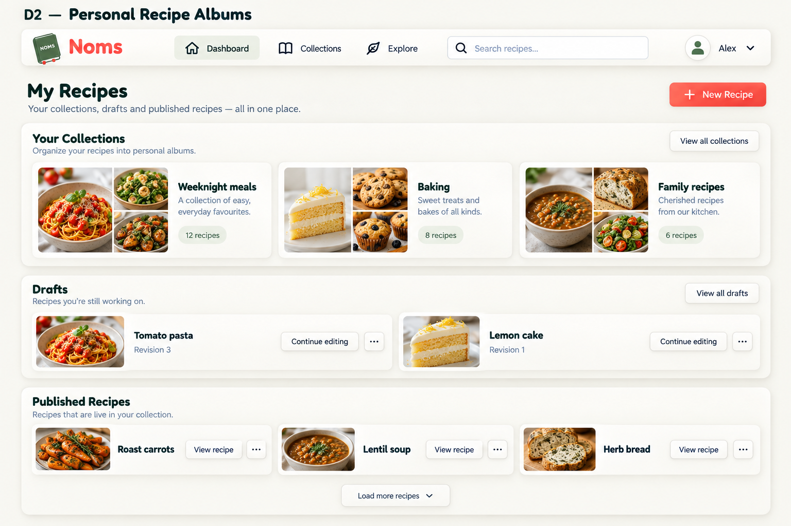

### Prompt

Use case: ui-mockup. One high-fidelity NOMS desktop UI design exploration, landscape. Reference image is STYLE ONLY: cozy cream, sage/olive, restrained coral, Fredoka rounded headings and Nunito body, gentle neumorphic raised cards and inset fields. Use small tilted olive NOMS book logo and floating cream horizontal navigation. Not a recipe editor. Print proposal ID/name clearly above screenshot. No invented metrics, ratings, AI, meal plans or social features. Legible realistic controls, spacious adult cozy aesthetic, no decorative clutter. D2 — Personal Recipe Albums. Authenticated nav Dashboard Collections Explore, inset Search recipes, Alex account. Dashboard My Recipes, coral New Recipe. Two private drafts Tomato pasta (Revision 3), Lemon cake (Revision 1), separate published recipes Roast carrots, Lentil soup, Herb bread. Collections Weeknight meals, Baking, Family recipes. No invented recency. Load more below published recipes. Three compact photo-collage collection album cards across top, then clearly separate draft grid and published recipe grid. No sidebar.

## D3 — Quiet Library

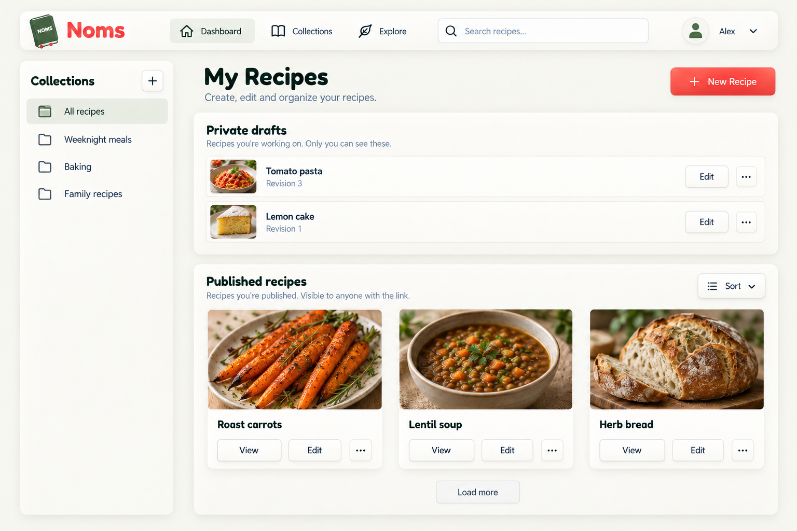

### Prompt

Use case: ui-mockup. One high-fidelity NOMS desktop UI design exploration, landscape. Reference image is STYLE ONLY: cozy cream, sage/olive, restrained coral, Fredoka rounded headings and Nunito body, gentle neumorphic raised cards and inset fields. Use small tilted olive NOMS book logo and floating cream horizontal navigation. Not a recipe editor. Print proposal ID/name clearly above screenshot. No invented metrics, ratings, AI, meal plans or social features. Legible realistic controls, spacious adult cozy aesthetic, no decorative clutter. D3 — Quiet Library. Authenticated nav Dashboard Collections Explore, inset Search recipes, Alex account. Dashboard My Recipes, coral New Recipe. Two private drafts Tomato pasta (Revision 3), Lemon cake (Revision 1), separate published recipes Roast carrots, Lentil soup, Herb bread. Collections Weeknight meals, Baking, Family recipes. No invented recency. Load more below published recipes. Narrow left collection text index; compact horizontal draft rows above generous published photo grid. Less decoration and tighter density.

## X1 — Community Recipe Album

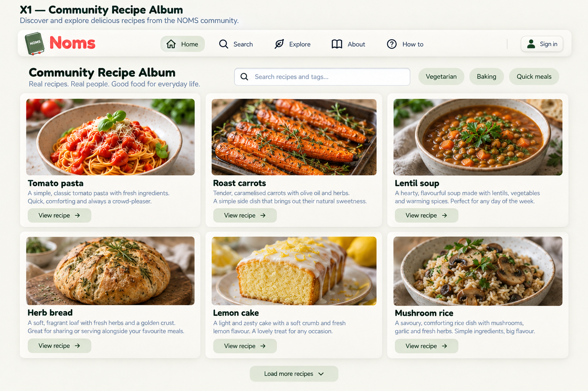

### Prompt

Use case: ui-mockup. One high-fidelity NOMS desktop UI design exploration, landscape. Reference image is STYLE ONLY: cozy cream, sage/olive, restrained coral, Fredoka rounded headings and Nunito body, gentle neumorphic raised cards and inset fields. Use small tilted olive NOMS book logo and floating cream horizontal navigation. Not a recipe editor. Print proposal ID/name clearly above screenshot. No invented metrics, ratings, AI, meal plans or social features. Legible realistic controls, spacious adult cozy aesthetic, no decorative clutter. X1 — Community Recipe Album. Explore public recipes only. Nav Home Search Explore About How to Sign in. Inset Search recipes and tags Vegetarian, Baking, Quick meals. Six photo recipes Tomato pasta, Roast carrots, Lentil soup, Herb bread, Lemon cake, Mushroom rice. Short descriptions, no ratings or trending labels. Load more. Compact heading/search/tag strip, three-column raised cream photo card grid, no hero.

## X2 — Sage Discovery Shelf

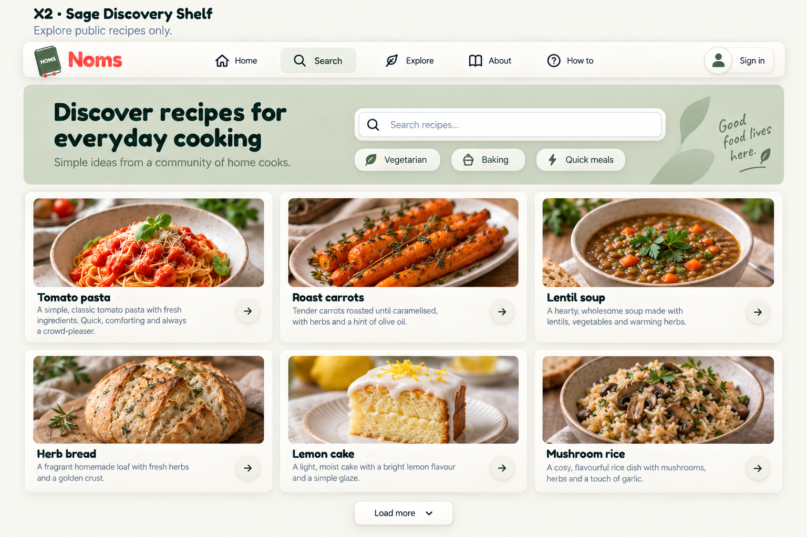

### Prompt

Use case: ui-mockup. One high-fidelity NOMS desktop UI design exploration, landscape. Reference image is STYLE ONLY: cozy cream, sage/olive, restrained coral, Fredoka rounded headings and Nunito body, gentle neumorphic raised cards and inset fields. Use small tilted olive NOMS book logo and floating cream horizontal navigation. Not a recipe editor. Print proposal ID/name clearly above screenshot. No invented metrics, ratings, AI, meal plans or social features. Legible realistic controls, spacious adult cozy aesthetic, no decorative clutter. X2 — Sage Discovery Shelf. Explore public recipes only. Nav Home Search Explore About How to Sign in. Inset Search recipes and tags Vegetarian, Baking, Quick meals. Six photo recipes Tomato pasta, Roast carrots, Lentil soup, Herb bread, Lemon cake, Mushroom rice. Short descriptions, no ratings or trending labels. Load more. Broad muted sage header band holds heading and search/tag strip, cream photo cards below in three columns.

## X3 — Quiet Recipe Index

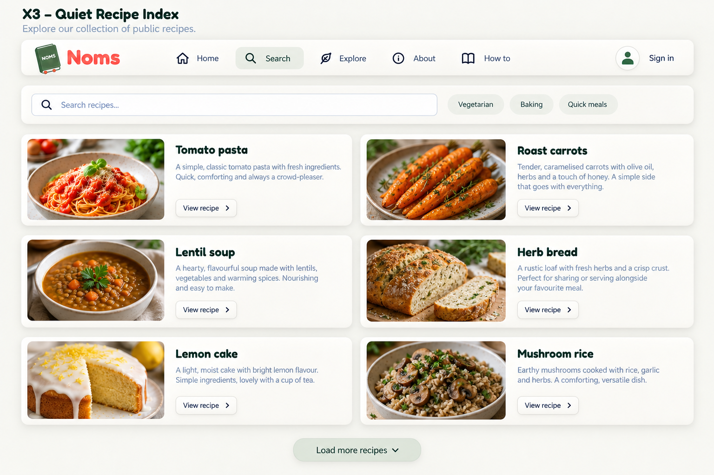

### Prompt

Use case: ui-mockup. One high-fidelity NOMS desktop UI design exploration, landscape. Reference image is STYLE ONLY: cozy cream, sage/olive, restrained coral, Fredoka rounded headings and Nunito body, gentle neumorphic raised cards and inset fields. Use small tilted olive NOMS book logo and floating cream horizontal navigation. Not a recipe editor. Print proposal ID/name clearly above screenshot. No invented metrics, ratings, AI, meal plans or social features. Legible realistic controls, spacious adult cozy aesthetic, no decorative clutter. X3 — Quiet Recipe Index. Explore public recipes only. Nav Home Search Explore About How to Sign in. Inset Search recipes and tags Vegetarian, Baking, Quick meals. Six photo recipes Tomato pasta, Roast carrots, Lentil soup, Herb bread, Lemon cake, Mushroom rice. Short descriptions, no ratings or trending labels. Load more. Compact search/tag header above wide horizontal image-and-description rows, two columns of horizontal cards, more text less photo area.

## L1 — Welcome Bookplate

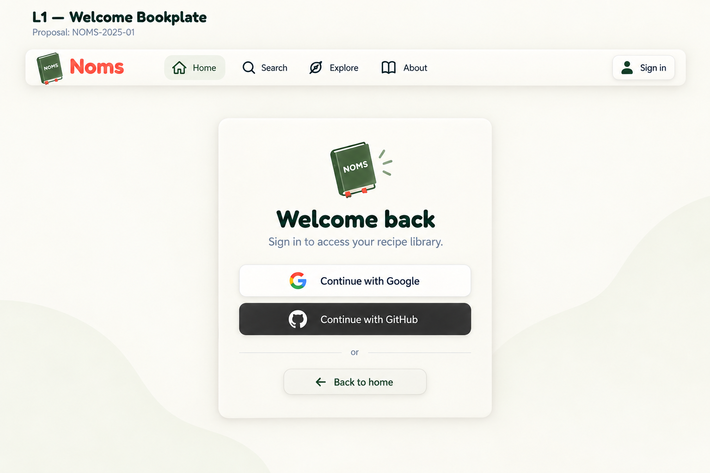

### Prompt

Use case: ui-mockup. One high-fidelity NOMS desktop UI design exploration, landscape. Reference image is STYLE ONLY: cozy cream, sage/olive, restrained coral, Fredoka rounded headings and Nunito body, gentle neumorphic raised cards and inset fields. Use small tilted olive NOMS book logo and floating cream horizontal navigation. Not a recipe editor. Print proposal ID/name clearly above screenshot. No invented metrics, ratings, AI, meal plans or social features. Legible realistic controls, spacious adult cozy aesthetic, no decorative clutter. L1 — Welcome Bookplate. Signed-out nav Home Search Explore About How to Sign in. Only two equal-prominence auth buttons Continue with Google and Continue with GitHub, Back to home. Welcome back, Sign in to access your recipe library. No password/email fields, no extra providers or invented legal text. Centered modest raised cream sign-in card with small book mark; quiet warm empty background.

## L2 — Cozy Kitchen Welcome

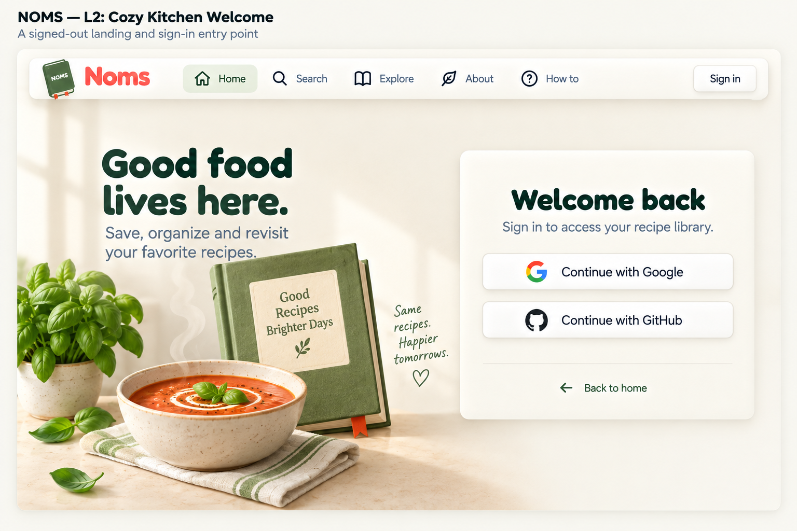

### Prompt

Use case: ui-mockup. One high-fidelity NOMS desktop UI design exploration, landscape. Reference image is STYLE ONLY: cozy cream, sage/olive, restrained coral, Fredoka rounded headings and Nunito body, gentle neumorphic raised cards and inset fields. Use small tilted olive NOMS book logo and floating cream horizontal navigation. Not a recipe editor. Print proposal ID/name clearly above screenshot. No invented metrics, ratings, AI, meal plans or social features. Legible realistic controls, spacious adult cozy aesthetic, no decorative clutter. L2 — Cozy Kitchen Welcome. Signed-out nav Home Search Explore About How to Sign in. Only two equal-prominence auth buttons Continue with Google and Continue with GitHub, Back to home. Welcome back, Sign in to access your recipe library. No password/email fields, no extra providers or invented legal text. Two-column central composition: charming restrained illustration of recipe book, soup bowl and herb on left; compact raised auth card right.

## L3 — Sage Welcome Panel

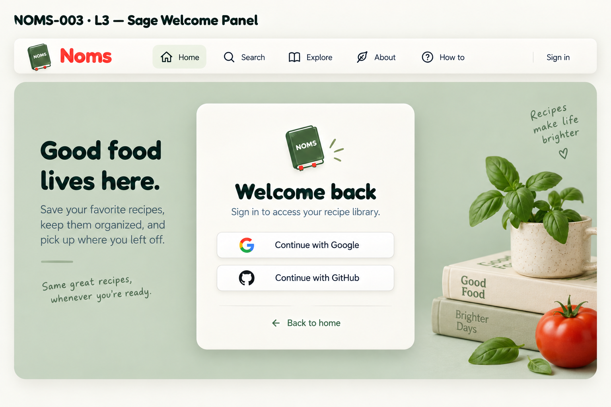

### Prompt

Use case: ui-mockup. One high-fidelity NOMS desktop UI design exploration, landscape. Reference image is STYLE ONLY: cozy cream, sage/olive, restrained coral, Fredoka rounded headings and Nunito body, gentle neumorphic raised cards and inset fields. Use small tilted olive NOMS book logo and floating cream horizontal navigation. Not a recipe editor. Print proposal ID/name clearly above screenshot. No invented metrics, ratings, AI, meal plans or social features. Legible realistic controls, spacious adult cozy aesthetic, no decorative clutter. L3 — Sage Welcome Panel. Signed-out nav Home Search Explore About How to Sign in. Only two equal-prominence auth buttons Continue with Google and Continue with GitHub, Back to home. Welcome back, Sign in to access your recipe library. No password/email fields, no extra providers or invented legal text. Broad rounded sage central backdrop with small subtle book motif, centered cream auth card inside, minimal illustration.

## G1 — Soft Lineage Canvas

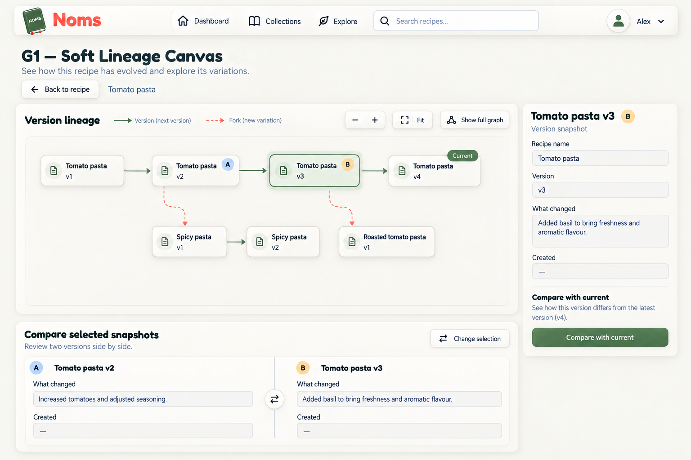

### Prompt

Use case: ui-mockup. One high-fidelity NOMS desktop UI design exploration, landscape. Reference image is STYLE ONLY: cozy cream, sage/olive, restrained coral, Fredoka rounded headings and Nunito body, gentle neumorphic raised cards and inset fields. Use small tilted olive NOMS book logo and floating cream horizontal navigation. Not a recipe editor. Print proposal ID/name clearly above screenshot. No invented metrics, ratings, AI, meal plans or social features. Legible realistic controls, spacious adult cozy aesthetic, no decorative clutter. G1 — Soft Lineage Canvas. Authenticated nav. Version graph for Tomato pasta, Back to recipe. Actual lineage: Tomato pasta v1 -> v2 -> v3 -> v4 Current; fork from Tomato pasta v2 -> Spicy pasta v1 -> v2; fork from Tomato pasta v3 -> Roasted tomato pasta v1. Distinct recipe names, no merges. Solid sage version edges, dashed coral fork edges and labelled legend. Selected Tomato pasta v3 with sage highlight, compare A v2 and B v3 marked separately. Zoom +/- Fit, Show full graph, detached details card showing v3 Added basil and Compare with current. Comparison area A v2 / B v3 and Compare selected snapshots. No private draft nodes. Preserve exact relationships, clear readable compact nodes; this is app mockup not standalone diagram. Wide inset cream spatial canvas with raised snapshot cards, main lineage horizontal and forks staggered below, right detached inspector.

## G2 — Recipe Family Lanes

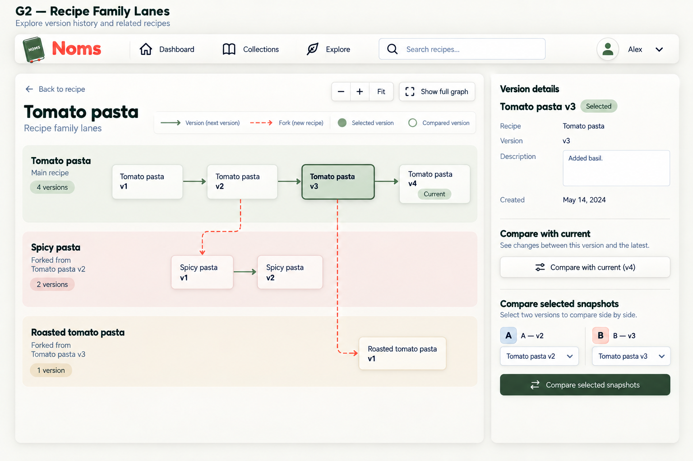

### Prompt

Use case: ui-mockup. One high-fidelity NOMS desktop UI design exploration, landscape. Reference image is STYLE ONLY: cozy cream, sage/olive, restrained coral, Fredoka rounded headings and Nunito body, gentle neumorphic raised cards and inset fields. Use small tilted olive NOMS book logo and floating cream horizontal navigation. Not a recipe editor. Print proposal ID/name clearly above screenshot. No invented metrics, ratings, AI, meal plans or social features. Legible realistic controls, spacious adult cozy aesthetic, no decorative clutter. G2 — Recipe Family Lanes. Authenticated nav. Version graph for Tomato pasta, Back to recipe. Actual lineage: Tomato pasta v1 -> v2 -> v3 -> v4 Current; fork from Tomato pasta v2 -> Spicy pasta v1 -> v2; fork from Tomato pasta v3 -> Roasted tomato pasta v1. Distinct recipe names, no merges. Solid sage version edges, dashed coral fork edges and labelled legend. Selected Tomato pasta v3 with sage highlight, compare A v2 and B v3 marked separately. Zoom +/- Fit, Show full graph, detached details card showing v3 Added basil and Compare with current. Comparison area A v2 / B v3 and Compare selected snapshots. No private draft nodes. Preserve exact relationships, clear readable compact nodes; this is app mockup not standalone diagram. Three softly separated horizontal lanes labelled by RECIPE, not author. Main recipe lane top, Spicy middle, Roasted bottom; cross-lane dashed fork connectors; compact inspector right.

## G3 — Guided Lineage Focus

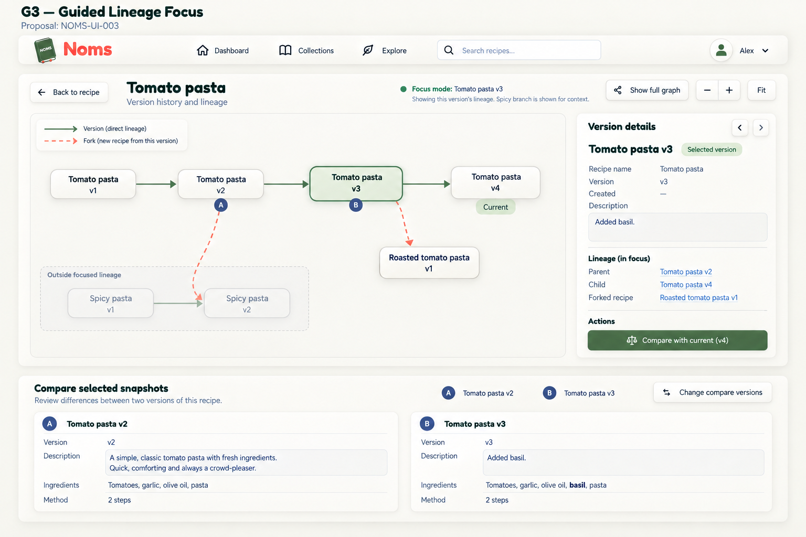

### Prompt

Use case: ui-mockup. One high-fidelity NOMS desktop UI design exploration, landscape. Reference image is STYLE ONLY: cozy cream, sage/olive, restrained coral, Fredoka rounded headings and Nunito body, gentle neumorphic raised cards and inset fields. Use small tilted olive NOMS book logo and floating cream horizontal navigation. Not a recipe editor. Print proposal ID/name clearly above screenshot. No invented metrics, ratings, AI, meal plans or social features. Legible realistic controls, spacious adult cozy aesthetic, no decorative clutter. G3 — Guided Lineage Focus. Authenticated nav. Version graph for Tomato pasta, Back to recipe. Actual lineage: Tomato pasta v1 -> v2 -> v3 -> v4 Current; fork from Tomato pasta v2 -> Spicy pasta v1 -> v2; fork from Tomato pasta v3 -> Roasted tomato pasta v1. Distinct recipe names, no merges. Solid sage version edges, dashed coral fork edges and labelled legend. Selected Tomato pasta v3 with sage highlight, compare A v2 and B v3 marked separately. Zoom +/- Fit, Show full graph, detached details card showing v3 Added basil and Compare with current. Comparison area A v2 / B v3 and Compare selected snapshots. No private draft nodes. Preserve exact relationships, clear readable compact nodes; this is app mockup not standalone diagram. Focus mode active on Tomato pasta v3: emphasize its ancestor v1/v2, descendant v4 and Roasted fork; Spicy branch muted contextual area labelled Outside focused lineage. Clear Show full graph control, inset canvas and right inspector. Never imply muted Spicy branch descends from v3.

## Review caveats

- D1 and D3 incorrectly state published recipes are visible to anyone with a link. Remove this: publication and visibility are independent, and published recipes may be private. D2's 'live in your collection' wording also needs clarification.
- D3 adds Sort; D2 adds View all drafts; menus/counts throughout are illustrative, not new feature commitments. D3 lacks its on-image proposal title; identify by its file/index.
- X1 highlights Home; X2/X3 highlight Search. All must highlight Explore. X1 tag-search placeholder and multi-chip selected appearance must not redefine current search/tag semantics. X2's handwritten slogan is optional decoration, not selected copy.
- Sign-in boards highlight Home incorrectly. L1 omits How to and weights GitHub more strongly; equal provider prominence remains the intent. L2/L3 use more photorealistic props and slogans than the restrained illustration brief; simplify if preferred. Spurious NOMS-2025-01/NOMS-003/NOMS-UI-003 board labels are generation artifacts, not ticket IDs.
- G1/G2 preserve the intended main and fork relationships. G3's dashed Spicy fork incorrectly terminates at v2 instead of v1: correct to Tomato pasta v2 -> Spicy pasta v1. Do not implement graph relationships from raster artwork.
- Graph details are read-only despite input-like wells. G1/G3 omit a distinct compare-selected submit control; retain actual comparison actions. G2 omits A/B markers on nodes. Blue/gold comparison markers are not selected tokens. Generated dates, change descriptions and differences are illustrative.
- G3's muted outside-lineage context is a visual proposal, not a claim about current filtering behavior. Preserve actual lineage/permission semantics, expansion controls and keyboard access. Dense/expanded, loading/error and empty states remain follow-up work.
- Actual Fredoka/Nunito, approved A3 and N1/N4 primitives replace approximations. These are composition options, not pixel-perfect or behavior specifications. Mobile/tablet deferred; dark mode and interaction refinements follow selections.
