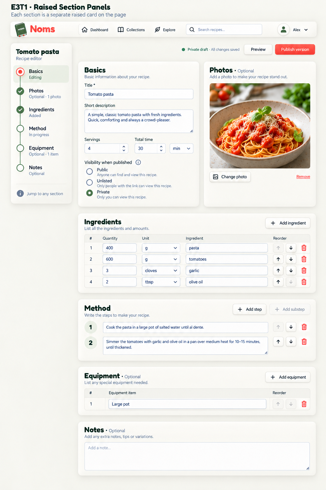

# E3T1 — Raised Section Panels

2026-09-13. Built-in image generation. User requested each editor section be its own raised panel, retaining the timeline and top photo. No application code changed.

## Review

**Preferred direction confirmed 2026-09-13.** The user accepted this composition and requested that it be documented. See the [canonical implementation plan](../../implementation-plans/NOMS-020-visual-design-refinement.md#preferred-recipe-editor-direction--e3t1-raised-section-panels) for the decision and remaining refinement scope. Earlier editor variants are retained as exploration history.

All six sections are distinct raised cards directly on the page background. Basics and Photos sit side by side; Ingredients, Method, Equipment and Notes stack below. Timeline retained. Visibility moved into Basics, since it governs the recipe rather than photos. Typography/logo are raster approximations. Generated first method field remains too shallow; preserve roomy growing textareas in implementation. Last method down arrow should be disabled when it is the final step. Status semantics, optional content and autosave must reflect actual application behavior; no new publishing gates implied. This is a full-page desktop concept, not a tablet proposal.

## Prompt

Use case: ui-mockup. Edit the provided NOMS editor reference into one high-fidelity full-page desktop mockup titled "E3T1 · Raised Section Panels". Preserve the cozy ivory/sage/coral palette, Fredoka-style rounded headings and Nunito body, shared horizontal nav, book logo, sidebar timeline, and top-down editor. KEY CHANGE: REMOVE the single giant raised wrapper around the form. Instead place every section in its OWN distinctly detached rounded cream neumorphic raised card directly on the warm background with clear 24px gutters and visible soft bottom-right shadow/top-left highlight. No shared white surface behind cards. Sidebar remains its own detached raised card. Basics and Photos are TWO separate raised panels side by side on top; Ingredients is its own full-width raised panel below; Method its own full-width raised panel below; Equipment its own full-width raised panel below; Notes its own full-width raised panel below. Use a tall FULL-PAGE desktop capture so all six panels appear at readable size, not a mobile layout. Desktop width about 1536 with tall canvas ~1800-2000. Main title and Preview / coral Publish version actions sit on FLAT background above panels, Private draft · All changes saved. Basics card includes Tomato pasta title, short description, servings4 time30min, Visibility when published Public/Unlisted/Private with Private selected (move visibility into Basics so it is not confused with photo privacy). Photos card includes large tomato pasta photograph, Photos · Optional, Change photo and Remove controls. Ingredients 4 quantity/unit/name rows 400g pasta,600g tomatoes,3 cloves garlic,2tbsp olive oil. Method 2 roomy multiline inset fields and Add step. Equipment optional with Large pot field; Notes optional with empty roomy textarea placeholder Add a note. Sidebar order Basics Photos Ingredients Method Equipment Notes; Basics coral active ring on inset sage highlight; Photos Optional · 1 photo; Ingredients Added; Method In progress; Equipment Optional · 1 item; Notes Optional. Thin subtle connected sage timeline nodes exactly like reference. Footer Jump to any section. All fields gently inset inside their individual raised cards. No accordion, no tabs, no wizard. Do not crop out lower panels. No heavy grain or toy-like inflated depth; subtle tactile warmth. Correct reorder endpoints disabled first-up last-down.
