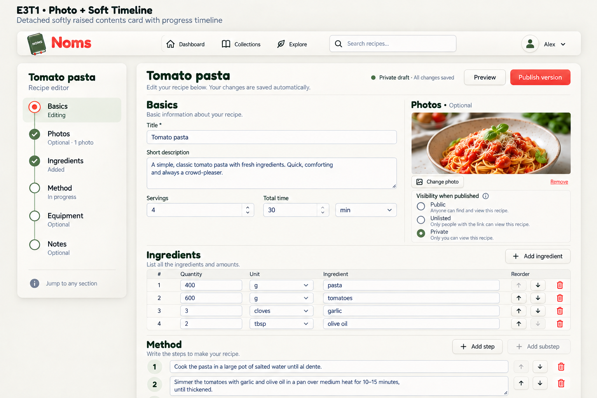

# E3T1 — Photo + Soft Timeline

2026-09-13. Generated with the built-in image tool. User prefers E3T1 and requested restoration of E3's top photo section. This example combines those directions; no app code changed.

## Review

Photo restored beside Basics; detached raised timeline retained; Photos moved second to reflect document order and explicitly optional. Inputs, visibility choices and continuous Ingredients/Method layout retained. Method fields should be roomier in implementation than this generated crop. Status semantics are illustrative and must match actual validation/persistence; completion is independent from active viewport section. Use actual Fredoka/Nunito fonts and approved A3 logo rather than raster approximations. No mandatory wizard or optional-section publishing gate.

## Prompt

Use case: ui-mockup. Generate one polished desktop NOMS recipe editor concept, labeled "E3T1 · Photo + Soft Timeline". Image 1 is primary style and sidebar reference; image 2 supplies the missing basics and image-section layout. Combine these carefully. Preserve image 1's detached raised cream neumorphic sidebar, thin connected sage timeline, understated coral active ring and inset sage active row, generous gutter, cozy ivory palette, Fredoka rounded display typography and Nunito body approximation, book logo and shared horizontal navigation. Main continuous top-down form now shown FROM THE TOP. Title Tomato pasta, status Private draft · All changes saved, Preview and Publish version at top. Top form area has Basics on left (Title Tomato pasta, Short description, Servings 4, Total time 30 min) and a substantial Photos section on right with appetizing tomato pasta photograph, label "Photos · Optional", Change photo button and Remove text action. Below photo include Visibility when published with Public, Unlisted, Private choices, Private selected. Ingredients full width below this top area: quantity/unit/ingredient columns with 400 g pasta, 600 g tomatoes, 3 cloves garlic, 2 tbsp olive oil. Below ingredients show Method heading and spacious multiline editable steps. Taller desktop canvas if needed so the photo, basics, ingredients and first two method fields are all legible; no bottom overlay. Sidebar order MUST be Basics, Photos, Ingredients, Method, Equipment, Notes to match content order, Basics active coral ring + sage inset and sublabel Editing; Photos sage check with sublabel Optional · 1 photo; Ingredients sage check with sublabel Added; Method hollow node with sublabel In progress; Equipment and Notes hollow nodes labeled Optional. Footer Jump to any section. No percent progress or mandatory wizard. Photo at TOP beside Basics is critical, not omitted or down below. No decorative props. Clear subtle borders and shadows, restrained neumorphism. Keep original E3T1 style not chunky E3T2 nodes. Reorder controls first-up disabled and last-down disabled. No arbitrary new features.
