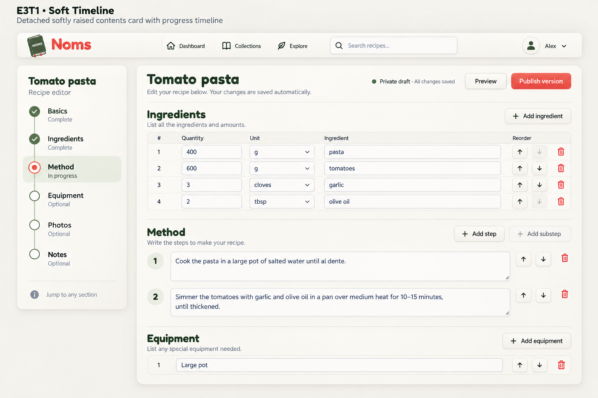
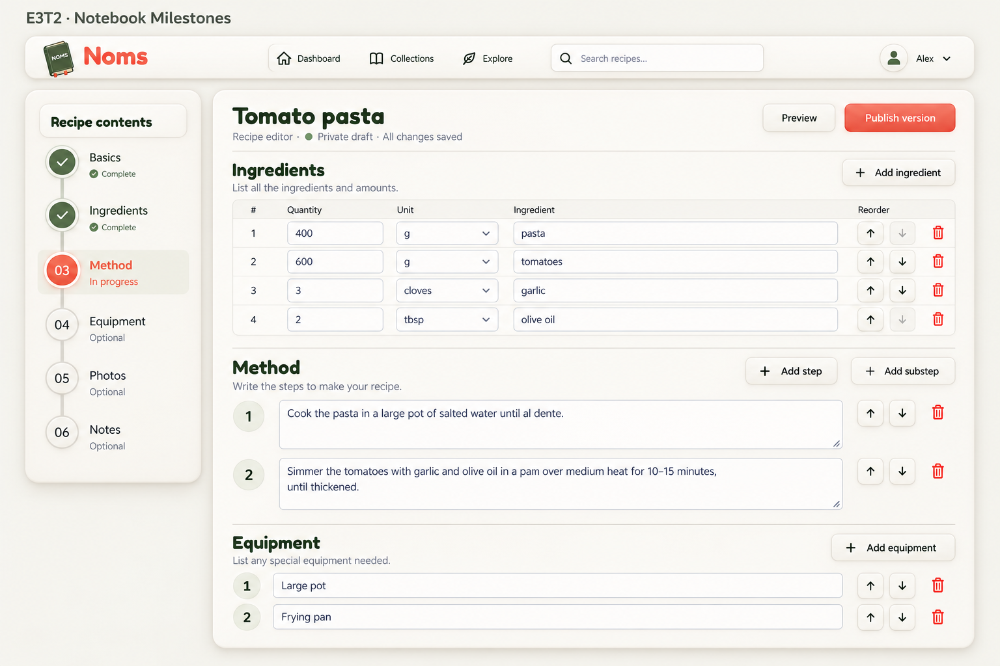
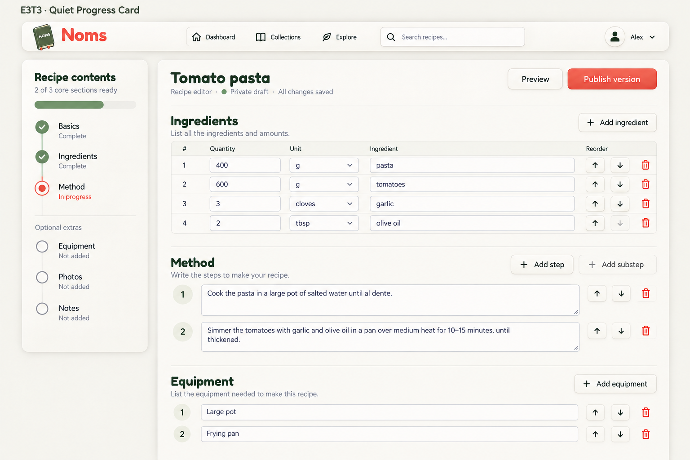

# Recipe editor — raised timeline sidebar

2026-09-13. Built-in image generation; desktop exploration only. Based on E3C and the user's preference for a detached neumorphic side panel with integrated section timeline/progress tracker. No individual variant selected. No application code changes.

## E3T1 · Soft Timeline

Detached softly raised cream contents card, clearly visible top-left highlight and bottom-right soft shadow. Thin vertical sage line joins small circular nodes. Basics and Ingredients have checkmarks with tiny 'Complete' labels. Method coral ring with center dot and inset sage active row, sublabel 'In progress'. Equipment, Photos, Notes hollow nodes and explicit 'Optional' labels. Footer small legend 'Jump to any section'. Most understated and balanced.

### Prompt

Use case: ui-mockup. Create a high-fidelity desktop NOMS recipe editor design exploration, landscape image. Input image is STYLE AND LAYOUT REFERENCE, not exact edit. Preserve cozy warm ivory, olive/sage, coral, rounded Fredoka-style headings and Nunito body, NOMS book logo, horizontal floating shared nav. Continuous top-down editing document to right of LOCAL sidebar, never wizard or separate tabs. Title Tomato pasta, Private draft · All changes saved, Preview and coral Publish version buttons at top. Frame main document scrolled to bottom of Ingredients then roomy Method fields, equipment below, so Method active makes sense. Show 400 g pasta,600 g tomatoes; method 1 Cook pasta in salted water. 2 Simmer tomatoes with garlic and olive oil. Large multiline inset fields, subtle borders, accessible dark labels. Sidebar is clearly physically detached from main form with spacious gutter and neumorphic raised light/shadow edges. No right inspector, no bottom overlay, no decorative props. Do not imply optional sections block publishing. One cohesive desktop screen, not multiple miniatures. Put proposal label at top outside app. Specific direction: E3T1 · Soft Timeline. Detached softly raised cream contents card, clearly visible top-left highlight and bottom-right soft shadow. Thin vertical sage line joins small circular nodes. Basics and Ingredients have checkmarks with tiny 'Complete' labels. Method coral ring with center dot and inset sage active row, sublabel 'In progress'. Equipment, Photos, Notes hollow nodes and explicit 'Optional' labels. Footer small legend 'Jump to any section'. Most understated and balanced.

## E3T2 · Notebook Milestones

Detached thicker pillowy cream panel with generous radius. Vertical recessed groove connects gently raised numbered circular badges 01–06. Adjacent text statuses, active Method coral badge and shallow sage inset row. Basics and Ingredients marked 'Complete', Method 'In progress'; other three 'Optional'. A small cream header inset reads 'Recipe contents'. Tactile notebook-like but not literal binder, more prominent physical depth.

### Prompt

Use case: ui-mockup. Create a high-fidelity desktop NOMS recipe editor design exploration, landscape image. Input image is STYLE AND LAYOUT REFERENCE, not exact edit. Preserve cozy warm ivory, olive/sage, coral, rounded Fredoka-style headings and Nunito body, NOMS book logo, horizontal floating shared nav. Continuous top-down editing document to right of LOCAL sidebar, never wizard or separate tabs. Title Tomato pasta, Private draft · All changes saved, Preview and coral Publish version buttons at top. Frame main document scrolled to bottom of Ingredients then roomy Method fields, equipment below, so Method active makes sense. Show 400 g pasta,600 g tomatoes; method 1 Cook pasta in salted water. 2 Simmer tomatoes with garlic and olive oil. Large multiline inset fields, subtle borders, accessible dark labels. Sidebar is clearly physically detached from main form with spacious gutter and neumorphic raised light/shadow edges. No right inspector, no bottom overlay, no decorative props. Do not imply optional sections block publishing. One cohesive desktop screen, not multiple miniatures. Put proposal label at top outside app. Specific direction: E3T2 · Notebook Milestones. Detached thicker pillowy cream panel with generous radius. Vertical recessed groove connects gently raised numbered circular badges 01–06. Adjacent text statuses, active Method coral badge and shallow sage inset row. Basics and Ingredients marked 'Complete', Method 'In progress'; other three 'Optional'. A small cream header inset reads 'Recipe contents'. Tactile notebook-like but not literal binder, more prominent physical depth.

## E3T3 · Quiet Progress Card

Detached raised cream sidebar with compact header 'Recipe contents' and small text '2 of 3 core sections ready' above a slim sage progress track. Below, elegant connected vertical timeline, completed checkmarks for Basics and Ingredients, coral active ring Method with 'In progress', optional Equipment Photos Notes grouped below under 'Optional extras' without progress requirement. The section tracker is clearly integrated into this one separate component. Softest low-noise treatment.

### Prompt

Use case: ui-mockup. Create a high-fidelity desktop NOMS recipe editor design exploration, landscape image. Input image is STYLE AND LAYOUT REFERENCE, not exact edit. Preserve cozy warm ivory, olive/sage, coral, rounded Fredoka-style headings and Nunito body, NOMS book logo, horizontal floating shared nav. Continuous top-down editing document to right of LOCAL sidebar, never wizard or separate tabs. Title Tomato pasta, Private draft · All changes saved, Preview and coral Publish version buttons at top. Frame main document scrolled to bottom of Ingredients then roomy Method fields, equipment below, so Method active makes sense. Show 400 g pasta,600 g tomatoes; method 1 Cook pasta in salted water. 2 Simmer tomatoes with garlic and olive oil. Large multiline inset fields, subtle borders, accessible dark labels. Sidebar is clearly physically detached from main form with spacious gutter and neumorphic raised light/shadow edges. No right inspector, no bottom overlay, no decorative props. Do not imply optional sections block publishing. One cohesive desktop screen, not multiple miniatures. Put proposal label at top outside app. Specific direction: E3T3 · Quiet Progress Card. Detached raised cream sidebar with compact header 'Recipe contents' and small text '2 of 3 core sections ready' above a slim sage progress track. Below, elegant connected vertical timeline, completed checkmarks for Basics and Ingredients, coral active ring Method with 'In progress', optional Equipment Photos Notes grouped below under 'Optional extras' without progress requirement. The section tracker is clearly integrated into this one separate component. Softest low-noise treatment.

## Review and implementation caveats

- E3T1 is the most restrained; E3T2 emphasizes raised tactile nodes; E3T3 adds an overall readiness summary.
- Completion semantics and required/core sections are proposals, not verified current validation requirements. Define these before implementation; never gate publishing on optional content.
- Active viewport section and completion status must remain independent; a completed section can be active.
- E3T3 incorrectly labels Equipment “Not added” despite populated equipment fields. Correct status to match content.
- Generated reorder buttons have incorrect disabled endpoints; first-up and last-down must be disabled. Add substep needs an explicit parent target.
- Autosave copy must reflect actual persisted state. Typography and logo are approximations; implement using actual Fredoka/Nunito and approved A3 logo.
- Maintain one continuous form and clickable anchor navigation, not a mandatory wizard. Mobile/tablet deferred.
