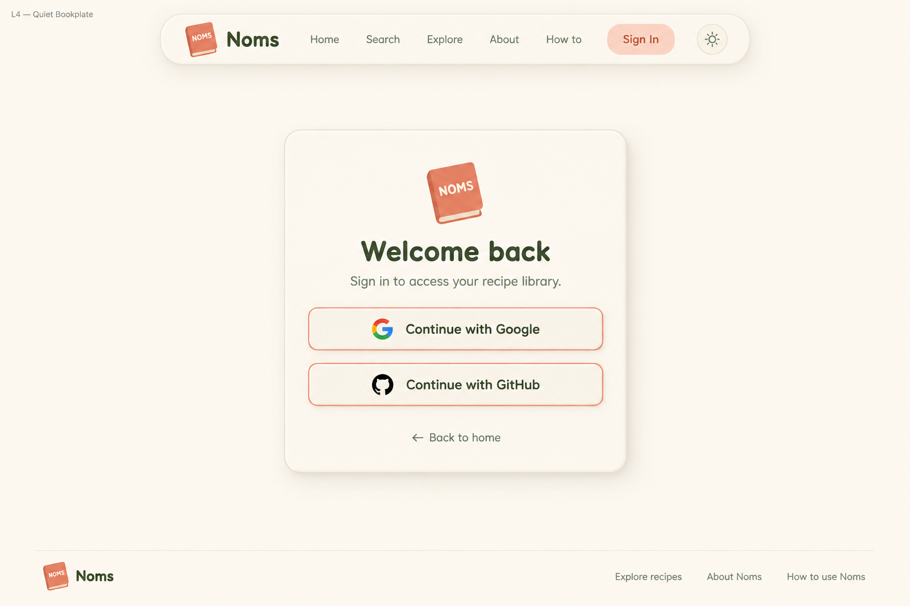
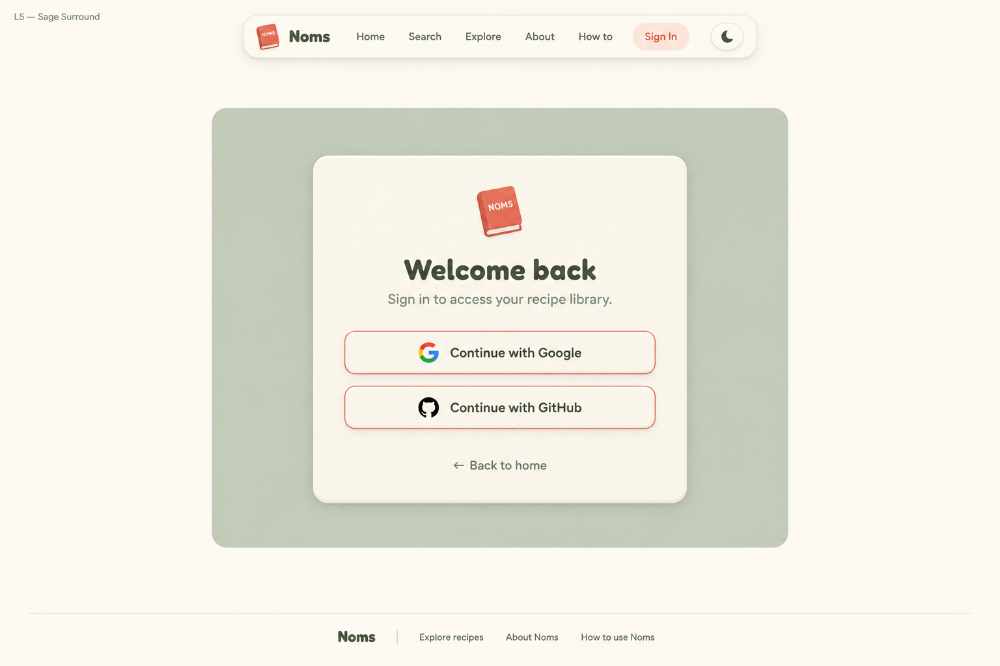
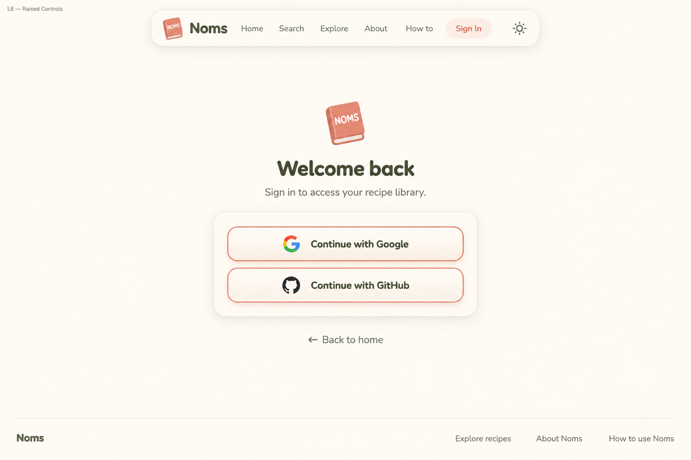

# Sign-in — Clean neumorphic alternatives v3

Three unselected desktop alternatives. Built-in image generation via imagegen skill; no app code changed. Preserve the browser-audited Google/GitHub OAuth flow and return destination behavior. No new authentication methods.

## L4 — Quiet Bookplate



Centered compact raised cream card about 440px wide. All content within one vertical stack: modest 60px book logo, heading, subtitle, provider buttons with 16px gap, Back to home link. Calm ivory background. Subtle visible raised edge and bottom-right shadow. Simplest composition.

## L5 — Sage Surround



Centered modest sage rounded rectangular surround about 760px wide and 590px high, containing a smaller raised cream sign-in card about 440px wide. No oversized hero. Small book mark above heading inside the cream card, subtitle, two identical provider buttons, Back to home link. Sage surround flat and restrained, cream card gently lifted. All other page space ivory and blank.

## L6 — Raised Controls



Centered compact composition: small book logo, heading and subtitle ABOVE a separate raised cream controls panel about 440px wide. Controls panel contains ONLY the two equal provider buttons stacked with generous but not excessive padding. Back to home link sits below the panel. This echoes original app layout while refining spacing and neumorphism. Blank ivory background, no large enclosing card around heading.

## Review

All three keep matching provider-button prominence, Back to home, public navigation, and clean blank space without quotes or decorative props. L4 unifies content in one card; L5 adds a sage surround; L6 is closest to the original heading-plus-controls-panel structure. Generated logos/provider icons and typography are approximations: use approved A3, official provider assets and actual Fredoka/Nunito. Some panels/logo sizes exceed requested approximate dimensions; refine to readable, compact desktop sizing. Footer is a density study, not approval to drop existing destinations. Preserve redirect safeguards, authenticated redirect, keyboard focus, link semantics and accessible contrast. Pending/cancelled/error states and dark/responsive variants remain unspecified. No direction is selected.

## Exact prompts

### L4

```text
Use case: ui-mockup. Generate ONE polished desktop NOMS sign-in page screenshot, 1536x1024 landscape. Clean cozy neumorphism matching a recipe-journal app: warm ivory background, raised cream rounded panels with fine borders and gentle highlights/shadows, muted coral accents, sage details, dark olive text, Fredoka rounded headings and Nunito body. Ample blank space must stay blank.
Shared compact rounded floating navbar: small tilted coral closed book icon with cream NOMS label, Noms wordmark, Home, Search, Explore, About, How to, Sign In (active), theme icon. No other nav active.
Only functional sign-in content: small book logo; heading "Welcome back"; subtitle "Sign in to access your recipe library."; two equally prominent full-width raised cream buttons with fine coral outlines, matching size/color: "Continue with Google" and "Continue with GitHub", small respective provider icons; "← Back to home" link.
Bottom understated footer with Noms and functional links Explore recipes, About Noms, How to use Noms. No tagline.
STRICT NO email/password fields, no registration, no new providers, no remember me, no legal consent copy, no security claims, no quotes, no inspirational slogans, no handwritten text, no people, no mascots, no food props, no plants, no decorative illustration scene, no extra marketing copy. This is a simple authentication screen not a landing page. Exact approved fonts/logo will be used in implementation; illustrate faithfully. Small external study label at top left: L4 — Quiet Bookplate. Centered compact raised cream card about 440px wide. All content within one vertical stack: modest 60px book logo, heading, subtitle, provider buttons with 16px gap, Back to home link. Calm ivory background. Subtle visible raised edge and bottom-right shadow. Simplest composition.
```

### L5

```text
Use case: ui-mockup. Generate ONE polished desktop NOMS sign-in page screenshot, 1536x1024 landscape. Clean cozy neumorphism matching a recipe-journal app: warm ivory background, raised cream rounded panels with fine borders and gentle highlights/shadows, muted coral accents, sage details, dark olive text, Fredoka rounded headings and Nunito body. Ample blank space must stay blank.
Shared compact rounded floating navbar: small tilted coral closed book icon with cream NOMS label, Noms wordmark, Home, Search, Explore, About, How to, Sign In (active), theme icon. No other nav active.
Only functional sign-in content: small book logo; heading "Welcome back"; subtitle "Sign in to access your recipe library."; two equally prominent full-width raised cream buttons with fine coral outlines, matching size/color: "Continue with Google" and "Continue with GitHub", small respective provider icons; "← Back to home" link.
Bottom understated footer with Noms and functional links Explore recipes, About Noms, How to use Noms. No tagline.
STRICT NO email/password fields, no registration, no new providers, no remember me, no legal consent copy, no security claims, no quotes, no inspirational slogans, no handwritten text, no people, no mascots, no food props, no plants, no decorative illustration scene, no extra marketing copy. This is a simple authentication screen not a landing page. Exact approved fonts/logo will be used in implementation; illustrate faithfully. Small external study label at top left: L5 — Sage Surround. Centered modest sage rounded rectangular surround about 760px wide and 590px high, containing a smaller raised cream sign-in card about 440px wide. No oversized hero. Small book mark above heading inside the cream card, subtitle, two identical provider buttons, Back to home link. Sage surround flat and restrained, cream card gently lifted. All other page space ivory and blank.
```

### L6

```text
Use case: ui-mockup. Generate ONE polished desktop NOMS sign-in page screenshot, 1536x1024 landscape. Clean cozy neumorphism matching a recipe-journal app: warm ivory background, raised cream rounded panels with fine borders and gentle highlights/shadows, muted coral accents, sage details, dark olive text, Fredoka rounded headings and Nunito body. Ample blank space must stay blank.
Shared compact rounded floating navbar: small tilted coral closed book icon with cream NOMS label, Noms wordmark, Home, Search, Explore, About, How to, Sign In (active), theme icon. No other nav active.
Only functional sign-in content: small book logo; heading "Welcome back"; subtitle "Sign in to access your recipe library."; two equally prominent full-width raised cream buttons with fine coral outlines, matching size/color: "Continue with Google" and "Continue with GitHub", small respective provider icons; "← Back to home" link.
Bottom understated footer with Noms and functional links Explore recipes, About Noms, How to use Noms. No tagline.
STRICT NO email/password fields, no registration, no new providers, no remember me, no legal consent copy, no security claims, no quotes, no inspirational slogans, no handwritten text, no people, no mascots, no food props, no plants, no decorative illustration scene, no extra marketing copy. This is a simple authentication screen not a landing page. Exact approved fonts/logo will be used in implementation; illustrate faithfully. Small external study label at top left: L6 — Raised Controls. Centered compact composition: small book logo, heading and subtitle ABOVE a separate raised cream controls panel about 440px wide. Controls panel contains ONLY the two equal provider buttons stacked with generous but not excessive padding. Back to home link sits below the panel. This echoes original app layout while refining spacing and neumorphism. Blank ivory background, no large enclosing card around heading.
```
