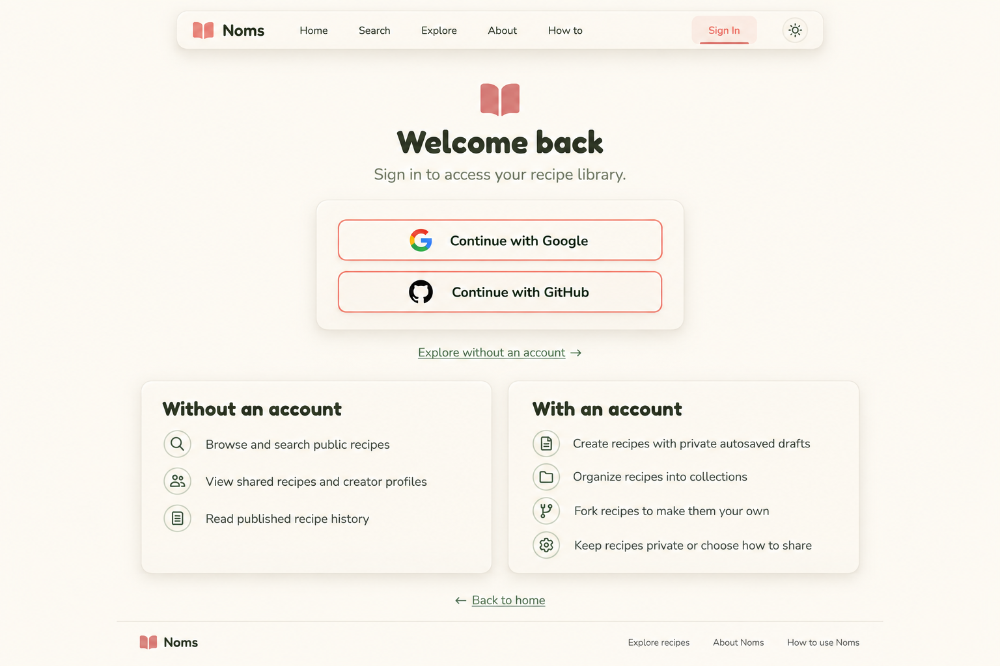

# L6B — Sign-in and guest access

User-selected preferred sign-in direction, refining L6. User requested text explaining features available with and without an account and accepted this example. Built-in image generation via imagegen skill; no app code changed.

Recorded decision: retain the raised provider-controls panel, equally prominent Google/GitHub buttons, Explore without an account link, and two concise guest/account feature sections. Keep the layout clean and free of inspirational quotes. This supersedes earlier L-series compositions as the preferred baseline; selection does not resolve the implementation/state caveats below.



Keeps equal Google/GitHub choices primary, adds Explore without an account linking to Explore, and two compact feature sections below. No inspirational quotes or decorative clutter. Guest history/shared recipe access is subject to recipe visibility; do not imply private content is publicly readable. Account features are additional to guest browsing, not an exclusive alternate set.

Review: requested text is legible and present; generated open-book logo differs from approved A3 and must be replaced in implementation. Use real Fredoka/Nunito and official provider assets. The study label was omitted. Feature blocks are fairly broad; verify wrapping/reading order at narrower widths and short desktop heights. Preserve redirect safeguards, authenticated redirect and existing shell destinations. No new auth method or pricing restriction. Pending/error/cancellation states still need specification.

## Exact prompt

```text
Use case: ui-mockup. One polished NOMS desktop sign-in page, 1536x1024 landscape, study label L6B — Sign-in and guest access.
Clean cozy neumorphism, warm ivory background, soft raised cream panels with fine borders, muted coral outlines, sage accents, dark olive text. Fredoka rounded headings and Nunito body. Simple functional UI, no decorative filler.
Compact floating navbar: small coral closed book logo, Noms, Home, Search, Explore, About, How to, Sign In active, theme icon.
Centered compact sign-in composition near top-middle: modest coral book mark, "Welcome back", "Sign in to access your recipe library." Beneath heading a separate raised cream controls panel with TWO equally prominent buttons, same cream fill and coral outline: "Continue with Google", "Continue with GitHub", respective small provider icons. No email/password fields.
Below controls, clearly visible text link "Explore without an account →". Then a centered approximately 900px-wide feature comparison with TWO compact side-by-side raised panels, aligned height and equal readability. This is informative, NOT pricing tiers. Left heading "Without an account" with three short bullet lines EXACTLY:
"Browse and search public recipes"
"View shared recipes and creator profiles"
"Read published recipe history"
Right heading "With an account" with four short bullet lines EXACTLY:
"Create recipes with private autosaved drafts"
"Organize recipes into collections"
"Fork recipes to make them your own"
"Keep recipes private or choose how to share"
Small simple line icons or sage checks only, no locks suggesting guest features are unavailable. Beneath comparison small "← Back to home" link. Understated footer Noms / Explore recipes / About Noms / How to use Noms.
Keep sign-in controls visually primary, comparison secondary but readable. Fit full content without clipping; do not make logo or headings oversized.
HARD AVOID: NO inspirational quotes, slogans, people illustrations, mascots, food props, plants, handwritten text, pricing, subscription language, legal consent text, security claims, extra providers, registration form, fake feature restrictions. Blank space stays blank. Exact feature wording as provided, no invented claims.
```
