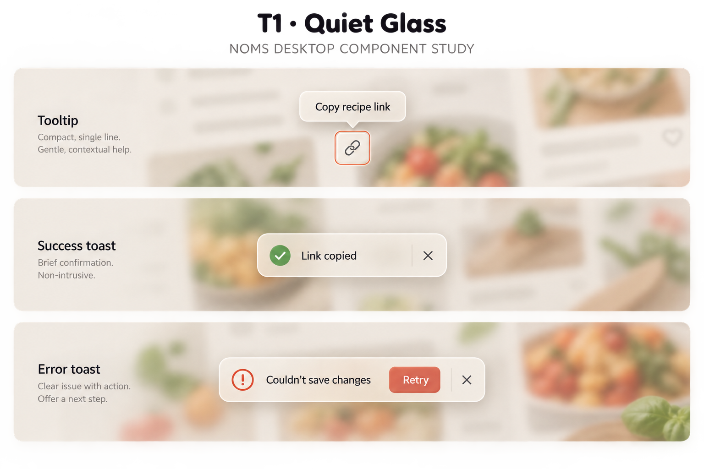
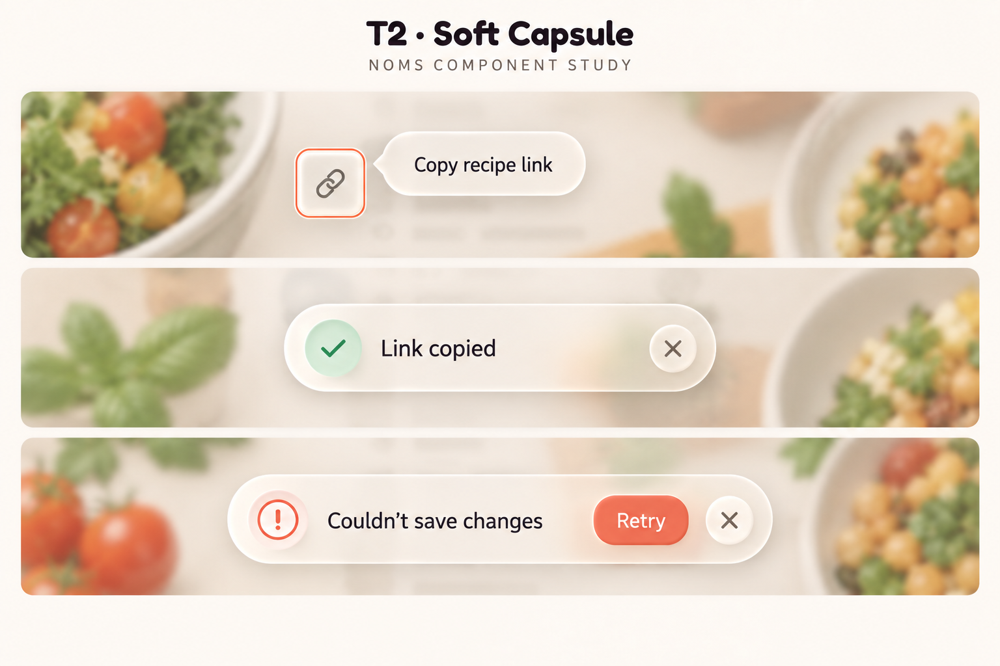
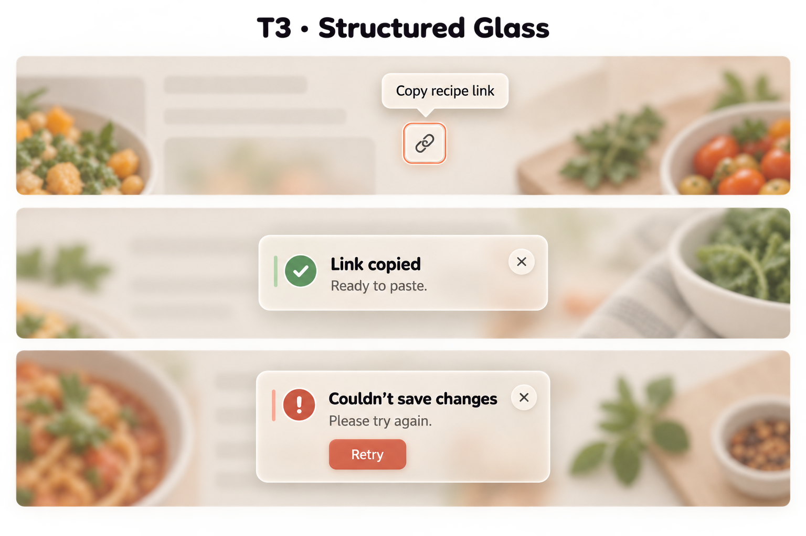

# Tooltip and toast directions v1

Status: T2 — Soft Capsule is the user-selected tooltip and toast direction, retaining M4 warm frosted glass. T1/T3 remain historical alternatives. Retain soft rounded silhouettes, small toast icon wells, concise Nunito text, semantic status icons, explicit dismiss controls and supported retry actions. Selection does not finalize timings, positioning, stacking or accessibility behavior. Built-in image generation using the imagegen skill. Reference: modals-m4-warm-glass-v1.png for material only. No code changes.

## T1 — Quiet Glass



## Implementation decisions — 2026-09-20

The first T2 implementation is shared tooltip/toast components plus collection Copy link/Share. One toast remains until explicit dismissal or the next completed result; it is not cleared while an action is pending and has no automatic timer. Results use a persistent polite live region, with repeat completions updating its child. No Retry/Undo is exposed without a supported action contract. Tooltips supplement named buttons, appear on hover/focus, dismiss with Escape, remain hoverable across the gap and follow viewport/scroll positioning. Messages wrap; existing material tokens supply glass, opaque and forced-color fallbacks. Broader adoption and responsive visual sign-off remain follow-up work. See [foundation implementation status](../../implementation-plans/NOMS-020-checkpoint-1-foundations.md).

The historical generation notes below describe the proposals, not additional implemented behavior.

## T2 — Soft Capsule



## T3 — Structured Glass




## Review and recommendation

T1 provides compact tooltip and single-line toast forms. T2 emphasizes roundness and icon wells. T3 adds a heading, supporting copy and separated action. The user selected T2 for its softer design, superseding the earlier recommendation to combine T1 and T3. Accommodate long messages with readable wrapping within T2's visual language, not forced single-line clipping.

All retain the requested messages, success/error icons, dismiss actions and retry example. These are enlarged separate component crops, not actual screen placement or simultaneous notification stacks. Generated backgrounds include food props and excessive whole-scene blur; T1/T3 also have an unwanted dark vignette over their study titles. These are presentation artifacts, not UI requirements. Do not dim, blur or block the whole page for tooltips/toasts. Use blur only within glass surfaces. T3 headings appear more display-like than requested: production notification text should use actual Nunito. Actual app tokens and measured contrast take precedence over raster colors, glow and saturation.

## Behavior to specify before implementation

- Tooltips describe an accessible named trigger; show on hover and keyboard focus, dismiss with Escape, remain hoverable while needed, and reposition at viewport edges without obscuring the trigger. They contain no interactive actions or essential-only instructions.
- Toasts do not steal focus or make the background inert. Announce routine status politely; choose error announcement urgency by context, not simply by color.
- Routine success may auto-dismiss with a suitable duration; pause timers during hover/focus. Actionable failures persist until dismissed or resolved. Exact timings, placement, stacking/queue limits and duplicate suppression are still open.
- Retry must invoke a supported safe operation and prevent duplicate requests. No fabricated Undo. Keep field validation and persistent unsaved/save errors inline where appropriate; a toast must not be their only record.
- Named close/action buttons, readable wrapping, reduced motion, contrast against varied backgrounds and opaque fallback are required. No accessibility behavior is proven by these images.
- Dark-mode and new phone/tablet designs remain deferred.

## Exact prompts

### T1

```text
Use case: ui-mockup. Create a polished NOMS desktop component study, landscape. Reference image is MATERIAL reference only for M4 warm frosted glass, NOT modal layouts. Three clearly separated enlarged detail crops stacked vertically: Tooltip, Success toast, Error toast. Muted cream recipe-page shapes with sage/coral food-photo colors behind glass to demonstrate translucency, no readable background copy, no navigation proposals. Background NOT dimmed or blocked: these are nonmodal overlays. Warm translucent ivory shells, backdrop blur confined to surfaces, fine illuminated borders, soft floating shadows. Nunito component text, Fredoka only external board heading. Palette cream #FAF7F2/#F5F0E8, dark text #2D2A26, coral #D9735A, success #5A9E6F, error #C4504A. Mostly milky glass behind text for readability, no rainbow, neon, blue tech styling, glossy plastic or quotes.
Top crop: small chain-link icon button with visible keyboard focus, nearby compact tooltip exact text "Copy recipe link", tiny pointer toward trigger, no buttons/close icon INSIDE tooltip. Middle crop success toast green check icon, exact "Link copied", right close X. Bottom crop error toast red warning icon, exact "Couldn't save changes", Retry button and right close X. Error/success colors only icons or small accents, NOT whole colored panels. Crops are separate examples, not simultaneous notifications. No Undo. Full components visible with generous whitespace. Title "T1 · Quiet Glass". Most minimal treatment. Tooltip compact 10px rounded rectangle, single line. Success toast slim 12px rounded rectangle, inline check/message/close. Error toast same slim rectangular family, inline icon/message/Retry/close, no heading/body split. No icon wells, no colored sidebars. Restrained glass shadow.
```

### T2

```text
Use case: ui-mockup. Create a polished NOMS desktop component study, landscape. Reference image is MATERIAL reference only for M4 warm frosted glass, NOT modal layouts. Three clearly separated enlarged detail crops stacked vertically: Tooltip, Success toast, Error toast. Muted cream recipe-page shapes with sage/coral food-photo colors behind glass to demonstrate translucency, no readable background copy, no navigation proposals. Background NOT dimmed or blocked: these are nonmodal overlays. Warm translucent ivory shells, backdrop blur confined to surfaces, fine illuminated borders, soft floating shadows. Nunito component text, Fredoka only external board heading. Palette cream #FAF7F2/#F5F0E8, dark text #2D2A26, coral #D9735A, success #5A9E6F, error #C4504A. Mostly milky glass behind text for readability, no rainbow, neon, blue tech styling, glossy plastic or quotes.
Top crop: small chain-link icon button with visible keyboard focus, nearby compact tooltip exact text "Copy recipe link", tiny pointer toward trigger, no buttons/close icon INSIDE tooltip. Middle crop success toast green check icon, exact "Link copied", right close X. Bottom crop error toast red warning icon, exact "Couldn't save changes", Retry button and right close X. Error/success colors only icons or small accents, NOT whole colored panels. Crops are separate examples, not simultaneous notifications. No Undo. Full components visible with generous whitespace. Title "T2 · Soft Capsule". Rounder pill-like tooltip without icon, compact text. Toasts large rounded capsule corners and small shallow circular frosted icon well at left. Single-line messages; error Retry compact pill-shaped action at right before close. Visible warm glass translucency and softly lit edges, slightly more tactile than T1 but no thick opaque neumorphic shell.
```

### T3

```text
Use case: ui-mockup. Create a polished NOMS desktop component study, landscape. Reference image is MATERIAL reference only for M4 warm frosted glass, NOT modal layouts. Three clearly separated enlarged detail crops stacked vertically: Tooltip, Success toast, Error toast. Muted cream recipe-page shapes with sage/coral food-photo colors behind glass to demonstrate translucency, no readable background copy, no navigation proposals. Background NOT dimmed or blocked: these are nonmodal overlays. Warm translucent ivory shells, backdrop blur confined to surfaces, fine illuminated borders, soft floating shadows. Nunito component text, Fredoka only external board heading. Palette cream #FAF7F2/#F5F0E8, dark text #2D2A26, coral #D9735A, success #5A9E6F, error #C4504A. Mostly milky glass behind text for readability, no rainbow, neon, blue tech styling, glossy plastic or quotes.
Top crop: small chain-link icon button with visible keyboard focus, nearby compact tooltip exact text "Copy recipe link", tiny pointer toward trigger, no buttons/close icon INSIDE tooltip. Middle crop success toast green check icon, exact "Link copied", right close X. Bottom crop error toast red warning icon, exact "Couldn't save changes", Retry button and right close X. Error/success colors only icons or small accents, NOT whole colored panels. Crops are separate examples, not simultaneous notifications. No Undo. Full components visible with generous whitespace. Title "T3 · Structured Glass". Tooltip stays small simple rounded glass bubble, no header. Success toast 16px rounded glass panel, icon left, bold Nunito heading "Link copied" and smaller supporting text "Ready to paste.", close X at upper right. Error toast same shell, bold heading "Couldn't save changes", supporting text "Please try again.", Retry action beneath message aligned with text, close X top right. Clear hierarchy and moderate padding, not modal-sized. Thin short status accent beside icon, neutral glass body. No promise changes were saved or retained.
```
