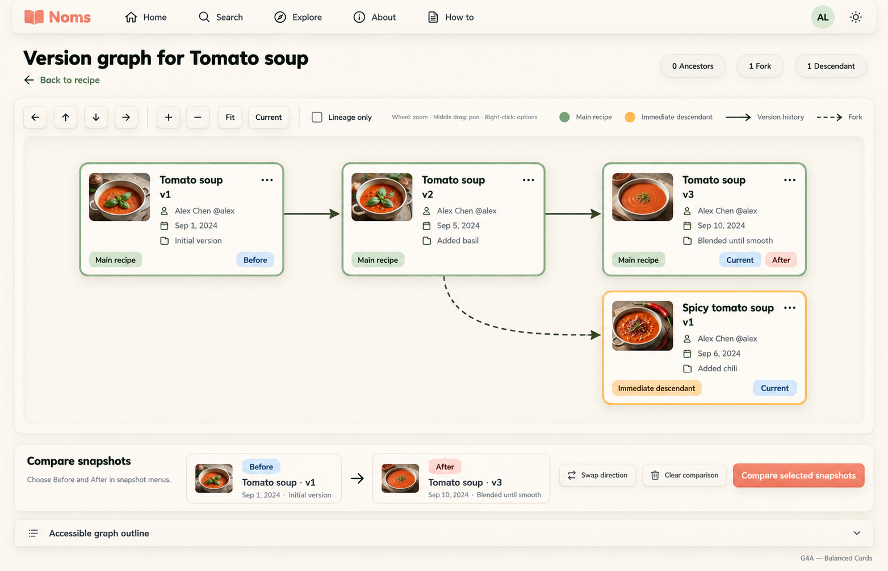
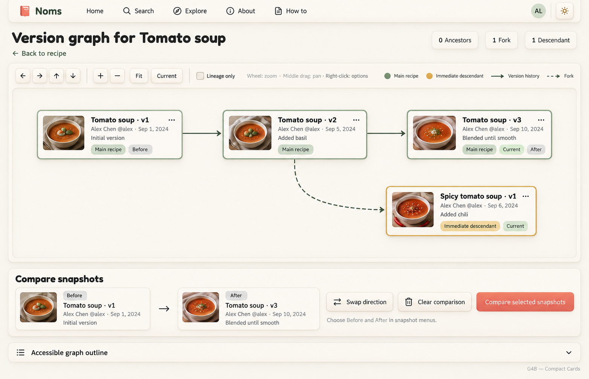
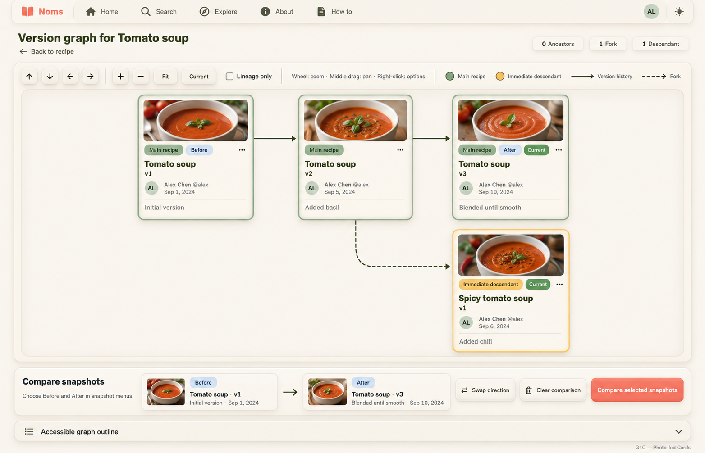

# G4 — Soft Canvas variations

**G4A — Balanced Cards is the user-selected preferred version-graph design.** G4B/G4C remain exploratory alternatives. Built-in image generation via imagegen skill; no application code changed.

## Recorded decision

Use G4A's inset soft canvas, moderately sized raised snapshot cards with compact thumbnails and readable metadata, raised navigation toolbar, and separate Before → After comparison panel below. Preserve exact solid version and dashed fork relationships, independent Current/relationship/comparison labels, snapshot actions, lineage controls and accessible outline. Do not treat selection as approval of incidental generated colors/assets or as completion of dense, expansion, error, keyboard and dark-state planning. This supersedes earlier graph compositions as the preferred visual baseline.

## G4A — Balanced Cards



Snapshot cards medium size: small landscape photo at upper left beside recipe title/version, then author, date, concise change summary. Clear compact labels at bottom. Moderate neumo lift. Balanced canvas space and metadata readability. Four cards arranged exactly as described.

## G4B — Compact Cards



Snapshot cards noticeably smaller low-height horizontal rectangles, tiny landscape thumbnail left and efficient text block right. Title/version strongest, author/date secondary, single-line change summary. Compact badges on lower edge. Lots of canvas room around four cards, no oversized node photos. Same exact graph and controls; not additional nodes. Efficient for eventual dense graphs.

## G4C — Photo-led Cards



Snapshot cards taller vertical rectangles with a 16:9 landscape photo across top in a softly inset well. Below photo title/version, author/date, change summary, compact relationship and comparison badges. Stronger but tasteful raised cream frame like X7C Explore cards. Canvas taller so four cards and connectors never collide. Same graph topology and full comparison controls underneath.

## Review and retained contract

All three visibly retain the same four-node graph: Tomato soup v1 → v2 → v3 via solid version edges; v2 → Spicy tomato soup v1 via a dashed fork edge. All main recipe versions share relationship styling; Current is independent of Before/After and also appears on the fork's latest version. Readonly comparison summaries, Swap/Clear/Compare, navigation controls, counts and accessible-outline entry are present. No quotes or decorative filler.

G4B's compactness is illustrated with a small graph, not validated with a dense graph. G4C requires more vertical canvas space. Before/After colors vary across boards and are not approved tokens; labels must remain independent of color. Generated logos, typography, thumbnails and dates are illustrative; use actual approved assets and data. The visible Lineage only checkbox and ellipsis buttons are proposed discoverability improvements for existing menu actions, not a change to filtering or snapshot semantics. Preserve direct snapshot links and full snapshot/background menus. Ancestor category is absent from this sample but must remain supported in the full legend. Show next 5 expansion, status/error feedback, actual comparison results, keyboard operation, dark mode and short-viewport behavior still require design and validation. No merges or private draft nodes are approved. Source/browser audit contracts take precedence over artwork.

## Exact prompts

### G4A

```text
Use case: ui-mockup. ONE polished desktop NOMS recipe version graph application screenshot, wide 1792x1152. Cozy clean neumorphism: warm ivory background, raised cream cards with fine borders and soft highlights/shadows, inset canvas, muted sage and coral accents, dark olive text, Fredoka headings and Nunito body. No quotes, slogans, decorative filler, people illustrations, props, or marketing copy.
Top compact shared navbar: coral book mark Noms, Home, Search, Explore, About, How to, AL avatar, theme. Page heading "Version graph for Tomato soup", Back to recipe link. Small lineage counts "0 Ancestors", "1 Fork", "1 Descendant".
Raised toolbar ABOVE canvas: four pan arrow buttons, zoom + and −, Fit, Current. A small unchecked "Lineage only" control exposes the existing lineage filter. Text hint "Wheel: zoom · Middle drag: pan · Right-click: options". Legend: sage Main recipe, ochre Immediate descendant, solid line Version history, dashed line Fork.
Large inset canvas occupying main page with EXACTLY FOUR snapshot cards and EXACTLY THREE directed connectors:
Top row left Tomato soup v1; middle Tomato soup v2; right Tomato soup v3. SOLID arrow v1 to v2, SOLID arrow v2 to v3.
Lower row underneath v3: Spicy tomato soup v1. A DASHED arrow forks from the BOTTOM of Tomato soup v2 and bends down/right to Spicy tomato soup v1. NO edge from Tomato soup v3 to Spicy. NO merges or extra nodes.
All THREE Tomato soup cards are sage-bordered and labelled Main recipe. Tomato soup v3 has Current badge. Spicy tomato soup v1 is ochre-bordered, labelled Immediate descendant, and also Current (latest in its own recipe). Tomato soup v1 additionally labelled Before, Tomato soup v3 additionally labelled After, independent from Current/Main recipe. Each card has food thumbnail, title, version, author Alex Chen @alex, published date, change summary, small ellipsis menu. Summaries: v1 Initial version; v2 Added basil; v3 Blended until smooth; Spicy v1 Added chili. Dates sample Sep 1, Sep 5, Sep 10, Sep 6 respectively.
BELOW canvas a separate raised compact "Compare snapshots" panel. Read-only summaries labelled Before "Tomato soup · v1" and After "Tomato soup · v3", with arrow between. Buttons Swap direction, Clear comparison, coral Compare selected snapshots. NO dropdown chevrons on summaries, NO editable fields. Small instruction "Choose Before and After in snapshot menus." No comparison result yet. Below visible collapsed Accessible graph outline.
No persistent inspector, no author lanes, no fake statistics. Keep node text legible and connectors unobstructed. All required core controls present. Small external study label: G4A — Balanced Cards. Snapshot cards medium size: small landscape photo at upper left beside recipe title/version, then author, date, concise change summary. Clear compact labels at bottom. Moderate neumo lift. Balanced canvas space and metadata readability. Four cards arranged exactly as described.
```

### G4B

```text
Use case: ui-mockup. ONE polished desktop NOMS recipe version graph application screenshot, wide 1792x1152. Cozy clean neumorphism: warm ivory background, raised cream cards with fine borders and soft highlights/shadows, inset canvas, muted sage and coral accents, dark olive text, Fredoka headings and Nunito body. No quotes, slogans, decorative filler, people illustrations, props, or marketing copy.
Top compact shared navbar: coral book mark Noms, Home, Search, Explore, About, How to, AL avatar, theme. Page heading "Version graph for Tomato soup", Back to recipe link. Small lineage counts "0 Ancestors", "1 Fork", "1 Descendant".
Raised toolbar ABOVE canvas: four pan arrow buttons, zoom + and −, Fit, Current. A small unchecked "Lineage only" control exposes the existing lineage filter. Text hint "Wheel: zoom · Middle drag: pan · Right-click: options". Legend: sage Main recipe, ochre Immediate descendant, solid line Version history, dashed line Fork.
Large inset canvas occupying main page with EXACTLY FOUR snapshot cards and EXACTLY THREE directed connectors:
Top row left Tomato soup v1; middle Tomato soup v2; right Tomato soup v3. SOLID arrow v1 to v2, SOLID arrow v2 to v3.
Lower row underneath v3: Spicy tomato soup v1. A DASHED arrow forks from the BOTTOM of Tomato soup v2 and bends down/right to Spicy tomato soup v1. NO edge from Tomato soup v3 to Spicy. NO merges or extra nodes.
All THREE Tomato soup cards are sage-bordered and labelled Main recipe. Tomato soup v3 has Current badge. Spicy tomato soup v1 is ochre-bordered, labelled Immediate descendant, and also Current (latest in its own recipe). Tomato soup v1 additionally labelled Before, Tomato soup v3 additionally labelled After, independent from Current/Main recipe. Each card has food thumbnail, title, version, author Alex Chen @alex, published date, change summary, small ellipsis menu. Summaries: v1 Initial version; v2 Added basil; v3 Blended until smooth; Spicy v1 Added chili. Dates sample Sep 1, Sep 5, Sep 10, Sep 6 respectively.
BELOW canvas a separate raised compact "Compare snapshots" panel. Read-only summaries labelled Before "Tomato soup · v1" and After "Tomato soup · v3", with arrow between. Buttons Swap direction, Clear comparison, coral Compare selected snapshots. NO dropdown chevrons on summaries, NO editable fields. Small instruction "Choose Before and After in snapshot menus." No comparison result yet. Below visible collapsed Accessible graph outline.
No persistent inspector, no author lanes, no fake statistics. Keep node text legible and connectors unobstructed. All required core controls present. Small external study label: G4B — Compact Cards. Snapshot cards noticeably smaller low-height horizontal rectangles, tiny landscape thumbnail left and efficient text block right. Title/version strongest, author/date secondary, single-line change summary. Compact badges on lower edge. Lots of canvas room around four cards, no oversized node photos. Same exact graph and controls; not additional nodes. Efficient for eventual dense graphs.
```

### G4C

```text
Use case: ui-mockup. ONE polished desktop NOMS recipe version graph application screenshot, wide 1792x1152. Cozy clean neumorphism: warm ivory background, raised cream cards with fine borders and soft highlights/shadows, inset canvas, muted sage and coral accents, dark olive text, Fredoka headings and Nunito body. No quotes, slogans, decorative filler, people illustrations, props, or marketing copy.
Top compact shared navbar: coral book mark Noms, Home, Search, Explore, About, How to, AL avatar, theme. Page heading "Version graph for Tomato soup", Back to recipe link. Small lineage counts "0 Ancestors", "1 Fork", "1 Descendant".
Raised toolbar ABOVE canvas: four pan arrow buttons, zoom + and −, Fit, Current. A small unchecked "Lineage only" control exposes the existing lineage filter. Text hint "Wheel: zoom · Middle drag: pan · Right-click: options". Legend: sage Main recipe, ochre Immediate descendant, solid line Version history, dashed line Fork.
Large inset canvas occupying main page with EXACTLY FOUR snapshot cards and EXACTLY THREE directed connectors:
Top row left Tomato soup v1; middle Tomato soup v2; right Tomato soup v3. SOLID arrow v1 to v2, SOLID arrow v2 to v3.
Lower row underneath v3: Spicy tomato soup v1. A DASHED arrow forks from the BOTTOM of Tomato soup v2 and bends down/right to Spicy tomato soup v1. NO edge from Tomato soup v3 to Spicy. NO merges or extra nodes.
All THREE Tomato soup cards are sage-bordered and labelled Main recipe. Tomato soup v3 has Current badge. Spicy tomato soup v1 is ochre-bordered, labelled Immediate descendant, and also Current (latest in its own recipe). Tomato soup v1 additionally labelled Before, Tomato soup v3 additionally labelled After, independent from Current/Main recipe. Each card has food thumbnail, title, version, author Alex Chen @alex, published date, change summary, small ellipsis menu. Summaries: v1 Initial version; v2 Added basil; v3 Blended until smooth; Spicy v1 Added chili. Dates sample Sep 1, Sep 5, Sep 10, Sep 6 respectively.
BELOW canvas a separate raised compact "Compare snapshots" panel. Read-only summaries labelled Before "Tomato soup · v1" and After "Tomato soup · v3", with arrow between. Buttons Swap direction, Clear comparison, coral Compare selected snapshots. NO dropdown chevrons on summaries, NO editable fields. Small instruction "Choose Before and After in snapshot menus." No comparison result yet. Below visible collapsed Accessible graph outline.
No persistent inspector, no author lanes, no fake statistics. Keep node text legible and connectors unobstructed. All required core controls present. Small external study label: G4C — Photo-led Cards. Snapshot cards taller vertical rectangles with a 16:9 landscape photo across top in a softly inset well. Below photo title/version, author/date, change summary, compact relationship and comparison badges. Stronger but tasteful raised cream frame like X7C Explore cards. Canvas taller so four cards and connectors never collide. Same graph topology and full comparison controls underneath.
```
