# NOMS-020: Application Visual Design Refinement — Implementation Plan

**Status:** Page redesigns integrated — checkpoint 8 integration review active; release acceptance remains open
**Created:** 2026-08-15
**Depends on:** Current application routes, components, design tokens, and the visual direction established by NOMS-013
**Coordination:** Feature tickets NOMS-016 through NOMS-019 should use shared primitives where stable; NOMS-020 must avoid redesigning feature behavior owned by those tickets.
**Approach:** Evolve the existing Noms identity into the selected Kitchen Console direction through an evidence-based visual audit, reusable token and component changes, and a route-by-route migration plan.

---

## Design reference organization

Integration checkpoint (2026-09-27): the public, Search, Dashboard, collection,
recipe and user-page redesigns are now included in
`codex/NOMS-020-visual-design-refinement` at `74c4200`.
See the [combined browser validation and remaining gates](NOMS-020-checkpoint-8-integration.md).
The page implementation phase is integrated, not release-approved: collection
navigation data refresh requires follow-up, alongside remaining regression,
accessibility and responsive acceptance.
Nested collection creation's parent-context defect was fixed and browser-verified
in `9b6d667` on 2026-09-27; see the integration report's follow-up evidence.
Empty-name public-profile presentation was fixed and browser-verified in
`9cbeef5` on the same date, including anonymous viewing and nonblank-name checks.
The [recipe-page handoff](NOMS-020-recipe-pages.md) and other route checkpoints
retain their source-branch tests and validation limits.

Start with the [design catalog](../assets/NOMS-020/README.md): [finalized proposals](../assets/NOMS-020/finalized/README.md) are the selected implementation baselines; [intermediate ideas](../assets/NOMS-020/intermediate/README.md) are historical alternatives, superseded iterations and deferred studies. Most proposal files retain their paths; logo and audit assets are grouped under `logo/` and `old-designs/`, with references updated. Finalized means selected visual direction, not production-ready artwork or approval of every generated control.

Precedence: explicit recorded user decisions and behavior/accessibility requirements → finalized reference notes → selected images → historical explorations. Never infer new functionality from incidental mockup content.

## Intended outcome

The application presents one deliberate, accessible, responsive visual system across public pages, authenticated workflows, dense data views, forms, and transient states.

### Landing, community Home and personal Dashboard — clarified 2026-09-28

The user's clarification supersedes the initial personal-Home composition.
`/` remains the public cozy v2 landing page; `/home` is **Community Home**, for
public recipe discovery, product/community notices and participation; `/dashboard`
is the existing personal management workspace. Historical boards called `/`
“Home”; neither those boards nor the superseded Your kitchen implementation
describe the current community route.

Home presents a large **Community spotlight**, additional community recipe cards,
an **Announcements** panel and **Get involved** links. Reuse Explore's bounded
public-only recipe source: the newest recipe is the spotlight, followed by up to
five more without duplication. Label this honestly as a newest-public-recipe
preview, not curated, trending or popular. Preserve real recipe/creator links,
metadata and image fallbacks; exclude private and unlisted recipes, including
those owned by the viewer. Home no longer reads personal drafts, collections or
owner-scoped search results.

The initial announcement is an authored, dated notice about the community Home
and Dashboard distinction, not a simulated activity stream. Participation links
lead to the existing public-profile directory, recipe creation and forking guide.
Creation still starts a private draft; the user chooses public visibility before
sharing. There are no invented comments, likes, rankings, events, challenges or
community metrics. Curated featured flags, an announcements service/authoring
workflow and additional engagement capabilities would require separately scoped
product work, not controls inferred from this design.

Retain the book mark, approved section artwork, Fredoka/Nunito, current palette,
raised panels, inset participation links and shared framed cards. Desktop uses
the shared 1760px cap; additional recipes sit directly below the spotlight beside
the news sidebar. Narrow layouts stack without changing content or destinations.
Loading, empty and retry states affect only recipes; notices and participation
remain available. Signed-in navbar/drawer Home still leads to `/home`. Per the
user's follow-up, the navbar book/wordmark always leads to landing `/`, regardless
of authentication; its accessible label is Noms introduction. The drawer also
retains Noms introduction `/`, and the footer groups Community Home
under Discover rather than Your kitchen. Existing sign-in/access rules and safe
return destinations are unchanged by this composition rework.

Implemented in `786a7bd` with review corrections `e09dda2` / `5440fd0`, then integrated
into NOMS-020. See [community Home evidence](NOMS-020-checkpoint-8-integration.md#community-home-rework--2026-09-28).
Broader dark, accessibility and per-page responsive acceptance remain separate
gates; this addition does not close checkpoint 8.

## Planned application mark

The current planned NOMS mark is **S3 — Continuous olive**, selected 2026-09-27 to replace S1. Preserve the gently clockwise-tilted closed olive book, continuous rounded olive spine matching the cover with a subtle vertical hinge crease (no horizontal bands or segmentation), cream page block, coral elastic strap and bookmark, and warm-white rounded NOMS title label. Use smooth matte painted surfaces with restrained broad brush variation, sculpted bevels, crisp warm directional highlights and clearly separated shadow planes. Retain the cozy character without heavy impasto or glossy plastic shading.

Reference artwork: [S3 — rightmost book in the comparison sheet](../assets/NOMS-020/logo/spine-options-s1-s3-v1.png); [selection and production notes](../assets/NOMS-020/logo/spine-options-s1-s3-v1.md). A3, F2 and S1 remain historical only; S3 supersedes logo depictions in earlier page mockups. The eight selected page icons are unchanged; their S1-family references retain the provenance of their shared palette, finish and lighting.

A standalone [static web SVG](../../assets/brand/noms-logo.svg) was prepared 2026-09-27 with transparent background, Fredoka 600 outlines and simplified vector shading; see [usage and validation](../../assets/brand/README.md). All navbar/footer/sign-in placements now share the painted PNG logo via one optimized WebP asset (2026-09-27); the SVG is retained as an alternative, not an active UI asset; tiny favicon/app-icon refinements, single-colour variants and the 3D model remain pending. The full title is not readable at tiny navigation sizes; pair it with the app wordmark.

## Selected visual direction: Kitchen Console

### Identity preservation — confirmed 2026-09-16

This is a refinement, not a rebrand. The existing app is the source of truth for typography, colors and visual personality; generated proposals primarily guide layout, hierarchy and component composition. Preserve Fredoka display and Nunito body typography, the existing warm palette and familiar accent roles, rounded forms, and cozy raised/inset neumorphic treatment. Do not sample replacement fonts or colors from generated images.

At kickoff, inventory actual current-main tokens and rendered styles before changing foundations. Reuse existing values by default and consolidate inconsistencies into semantic tokens rather than introducing a new palette or type system. Adjust sizes, spacing, contrast, borders or elevation only where needed for readability, accessibility or consistency, keeping the established character. Document such adjustments; material changes to typography, palette or overall feel require user review before adoption.

2026-09-23 elevation refinement: raised and inset page components now share theme-aware `--neumo-surface`, `--elevation-raised`, `--elevation-raised-hover`, and `--elevation-inset` tokens; compact controls use the corresponding compact elevation tokens. Their translucent surface picks up the local page color, so depth comes from light and shadow rather than a contrasting fill. Use these shared values for new cards, wells, and controls instead of copying Explore-specific shadows. The navbar retains an opaque shell; its active link and search use that shell's color with shared inset elevation. Frosted overlays, accent-filled controls, and illustration-specific shadows remain separate materials.

Kitchen Console retains the warmth, tactility, and personality of the existing interface while making hierarchy and interaction state clearer. Neumorphism remains part of the product identity, but depth is functional rather than ornamental:

- **Flat:** page canvases, long-form content, and low-priority supporting regions.
- **Inset:** editors, graph canvases, input wells, and areas that receive content.
- **Raised:** buttons, cards, tabs, selectors, and other directly interactive controls.
- **Floating overlays:** M4 warm frosted glass for modal shells, menus/popovers, tooltips, toasts and other overlay surfaces where present. This treatment does not introduce new overlay features.

Visible borders, color, labels, and focus treatments must communicate boundaries and state without relying on shadows alone. The working palette combines warm cream, deep charcoal-olive, sage/olive structure, and restrained tomato-coral emphasis. Food imagery and the existing typography provide the culinary character. Glassmorphism is selected specifically for overlays, not as a replacement for the page's neumorphic system; avoid generic dashboard and developer-tool styling.

## Selected overlay direction — M4 Warm Frosted Glass

User decision: [M4 modal example and notes](../assets/NOMS-020/modals-m4-warm-glass-v1.md) is the finalized modal direction, superseding M1–M3 and enhanced M2. Apply its warm frosted-glass surface language to overlay components: translucent ivory shells, backdrop blur, fine illuminated borders and soft floating shadows. Preserve actual app fonts, warm palette, coral actions and semantic danger styling. Keep fields and critical content sufficiently opaque for readability.

Regular page cards, editor panels, inset wells and controls retain their selected neumorphic character. A visually “floating” navigation bar or detached editor sidebar is not automatically an overlay; retain N1/N4 and E3T1 unless explicitly revised.

Modal artwork is selected; menus, popovers, tooltips and toasts inherit the material direction, not an unreviewed modal layout or behavior. Refine each component's sizing, placement and states within shared-foundation work. This supersedes opaque overlay-shell styling in older page/state images without changing their selected layout or interaction contracts.

Validate contrast over varied underlying content and provide an opaque fallback where blur/transparency is unavailable or reduced transparency is requested. Preserve explicit focus, semantic roles, appropriate dismissal and status behavior; modal focus containment/background inertness must not be applied indiscriminately to nonmodal overlays. Dark-mode design remains deferred; mobile/tablet discovery follows the per-page workflow below.

These concept boards are directional references, not pixel-perfect specifications. Generated copy, data, and incidental spacing may be approximate. Implementation decisions must follow the documented visual principles, established product behavior, accessibility requirements, and shared component contracts.

### Selected tooltips and toasts — T2 Soft Capsule

Use [T2 Soft Capsule](../assets/NOMS-020/overlays-t2-soft-capsule-v1.png) for tooltips and toasts within M4's glass material language ([notes](../assets/NOMS-020/tooltip-toast-directions-v1.md)). Retain soft rounded shapes, compact tooltip text, small toast status-icon wells, dismiss controls and supported retry actions. Use actual Nunito and current palette tokens. T1/T3 remain alternatives, not implementation targets. Allow readable text wrapping; do not infer oversized components from the study crops. Define timing, placement, stacking and focus/live-region behavior in shared-foundation work. No page-wide dimming, blur or focus trapping for these nonmodal overlays.

### Selected menus and collection picker — overlay P1–P3

User selection recorded 2026-09-17: [P1 Account menu, P2 Action menus and P3 Collection picker](../assets/NOMS-020/menu-popover-examples-v1.md) are the finalized composition references within M4's warm glass language. Retain identity/navigation/sign-out grouping, clear focused/disabled/destructive action states, exact graph menu actions, and the picker's searchable nested independent selections with explicit additive confirmation. Preserve current route permissions and destructive safeguards. Membership display, eligible collections, search semantics, partial failure, pending/cancel behavior and keyboard/edge positioning remain checkpoint-specific contracts; visual approval does not authorize unrelated feature expansion. Overlay P labels are distinct from profile/settings P1/P8.

## Selected shared navigation direction — N1 + N4

Decision recorded 2026-09-12: combine **N1 — Cozy Counter's familiar horizontal layout** with **N4 — Floating Pantry's floating, rounded silhouette**. This is the selected navigation-bar direction for further refinement, not a finished component specification.

References: [N1](../assets/NOMS-020/navigation-n01-v1.png), [N4](../assets/NOMS-020/navigation-n04-v1.png), and [all ten explorations and prompts](../assets/NOMS-020/navigation-directions-v1.md).

- Use a warm cream bar slightly inset from the viewport edges, with rounded corners and gentle neumorphic depth.
- Use the S3 book logo direction and coral Noms wordmark, with Fredoka display and Nunito navigation-label typography.
- Keep destinations compact and clearly labelled, with a sage selected state and explicit focus treatment; do not rely on shadows alone.
- Include inset search access and a softly raised coral New recipe action in the appropriate authenticated context.
- Keep surrounding content calm: N4's decorative kitchen props, heavy framing and incidental slogans are not part of the navigation direction.
- Generated labels such as Meal plan are not approved feature additions. Resolve exact destinations against existing routes and authentication state.

Before shared-shell migration, resolve desktop signed-out/signed-in variants, overflow, account/menu access, keyboard focus and touch targets. Dark-mode design remains deferred; discover phone/tablet adaptations with each page. Compact menus/drawers and any workspace-specific secondary navigation remain open decisions. The earlier persistent-sidebar/icon-rail model below is superseded for shared primary navigation; it is not a requirement to implement N2 or N7.

## Preferred Settings and Profile directions — P1 and P8

Decision recorded 2026-09-13: **P1 — Kitchen Passport** and **P8 — Cozy Accordion** are the preferred desktop Settings and public-profile references. Both remain preferred; the exact combination and disclosure behavior are still to be refined.

References: [P1 Settings/Profile](../assets/NOMS-020/settings-profile-p01-v1.png), [P8 Settings/Profile](../assets/NOMS-020/settings-profile-p08-v1.png), and [exploration notes and prompts](../assets/NOMS-020/settings-profile-directions-v1.md).

- Retain P1's clear identity panel, labelled profile form, separate linked-account card, and public collections/recipes hierarchy.
- Explore P8's rounded disclosure sections for grouping profile settings, linked accounts and account deletion. Expanded/collapsed defaults, and whether public collection/recipe sections should collapse, remain open decisions rather than approved behavior.
- Preserve warm cream, sage/olive and coral, Fredoka/Nunito, gentle neumorphic controls, selected N1/N4 navigation and C3 Kitchen Albums collection imagery.
- Keep account details/actions private; public profiles show only public identity and content. Preserve existing avatar editing, validation, provider linking/unlinking safeguards and account-deletion confirmation behavior regardless of omissions in generated boards.
- Generated text, counts, identities, provider graphics and A3 approximations are illustrative, not production specifications.

Resolve desktop interaction/disclosure states within the profile/settings checkpoint. Dark-mode design remains deferred; discover phone/tablet adaptations within this page's workflow. Other P-series boards are exploration history, not preferred directions.

Implementation checkpoint (2026-09-25, `codex/NOMS-020-user-pages`, based on `7b2dab2`): the public profile, profile settings and linked-account routes now combine P1's identity/form layout with P8's raised disclosure panels. The implementation defaults to expanded public collections, public recipes and profile fields, with account deletion collapsed; these defaults are ready for user review rather than a new design approval. Linked accounts remains its own route, with a direct settings card, connected-provider status and a disabled last-account unlink action. Existing avatar editing, server validation and confirmation flows are retained. Layout styles live in `assets/user-pages.css`, avoiding shared theme changes and other page workstreams. Mobile stacks the identity/form columns and account actions; tablet keeps the horizontal identity header when space permits. PB2/ST4B icons were subsequently integrated and browser-checked on 2026-09-27; see checkpoint 8's brand-artwork evidence.

Checkpoint evidence: server and WASM checks/lints, formatting and the 13 focused settings tests passed. Browser checks on an isolated mock-OAuth deployment verified profile save/persistence, invalid-username save gating, signed-out access, public-only recipe/collection rendering, empty states, keyboard disclosure toggling, the deletion dialog's cancel path, the last-linked-account safeguard, and desktop/narrow/tablet layouts. Existing dark tokens received a smoke check, not a dark-mode redesign. Live avatar uploads, multi-provider unlink completion, forced network failures and public-content pagination were not re-exercised in this browser pass.

Validation commands: `cargo fmt --check`, `git diff --check`, `SQLX_OFFLINE=true cargo check --features server`, `SQLX_OFFLINE=true cargo check --target wasm32-unknown-unknown`, `SQLX_OFFLINE=true cargo clippy --features server -- -D warnings`, `SQLX_OFFLINE=true cargo clippy --target wasm32-unknown-unknown -- -D warnings`, and `SQLX_OFFLINE=true cargo test --features server pages::settings -- --test-threads=4` passed (builds reused the integration worktree's target cache). A broader `cargo test --features server -- --test-threads=8` run was interrupted after stalling in `db::tests::runtime_grants_enforce_a_non_owning_data_plane_role`; it is not a completed regression-suite pass. Second-pass self-review found no remaining blocking issues within the page redesign; no independent-agent review was performed.

## Preferred Recipe Editor direction — E3T1 raised section panels

Decision recorded 2026-09-13: use **E3T1 — Raised Section Panels (v5)** as the preferred desktop editor direction. It combines E3's continuous top-down form, E3T1's detached neumorphic timeline sidebar, the restored top photo section, and individually raised section cards.

References: [preferred full-page example](../assets/NOMS-020/recipe-editor-e3t1-panels-v5.png) and [prompt and review notes](../assets/NOMS-020/recipe-editor-e3t1-panels-v5.md). Earlier E3/E3T studies remain exploration history; v5 is the current composition reference.

- Give Basics, Photos, Ingredients, Method, Equipment and Notes their own softly raised cream panels, with consistent rounded corners, subtle borders and clear gaps on the flat warm page background. Do not retain a large raised wrapper behind all panels.
- Place Basics and Photos side by side at the top; stack the remaining panels below. Keep the photo preview and change/remove controls. Recipe visibility belongs with Basics, not photo privacy.
- Retain a separate raised local contents sidebar with a thin connected timeline, sage inset active row and restrained coral active marker. Order links to match the document: Basics, Photos, Ingredients, Method, Equipment, Notes.
- Sidebar links jump within one continuous form, not a mandatory wizard. Keep active-section indication independent of content/completion status. Define status semantics against actual validation; optional sections must not introduce publishing gates.
- Use inset fields inside raised panels, roomy growing method textareas, actual Fredoka/Nunito fonts, the approved S3 logo direction and selected N1/N4 shared navigation. Preserve readable borders and keyboard focus without depending on shadows alone.
- Preserve ingredient and nested-step editing, equipment, photo upload/edit/reorder, visibility, validation, save failures, publishing and discard safeguards. Generated controls, counts and save-status copy are illustrative, not behavior specifications.

Resolve desktop sidebar scrolling/focus, nested steps and save/error feedback within the editing checkpoint. Dark-mode design remains deferred; discover phone/tablet adaptations within this page's workflow. This records planning only; application implementation has not started as part of this decision.

## Preferred Image Editor direction — I1B Coral Control Deck

Decision recorded 2026-09-14: **I1B — Coral Control Deck (v3)** is the preferred desktop image-editor direction. This selects the latest coral-slider refinement, not the earlier green-slider I1B board.

References: [preferred example](../assets/NOMS-020/image-editor-i1b-coral-v3.png) and [prompt and review notes](../assets/NOMS-020/image-editor-i1b-coral-v3.md). Earlier I-series examples remain exploration history.

- Keep a wide, neutral-color photo preview above three side-by-side, individually raised panels: Frame, Transform and Color. All controls remain exposed; do not use tabs, accordions or overflow menus to hide groups.
- Use primary tomato-coral slider fills, neutral unfilled tracks, raised ivory thumbs and inset numeric fields. Retain warm cream panels, subtle pale-coral headers, dark olive labels and gentle neumorphic depth. Reserve the large solid coral button for Apply changes.
- Preserve crop size and X/Y position; rotation, independent width/height scaling and both flips; saturation and red/green/blue channel contrast. Keep numeric entry alongside sliders, plus undo, redo, reset, close and cancel. Apply changes is clearer wording for the existing OK action, not a recipe publish action.
- Keep the photo visually neutral and enforce actual crop-mode geometry; generated crop outlines, offsets and slider fills are illustrative. Use actual Fredoka/Nunito typography and shared design tokens.
- Maintain visible boundaries, keyboard focus and accessible contrast; coral is an interaction accent, not an error signal. Keep modal focus contained, background inert and footer actions reachable.

Resolve short-desktop viewport sizing, control hit targets, focus/disabled states, crop manipulation and cancel/reset behavior within the editing checkpoint without hiding control groups. Preserve context-specific capabilities, including avatar cropping. Dark-mode design remains deferred; discover phone/tablet composition within this page's workflow. This decision records visual planning only, not application implementation.

## Additional preferred page directions — reconciled 2026-09-15

These selections were established during exploration and are now reflected in the canonical coverage table. Preferred composition does not mean all states or implementation details are resolved.

| Area | Preferred reference | Retained direction |
| --- | --- | --- |
| Search | [S2 scopes](../assets/NOMS-020/search-s2-scopes-v1.png), [states](../assets/NOMS-020/search-s2-states-v1.png), [notes](../assets/NOMS-020/search-s2-scopes-and-states-v1.md) | Recipe Finder: inset search, clear result scopes, chips and expandable filters; reconcile labels and behavior with current search contracts |
| Landing `/`, About, How-to | [Landing (historically Home)](../assets/NOMS-020/public-home-cozy-v2.png), [About](../assets/NOMS-020/public-about-cozy-v2.png), [How-to](../assets/NOMS-020/public-how-to-cozy-v2.png), [notes](../assets/NOMS-020/public-cozy-v2-prompts.md) | Accepted cozy v2 references: rounded typography, restrained kitchen illustrations, warm raised surfaces; generated slogans/copy are not requirements |
| Community Home `/home` | Clarified community composition above; [implementation evidence](NOMS-020-checkpoint-8-integration.md#community-home-rework--2026-09-28) | Public recipe spotlight/discovery, authored announcements and participation links; shared NOMS materials, no personal content or duplicate Dashboard |
| Collections | [C3 Kitchen Albums](../assets/NOMS-020/collections-c3-v1.png), [notes](../assets/NOMS-020/collections-directions-v1.md) | Photo-collage album cards, cream surfaces and coral bookmark accents; preserve nested collection structure. [Four-page implementation checkpoint](NOMS-020-collections.md): implemented on task branch; browser acceptance pending |
| Recipe detail and history | [R3A Soft Album](../assets/NOMS-020/recipe-album-r3a-v2.png), [notes](../assets/NOMS-020/recipe-album-neumorphic-v2.md) | Photo-led detail, soft raised panels, thumbnail history and sage selected-version treatment; neutral draft labels rather than error-red headings |

Dashboard now has a preferred [Central Workspace design](../assets/NOMS-020/dashboard-central-workspace-v1.md) and [reference image](../assets/NOMS-020/dashboard-central-workspace-v1.png), superseding the earlier D-series compositions. Retain a persistent raised sidebar, nested collection navigation, private draft continuation, and a central library with search, status/visibility filters, sorting, grid/list views and bulk collection organization. These management capabilities are planned functional expansion, not merely visual changes or already implemented behavior. Keep the UI clean: no inspirational quotes, slogans, decorative people or unrelated props. Overview, selection behavior, draft collection membership, exact filter options, pagination and interaction states remain unresolved; bulk destructive/publication actions are not approved.

Explore's preferred direction is **X7C — Framed Recipe Cards** ([image](../assets/NOMS-020/explore-x7c-vertical-v5.png), [notes](../assets/NOMS-020/explore-vertical-cards-v5.md)). Use vertical raised cream cards with inset 16:9 landscape photos, recipe title, brief description, and avatar/display-name/handle attribution. Let the grid fit as many readable columns as available container width allows; the four-column image is not a fixed limit. Keep search/tag controls simple, retain Load more, and omit inspirational quotes and decorative filler. Exact card minimum width, truncation, fallback imagery, interaction states and dark parity remain to be defined.

Sign-in's preferred direction is **L6B — Sign-in and guest access** ([image](../assets/NOMS-020/signin-l6b-guest-access-v4.png), [notes](../assets/NOMS-020/signin-l6b-guest-access-v4.md)). Retain the raised controls panel with equal Google/GitHub choices, a clear Explore without an account link, and two concise sections explaining guest browsing and additional account features. Keep public/shared-content claims subject to visibility, preserve return destinations, and avoid inspirational quotes or decorative clutter. Pending/cancelled/error states, short-viewport layout, dark parity and exact production assets remain unresolved.

Version graph's preferred direction is **G4A — Balanced Cards** ([image](../assets/NOMS-020/version-graph-g4a-v4.png), [notes](../assets/NOMS-020/version-graph-g4-variations-v4.md)). Retain the inset soft canvas, moderately sized raised snapshot cards with compact thumbnails and readable metadata, raised navigation toolbar, and separate Before → After comparison panel. Preserve exact version/fork connections, independent Current/relationship/comparison labels, lineage counts/filtering, snapshot menus, pan/zoom/Fit/Current, and accessible outline. The selected [integrated light page](../assets/NOMS-020/g4a-integrated-page-light-v1.md), [selection/comparison states](../assets/NOMS-020/g4a-selection-comparison-states-v1.md) and [density/expansion states](../assets/NOMS-020/g4a-dense-expansion-states-v1.md) complete the current visual baseline. Exact keyboard, async, viewport and accessibility contracts still require implementation validation; generated colors and assets are not final tokens.

The [browser audit](../assets/NOMS-020/page-audit-and-revised-proposals-v2.md) records representative live states, remaining verification gaps, the existing Explore tag-filter wiring issue, and required graph/collection/pagination semantics. Visual selections do not resolve functional issues. Use the audit to qualify the [earlier exploration briefs](../assets/NOMS-020/dashboard-explore-signin-graph-briefs-v1.md).

## Active scope and deferred work

Implement the selected **desktop, light-mode** direction incrementally. User decision 2026-09-17: discover mobile and tablet adaptations page by page, during or after that page's desktop work. This supersedes earlier blanket mobile/tablet deferrals in historical design notes. Dark-mode redesign remains deferred.

Preserve existing dark-mode and narrow-screen usability throughout desktop work: retain reachable controls and readable content and avoid light-only global overrides. Mobile/tablet discovery and implementation are part of each page's scope; a separate app-wide responsive mockup phase is not required. Material departures from selected design or behavior still require review. Dark-mode redesign requires explicit resumption.

Use 1440 × 900 and a short desktop viewport such as 1280 × 720 for desktop review, 390 × 844 for phone and 834 × 1194 for portrait tablet, plus intermediate widths and orientation changes where relevant. Choose breakpoints from content pressure, not device labels.

### Per-page desktop and responsive workflow

1. Inspect current behavior and implement the selected desktop composition using shared components.
2. During desktop work or immediately afterward, inspect the same page on phone and tablet. Identify content priority, wrapping, navigation overflow, sidebars, touch controls, overlays, scrolling and virtual-keyboard constraints.
3. Propose only adaptations that need design judgment; use browser examples or targeted mockups where useful. Do not simply scale the desktop screenshot down or automatically adopt historical tablet ideas.
4. Implement and test the agreed adaptations with the page's representative populated, empty, loading, error and focus states. Feed reusable patterns back into shared components and recheck affected pages.
5. Review desktop, phone and tablet evidence together. Desktop completion may be an intermediate checkpoint, but track responsive discovery, implementation and validation separately; do not mark the whole page complete while those remain outstanding.

G4A's desktop model is a pan/zoom canvas followed by comparison controls and inline results. Older side-inspector, history-lane, bottom-sheet and floating-tray studies are historical ideas, not requirements. NOMS-010 continues to own branching/comparison behavior; NOMS-020 owns visual integration and accessibility.

## Visual reference boards

The following legacy boards are retained in the repository as exploration history. Where they differ from the preferred references above, the newer recorded decisions take precedence; none of these older boards supersedes a later selection.

### Core direction

| Light | Dark |
| --- | --- |
| [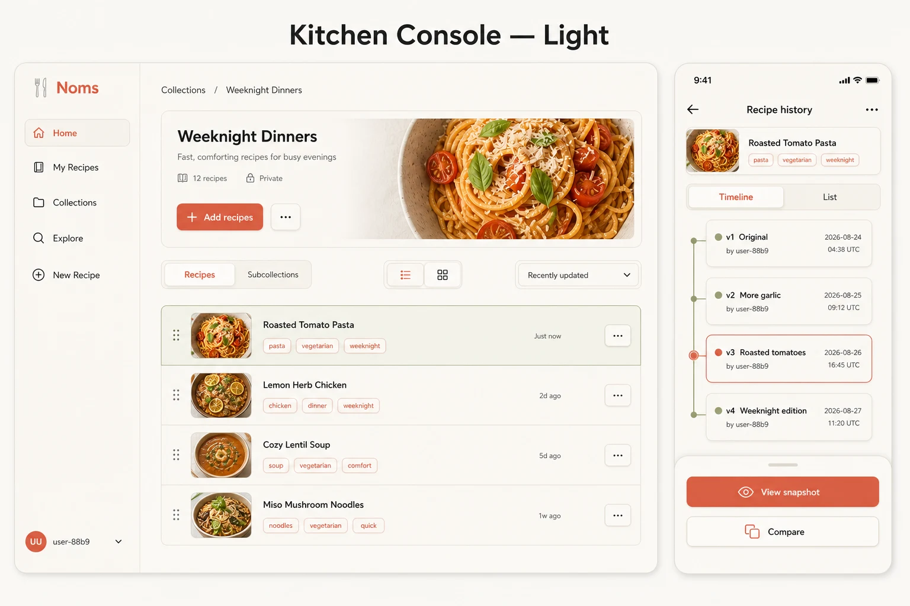](../assets/NOMS-020/selected-direction-light.webp) | [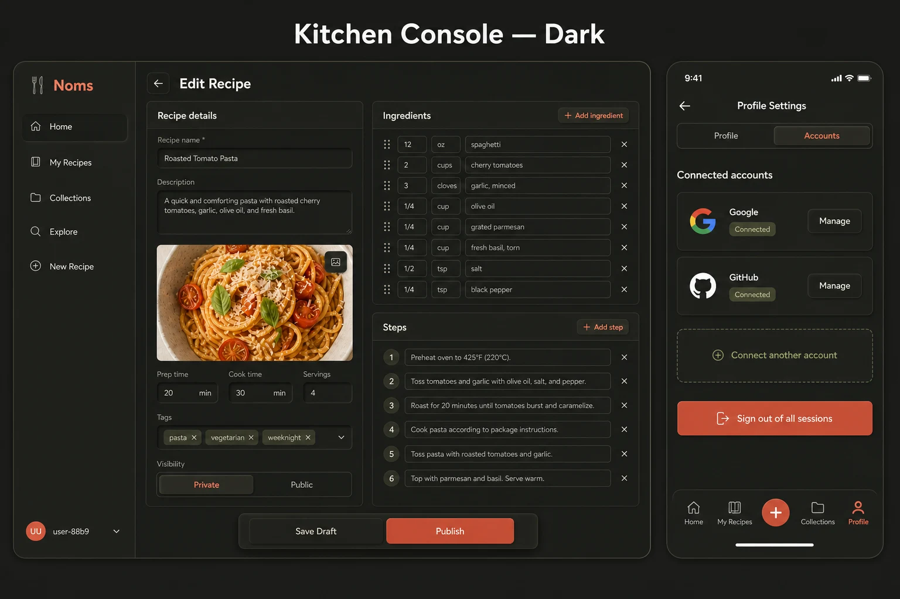](../assets/NOMS-020/selected-direction-dark.webp) |

### Representative routes and states

| Public and sign-in | Collections | Profile and empty states |
| --- | --- | --- |
| [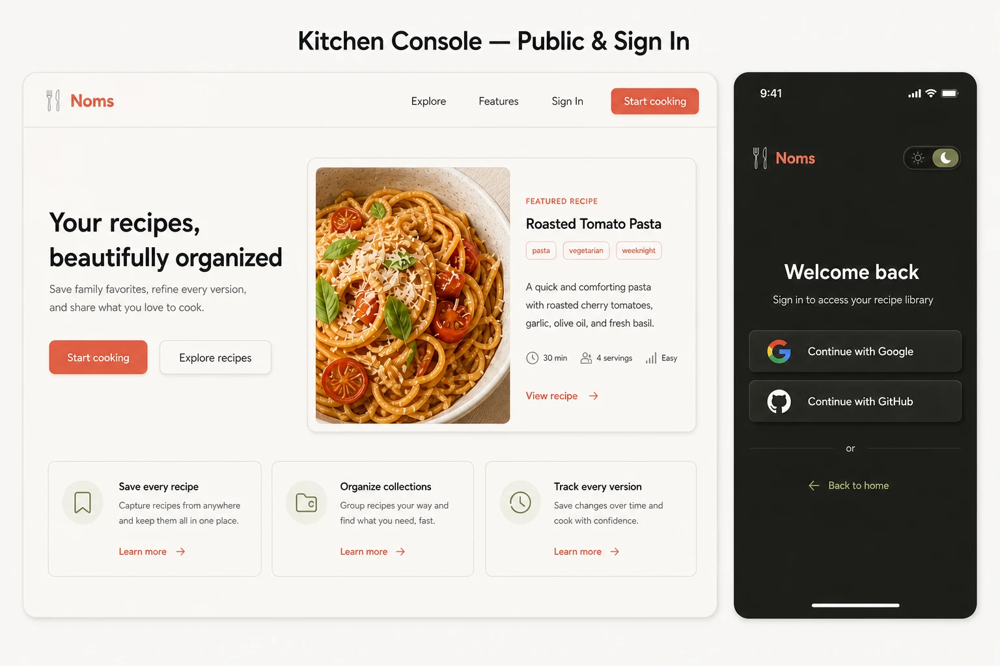](../assets/NOMS-020/public-and-sign-in.webp) | [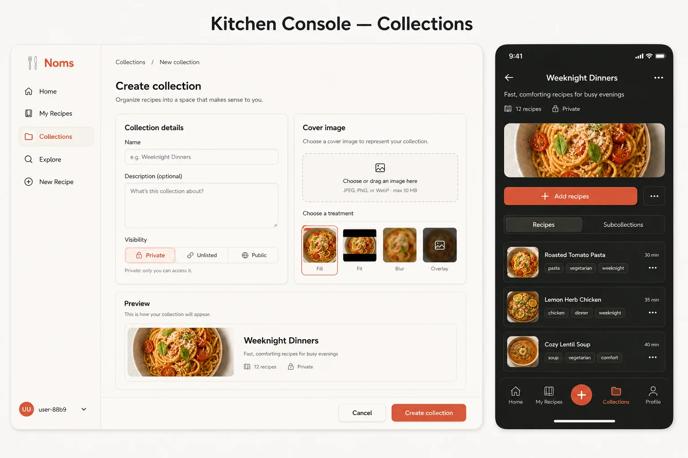](../assets/NOMS-020/collections.webp) | [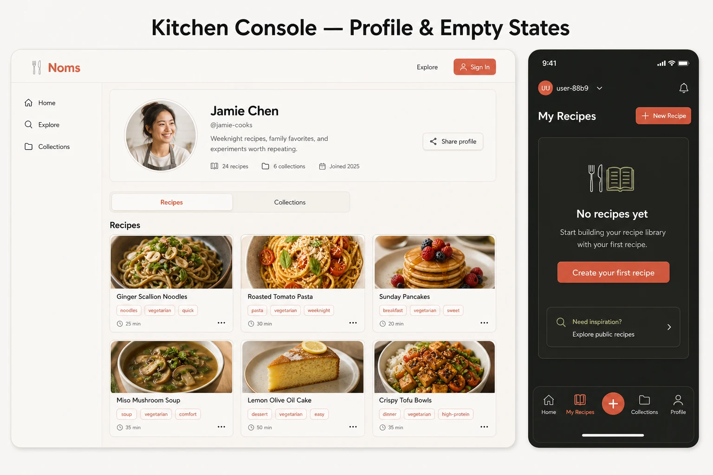](../assets/NOMS-020/profile-and-empty-states.webp) |

### Version history and comparison

| Version comparison | Spatial branching canvas |
| --- | --- |
| [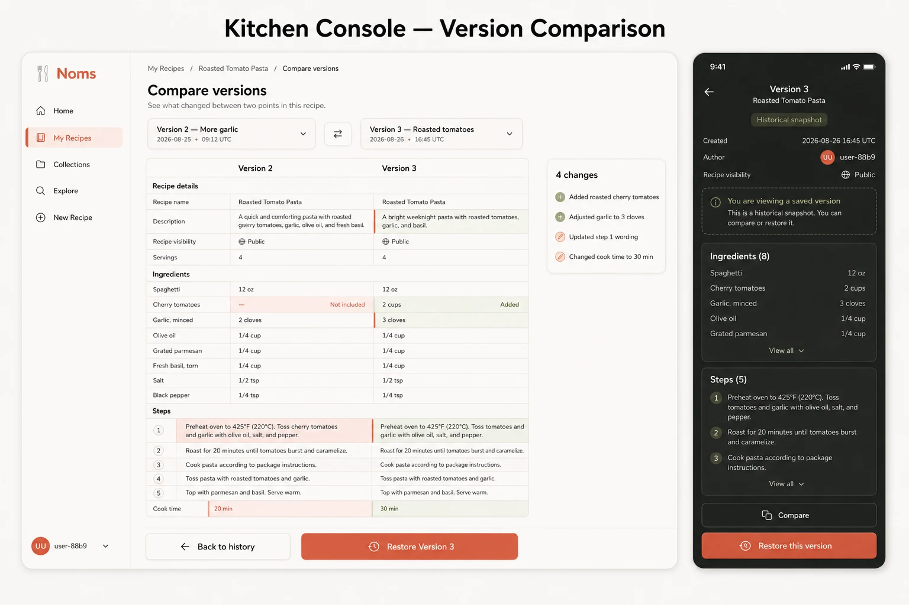](../assets/NOMS-020/version-comparison.webp) | [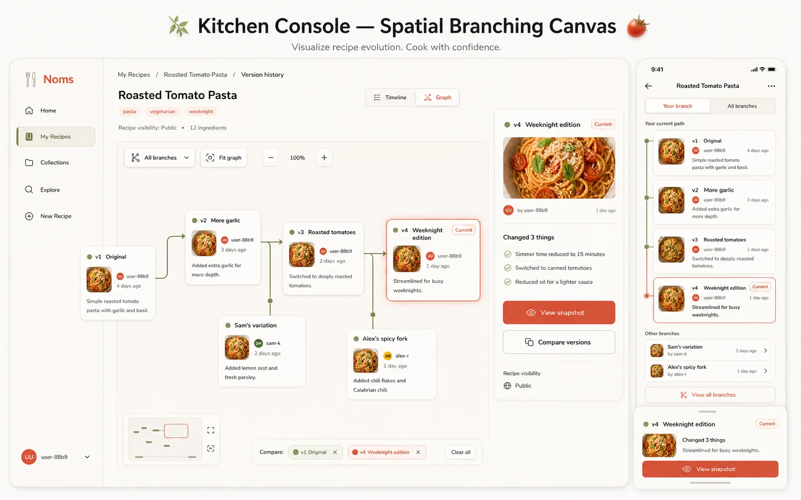](../assets/NOMS-020/version-graph-spatial-canvas.webp) |

| History lanes | Guided graph |
| --- | --- |
| [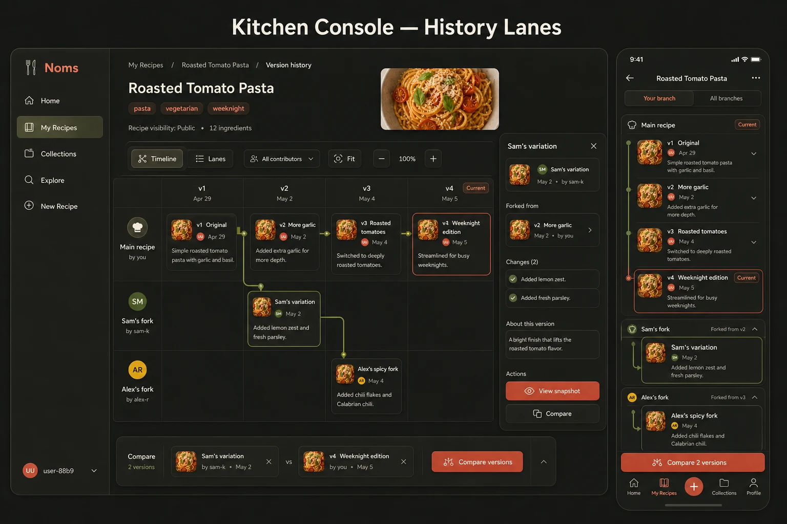](../assets/NOMS-020/version-graph-history-lanes.webp) | [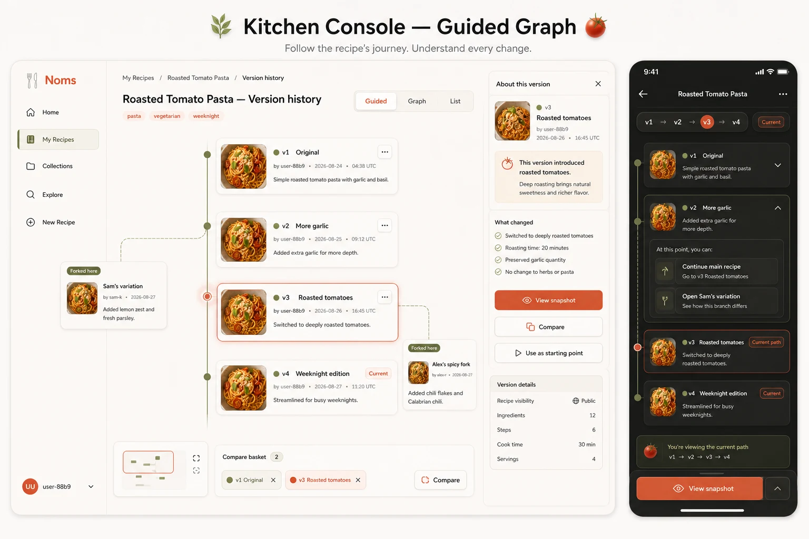](../assets/NOMS-020/version-graph-guided.webp) |

These earlier graph alternatives are superseded by G4A. They are not parallel implementation targets.

### Portrait-tablet adaptations

| Spatial canvas | Guided history | History lanes |
| --- | --- | --- |
| [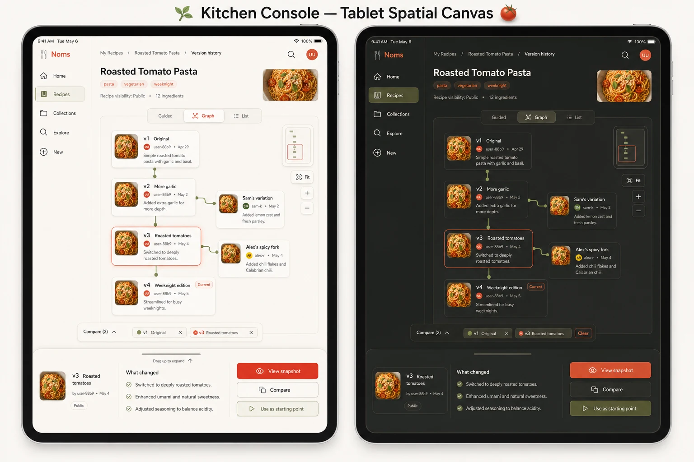](../assets/NOMS-020/tablet-spatial-canvas.webp) | [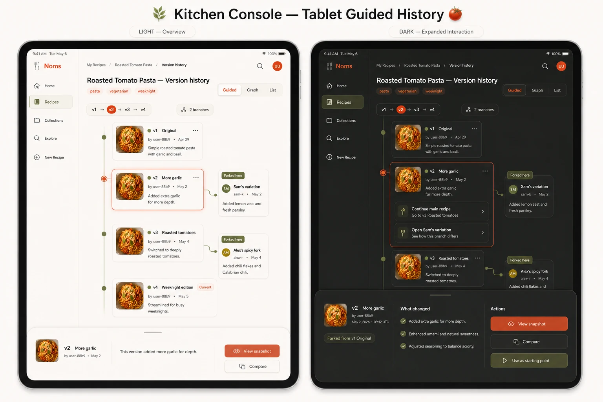](../assets/NOMS-020/tablet-guided-history.webp) | [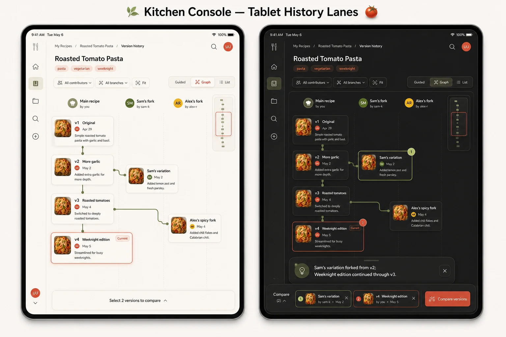](../assets/NOMS-020/tablet-history-lanes.webp) |

These tablet boards are deferred explorations only. Their inspector, bottom-sheet and comparison-tray patterns are not selected implementation requirements.

## Consolidated planning home and provenance

As of 2026-09-12, this document on `codex/NOMS-020-visual-design-refinement` is the canonical visual-overhaul plan. Continue design planning in `.worktrees/NOMS-020-visual-design-refinement`.

- Historical 2026-09-12 application baseline: `main` at `ce080b4`; this is not a claim about current HEAD.
- Kitchen Console principles, responsive guidance, and 21 reference/proposal boards: merged from `codex/noms-020-visual-examples` (`396d24b`).
- Historical A3 logo and original application screenshots: inherited from `main` (visual documentation commit `257402f`).
- [Refreshed desktop audit (2026-09-17)](../assets/NOMS-020/old-designs/audit-2026-09-17/README.md) records the running checkout and fixture caveats; use it as the desktop baseline, not as a claim about later main revisions.
- [Earlier logo proposals](../assets/NOMS-020/logo/) are retained for history; S3 now supersedes A3, F2 and S1 as the planned application mark.
- [NOMS-013 content inventory](../../docs/design/NOMS-013/content-inventory.md) and [page copy](../../docs/design/NOMS-013/page-copy.md) remain supporting references. Their search-related claims need reconciliation with the current Search page.

The source branch is retained as history. Its missing temporary worktree is not an active planning location. Feature-specific behavior remains owned by the corresponding feature ticket; this plan owns its visual integration.

## Remaining page and state planning

Historical audits include representative populated graph and comparison flows as recorded in the browser-audit notes, but not every dialog, dense graph, error or responsive state. Re-audit current main at implementation kickoff; historical screenshots are not current regression baselines. Resolve the following details within the relevant checkpoint, not through another broad design exploration. Dark-mode items in this inventory are deferred.

| Area | Existing direction | Remaining planning |
| --- | --- | --- |
| Shared shell | Selected N1 + N4 navigation-bar direction | Public versus authenticated variants, exact destinations, search/account access, responsive overflow, secondary navigation if needed, footer density, S3 sizing, focus and active states |
| Search | Preferred S2 Recipe Finder; scopes and state boards exist | Validate scopes, suggestions, filters/facets, sorting and pagination against current behavior; refine empty/error states and dark parity; phone/tablet discovery per page |
| Landing `/`, About, How-to | Accepted cozy v2 boards (historically called Home) | Reconcile actual copy, illustration restraint, reading widths, anchor navigation and guide claims with Search; deferred dark parity and per-page responsive discovery |
| Community Home `/home` | Community spotlight, announcements and participation composition implemented 2026-09-28; supersedes personal Home | Complete dark/contrast and full per-page responsive acceptance; future editorial curation, announcements authoring and engagement features require separate behavior planning |
| Sign-in | Preferred L6B: raised provider controls, guest-access link and guest/account feature sections | Preserve Google/GitHub flow and return destination; refine visibility-qualified copy, pending/cancelled/error feedback, short-viewport sizing, dark parity and signed-out shell |
| Dashboard | Preferred Central Workspace v1: persistent sidebar and central content management | Scope library search/filters/sort, list/grid and bulk collection organization; define Overview, selection, multiple memberships, draft eligibility, pagination, empty/loading/error states and dark parity |
| Explore | Preferred X7C Framed Recipe Cards: vertical neumo cards, inset 16:9 images, author details, adaptive columns | Define readable minimum width, long text and image/avatar fallbacks, focus/link semantics, tag behavior, loading/no-results/error states and dark parity; track existing tag-filter wiring separately |
| Recipe editor and drafts | Preferred E3T1 raised section panels (v5), restored photo and detached timeline sidebar | Desktop/dark interaction states, tracker semantics and focus, ingredient and nested-step editing, equipment, image upload/edit/reorder, validation, autosave/save failure, publishing, visibility and discard confirmation; phone/tablet discovery per page |
| Image editor | Preferred I1B Coral Control Deck (v3): wide preview above three raised panels, all controls exposed, coral sliders | Short-desktop sizing, dark mode, numeric entry, crop geometry, keyboard/focus and disabled states, undo/redo/reset/cancel/apply, context-specific avatar cropping; phone/tablet discovery per page |
| Recipe detail and snapshots | Preferred R3A Soft Album, plus earlier comparison studies | Scaling controls, historical-version context, comparisons, restore confirmation, fork attribution, sharing and collection membership |
| Version graph | Preferred G4A Balanced Cards on an inset soft canvas, raised toolbar and separate comparison panel | Selected integrated page and state studies cover visual direction; validate lineage, routing, viewport stability, same-snapshot feedback, stale async results, focus and accessible outline; dark redesign deferred; phone/tablet discovery per page |
| Collections | Preferred C3 Kitchen Albums | Nested paths, breadcrumbs, covers, create/edit forms, recipe/child reordering, membership picker, sharing and deletion-impact preview |
| Public profile and settings | Preferred P1 Kitchen Passport and P8 Cozy Accordion | Resolve combination/disclosure behavior; desktop public recipe/collection sections, avatar editing, validation, save feedback, linked accounts, linking failures, unlink and account-deletion dialogs; phone/tablet discovery per page |
| Shared feedback | Empty-state examples | Loading, retry, permission/sign-in required, missing content/404, success notices, disabled/pending controls and image failures |
| Upcoming feature integration | NOMS-016 through NOMS-019 coordination | Import/export, taxonomy, pantry/planning and visual recipe flow must receive visual specifications when their behavior is sufficiently defined; do not treat them as implemented main routes |

For each migrated area, cover desktop light-mode happy/loading/empty/error/disabled/focus states as applicable, keyboard access and reduced motion. Retain Fredoka display and Nunito body. Establish exact typography, contrast, colors, spacing and elevation in checkpoint 1; keep dark-mode regression protection and apply the per-page mobile/tablet discovery and acceptance workflow above.

## Page illustration and icon design tracker

### About and How-to additions — 2026-09-28

- [x] Select **About A3 — Information index card**: landscape cream card, olive backing and circled lowercase information symbol, coral top index tab, restrained ruled lines, gentle tilt and painted finish.
- [x] Select **How-to H3 — Recipe checklist and pencil**: portrait cream card with olive backing, coral top index tab, three olive checkmarks in cream wells and a diagonal coral pencil at the lower right. Retain the rounded, painted dimensional style.
- [x] Export separate transparent PNGs: [About A3](../../assets/brand/page-icons/about-v1.png) and [How-to H3](../../assets/brand/page-icons/how-to-v1.png), generated 2026-09-28 with the built-in image tool. Both retain the selected palette, painted finish and individual object composition.
- [x] Integrate both icons into their page headings and navigation drawer; verify desktop and 390px responsive rendering, decorative accessibility and drawer navigation. Completed 2026-09-28; evidence in checkpoint 8.

These selections extend the original eight page identities. The **About A3** label refers to this information-card study, not the historical app-logo A3. See [selected concept sheet](../assets/NOMS-020/page-icons/about-how-to-a1-h3-v1.png). Other variants remain intermediate ideas.

Added 2026-09-18. Exploration proceeded one page at a time, starting with Dashboard, then Explore, Collections and Recipe editor. The eight selected identities below were subsequently produced and integrated at the user's request on 2026-09-27; existing page-layout selections remain unchanged. Additional concepts still require approval.

### Existing identity decisions

- [x] Select the canonical app logo: [S3 — Continuous olive](../assets/NOMS-020/logo/spine-options-s1-s3-v1.md), selected 2026-09-27 replacing S1; continuous olive spine matching the cover, coral strap/bookmark, tilted painted form.
- [x] Generate [initial mascot concepts](../assets/NOMS-020/mascots/README.md); exploration only.
- [ ] Select a mascot and approve specific uses, if pursued; no mascot is currently approved.
- [x] Prepare standalone static S3 web SVG with verified Fredoka outlines and transparent background; browser review at 32–320px on light/dark surfaces (2026-09-27).
- [x] Integrate and standardize the painted PNG book across navigation, footer and sign-in; retain the SVG as an unused alternative (2026-09-27).
- [ ] Prepare favicon/single-colour variants and the separately discussed 3D model.

### Page-by-page exploration queue

Dashboard icon **P1 — Classic pinboard**, Explore icon **EC1 — Pocket compass**, Search icon **EX3 — Lifted pages**, Collections icon **CT4 — Lived-in shelves**, Recipe editor icon **ED3 — Editing clipboard**, History icon **HI5 — Timeline ledger + clock**, Profile icon **PB2 — Rounded rim**, and Settings icon **ST4B — Compact control panel** are selected (2026-09-18). EX3 was reassigned from Explore to Search; its original asset filenames and sheet title remain historical provenance. Dashboard represents an active workspace; Explore uses a pocket compass; Search uses an open book and magnifying glass; Collections uses a three-level bookcase; Recipe editor uses a clipboard and coral pencil; History combines revision entries with a clock; Profile uses a landscape identity card with a continuous coral inner rim. Settings uses a compact panel with three horizontal sliders, one rotary knob and three buttons. All eight queued page-icon directions are now selected; transparent production PNGs, optimized WebP derivatives, heading placements and browser integration are complete for all eight (2026-09-27); see [checkpoint 8 evidence](NOMS-020-checkpoint-8-integration.md#brand-artwork-integration--2026-09-27). Any additional page-specific directions remain unapproved. The suggested order is an exploration order, not a change to implementation checkpoints.

| Order | Area | Starting concept (unapproved) | Examples generated | Direction approved | Production assets ready | Integrated and verified |
| --- | --- | --- | --- | --- | --- | --- |
| 1 | Dashboard | Active workspace / P1 Classic pinboard, not storage | [P1–P6 pinboards](../assets/NOMS-020/page-icons/dashboard-pinboards-p1-p6-v3.md); [D3A–D3F](../assets/NOMS-020/page-icons/dashboard-d3-workspaces-v2.md); [initial D1–D5](../assets/NOMS-020/page-icons/dashboard-d1-d5-v1.md) | P1 Classic selected 2026-09-18 (top-left in sheet) | [PNG + WebP pipeline](../../assets/brand/page-icons/README.md) | [Verified 2026-09-27](NOMS-020-checkpoint-8-integration.md#brand-artwork-integration--2026-09-27) |
| 2 | Explore | EC1 Pocket compass / discovery; former EX3 moved to Search | [EC1–EC6 generated 2026-09-18](../assets/NOMS-020/page-icons/explore-compasses-ec1-ec6-v1.md) | EC1 selected 2026-09-18 (top-left in sheet) | [PNG + WebP pipeline](../../assets/brand/page-icons/README.md) | [Verified 2026-09-27](NOMS-020-checkpoint-8-integration.md#brand-artwork-integration--2026-09-27) |
| 3 | Collections | CT4 Lived-in shelves: three-level bookcase with mixed book arrangements | [CT1–CT4 three-level cases](../assets/NOMS-020/page-icons/collections-three-level-ct1-ct4-v3.md); [CL1A–CL1F history](../assets/NOMS-020/page-icons/collections-cl1-refinements-v2.md); [initial CL1–CL6](../assets/NOMS-020/page-icons/collections-bookshelves-cl1-cl6-v1.md) | CT4 selected 2026-09-18 (bottom-right in sheet); supersedes CL1 preference | [PNG + WebP pipeline](../../assets/brand/page-icons/README.md) | [Verified 2026-09-27](NOMS-020-checkpoint-8-integration.md#brand-artwork-integration--2026-09-27) |
| 4 | Recipe editor | ED3 Editing clipboard with coral clip and pencil | [ED1–ED4 generated 2026-09-18](../assets/NOMS-020/page-icons/editor-ed1-ed4-v1.md) | ED3 selected 2026-09-18 (bottom-left in sheet) | [PNG + WebP pipeline](../../assets/brand/page-icons/README.md) | [Verified 2026-09-27](NOMS-020-checkpoint-8-integration.md#brand-artwork-integration--2026-09-27) |
| 5 | Search | EX3 Lifted pages: magnifying glass over an open book | [EX1–EX4 sheet, originally titled Explore](../assets/NOMS-020/page-icons/explore-open-book-ex1-ex4-v1.md) | EX3 reassigned to Search 2026-09-18 (bottom-left in sheet) | [PNG + WebP pipeline](../../assets/brand/page-icons/README.md) | [Verified 2026-09-27](NOMS-020-checkpoint-8-integration.md#brand-artwork-integration--2026-09-27) |
| 6 | History / versions | HI5 Timeline ledger + clock; no separate branching graph icon selected | [HI5 generated 2026-09-18](../assets/NOMS-020/page-icons/history-hi5-ledger-clock-v1.md) | HI5 selected 2026-09-18 | [PNG + WebP pipeline](../../assets/brand/page-icons/README.md) | [Verified 2026-09-27](NOMS-020-checkpoint-8-integration.md#brand-artwork-integration--2026-09-27) |
| 7 | Profile | PB2 Rounded rim: landscape identity card with continuous coral inner border | [PB1–PB3 inner borders](../assets/NOMS-020/page-icons/profile-coral-inner-border-v3.md); [PA1–PA6 history](../assets/NOMS-020/page-icons/profile-pr2a-refinements-v2.md); [initial identity/portrait studies](../assets/NOMS-020/page-icons/profile-identity-portrait-v1.md) | PB2 selected 2026-09-18 (center in sheet); refines PR2A preference | [PNG + WebP pipeline](../../assets/brand/page-icons/README.md) | [Verified 2026-09-27](NOMS-020-checkpoint-8-integration.md#brand-artwork-integration--2026-09-27) |
| 8 | Settings | ST4B compact panel combines three horizontal sliders, a rotary knob and three buttons | [ST4B compact panel](../assets/NOMS-020/page-icons/settings-st4b-compact-v3.md); [ST4 history](../assets/NOMS-020/page-icons/settings-st4-combined-v2.md); [ST2A–ST2C panels and ST3A–ST3C dials](../assets/NOMS-020/page-icons/settings-controls-dials-v1.md) | ST4B selected 2026-09-18; supersedes wider ST4 | [PNG + WebP pipeline](../../assets/brand/page-icons/README.md) | [Verified 2026-09-27](NOMS-020-checkpoint-8-integration.md#brand-artwork-integration--2026-09-27) |

### TODOs for each area

- [x] Agree the eight metaphors and supporting heading placements; a separate illustration is not required for every route.
- [x] Generate and save labeled alternatives in the design assets; link the exploration from this tracker.
- [x] Record the user's selected direction and date, preserving rejected/superseded concepts as intermediate ideas.
- [x] Use detailed supporting page identities, not competing app logos or replacements for conventional small control icons.
- [x] Extend the shared book/page artwork to navigation drawer and dashboard sidebar labels at 32px; user-requested 2026-09-27. Existing routes, labels, avatars and small action controls remain unchanged. Evidence is recorded in checkpoint 8.
- [x] Prepare the approved assets and verify actual display sizes, preserving the selected olive/cream/coral palette, tilt, painted finish and lighting. S3 does not replace the selected page-icon artwork.
- [x] Review artwork in live page compositions; retain small conventional controls and avoid extra decorative clutter.
- [x] Integrate the eight identities with decorative accessibility treatment, successful asset loading and representative compact-width sizing. Broader per-page phone/tablet and dark regression acceptance remain separate open gates.

Update the table with linked evidence as each stage is completed; generated does not mean approved, and approved does not mean production-ready or implemented. Evaluate any additional routes (Home/About/How-to, sign-in, recipe detail and image editor) during their page work rather than assuming each needs a new emblem. This optional art exploration does not block shared foundations or approved page-layout implementation.

## Implementation checkpoints

Checkpoint 0 evidence: [2026-09-19 baseline inventory and runtime checks](NOMS-020-checkpoint-0-baseline.md). Application source matched local main at that baseline; representative fresh captures and mock-account flows are recorded there. Later slices still require their own detailed state baselines.

Checkpoint 1 work: [shared-foundation slices and acceptance criteria](NOMS-020-checkpoint-1-foundations.md), completed 2026-09-22 after eleven reviewed slices and a green full CI gate. Shared navigation/Explore and subsequent route workstreams have since been integrated; that earlier CI result is not a test run of the final combined revision.

Checkpoint 2 navigation: [N1/N4 implementation contract and verification](NOMS-020-checkpoint-2-navigation.md), started 2026-09-22. [Explore X7C implementation and acceptance checklist](NOMS-020-checkpoint-2-explore.md) records the framed-card slice, honest tag labels and retry behavior. The earlier browser-access restriction no longer blocks the integration deployment: shared navigation and Explore's empty public state were exercised on 2026-09-27. This does not close every populated, pagination, keyboard or responsive acceptance item in the original checklist.

Checkpoint 8 is now active. [Integration evidence](NOMS-020-checkpoint-8-integration.md) records the merged route revisions, browser workflows, confirmed issues and exact limits. The user approved private local fixtures; representative populated collection, recipe/image, history and fork-graph flows were validated. The 2026-09-29 follow-up fixes preserve encoded search queries, client-side sign-in return context and initial search-dropdown selection. The later graph request-lifecycle fix guards A → B → A navigation. Dense graph follow-ups now cover readable zoom, complete cards down to 320px, keyboard expansion through all 62 snapshots, stable focus/position while prepending, sampled contrast and reduced-motion loading. The populated pagination follow-up covers 30 Search recipe results, a 31-recipe collection and all 33 Dashboard recipes; Search/collection focus and collection error-copy fixes passed delayed/failure checks and 320px geometry checks. The editor follow-up fixes closed image dialogs intercepting native text undo and replaces raw recipe/draft load errors with a generic safe-exit alert. Avatar adjustments/apply/upload/reopen and representative authenticated non-owner denials passed browser checks. The final combined code gate on `db9e0a0` passed 834 tests (12 ignored), including the dependency audit with existing allowed warnings. Graph touch/long-press and screen-reader checks, plus broader per-route accessibility/dense-data acceptance, remain open. Checkpoints 3–6 are implemented/integrated; Dashboard's existing-behavior visual migration is integrated, while its unapproved functional expansion remains deferred. Per-route acceptance gaps carry forward rather than disappearing at merge time.

Proceed in reviewable slices. Each checkpoint records decisions, tests and screenshots before acceptance. This documentation cleanup does not authorize a new deployment or unrelated application changes.

Latest checkpoint 8 update (2026-09-30): [sharing, draft action failure and rectangular crop evidence](NOMS-020-checkpoint-8-integration.md#sharing-draft-action-failures-and-rectangular-crop-acceptance--2026-09-30) records failure recovery, mouse resizing and the pending-discard action guard. Final combined `just ci` on `6a434ee`: 842 passed, 0 failed, 12 ignored. [Earlier editor recovery evidence](NOMS-020-checkpoint-8-integration.md#editor-failure-recovery-fixes--2026-09-30) covers collection load/save, avatar retries and shared draft-save feedback; its 840-test gate and the earlier 834-test gate are historical. Remaining whole-app acceptance stays open.

| Checkpoint | Scope and decisions | Exit evidence |
| --- | --- | --- |
| 0 — Baseline and boundaries | Inspect current main and project guidance; inventory affected routes/primitives; reconcile intervening changes; capture current desktop screenshots and behavior; record existing defects separately | Baseline revision, route/state checklist, commands and fixtures documented; no unrelated changes absorbed |
| 1 — Shared foundations | Inventory and reuse current typography, palette and accent roles; consolidate existing values into semantic tokens and reusable components. Preserve Fredoka/Nunito, rounded forms and neumorphic character; refine spacing, elevation, borders, focus and motion only as needed | Before/after identity review; justified token changes documented; measured contrast and visible focus; existing dark/narrow layouts remain usable; no broad light-only overrides or unapproved rebrand |
| 2 — First complete slice | N1/N4 desktop shared navigation plus Explore X7C; resolve signed-in/out destinations, overflow, card minimum width, truncation, fallbacks and nested link semantics; retain current search/pagination behavior | Before/after screenshots, populated/empty/loading/error states, keyboard walkthrough, phone/tablet discovery and validation, dark smoke tests; explicit review before wider rollout |
| 3 — Public and account entry | Home/About/How-to cozy v2, Search S2 and sign-in L6B using established primitives; reconcile copy/scopes with current behavior; retain providers and return destination | Route tests and screenshots, search empty/error cases, auth pending/cancel/error and visibility-qualified guest copy |
| 4 — Content browsing and account management | C3 collections, R3A detail/history, P1/P8 profile/settings; settle disclosure defaults before coding; preserve membership, sharing, linking and destructive-action safeguards | Representative nested/multi-membership and public/private states; dialogs, validation and save failure verified; no accidental disclosure |
| 5 — Editing | E3T1 v5 recipe editor and I1B coral image editor; settle progress semantics and focus/scroll behavior; preserve continuous form and all visible image controls | Draft/autosave/save failure, publish/discard, nested steps, image crop/undo/reset/cancel/apply tested; short-desktop layout and keyboard checks |
| 6 — Version graph | Integrated G4A with selected comparison and dense/expansion states; preserve menus, solid/dashed topology, labels and accessible outline; define same-snapshot feedback, async request identity, focus after expansion and viewport stability | Populated fork fixture, comparison/no-difference/error/retry, concurrent/stale request checks, dense routing, pan/zoom and outline keyboard evidence |
| 7 — Dashboard scoped expansion | Central Workspace visual direction; first agree Overview content, exact filters/sort, selection scope/persistence, draft membership, multiple collections, pagination and count semantics | Written behavior decisions and tests before adding features; separate visual migration from backend/data changes; no assumed bulk delete/publish/visibility actions |
| 8 — Release review | Review migrated routes as one system, remove obsolete styles only when safe, finalize production S3 artwork if replacing current mark | Screenshot review, regression/accessibility checks, known-issue/deferred-work list and rollback notes; deployment remains a separate action |

Suggested order is foundations → navigation/Explore → other route slices. Dashboard functional expansion is gated independently and must not block safe visual work elsewhere. Checkpoints may be split further; do not bundle unrelated feature changes to finish a design board.

### Parallel workstreams and dependency gates

Added 2026-09-18. Checkpoint numbers describe scope and acceptance gates, not a requirement to implement every page sequentially. The shared critical path is **checkpoint 0 baseline → checkpoint 1 foundations → checkpoint 2 navigation/Explore review**. After that review is accepted and its shared changes are integrated, independent route workstreams may proceed concurrently. Route discovery and asset preparation can happen earlier, but should not introduce competing shared implementations.

| Workstream | Prerequisites | Ownership and coordination boundary |
| --- | --- | --- |
| Shared foundations and shell (0–2) | Refreshed current-main baseline and resolved route/component inventory | One coordinating owner for tokens, global styles, typography, shared controls, overlays, navigation and reusable recipe/collection cards. Validate the first complete Explore slice before wider route rollout |
| Public pages, Search and sign-in (3) | Accepted 0–2; current copy, search and auth contracts verified | Own route composition and route-specific states; consume shared cards, search controls and provider controls without changing auth behavior |
| Collections and recipe detail/history (part of 4) | Accepted 0–2; membership, sharing and historical-version behavior resolved | Own browsing compositions and route-local states; coordinate collection picker changes with the shared owner and version/comparison interfaces with the graph stream |
| Profile and Settings (part of 4) | Accepted 0–2; P1/P8 disclosure and privacy decisions resolved | Own account/public-profile composition and validation presentation; coordinate avatar image-editor interfaces with Editing and shared account/confirmation overlays with the shared owner |
| Recipe editor and image editor (5) | Accepted 0–2; continuous-form, tracker and image-control behavior resolved | Own editor composition and context-specific image controls; maintain a stable image-editor contract for avatar and recipe callers. Keep these editors together initially; split only after their interface and file ownership are explicit |
| Version graph (6) | Accepted 0–2; graph interaction contracts and populated fixtures defined | Own graph canvas, topology presentation and comparison states; coordinate shared snapshot/comparison components with detail/history. Need not wait for all of checkpoint 4 if the shared interfaces are already stable |
| Dashboard (7) | Accepted 0–2 for visual migration; explicit written behavior approval before functional expansion | Separate existing-behavior visual work from new management capabilities. Coordinate cards and collection interfaces with their owners; unresolved expansion must not block other streams |
| Logo and page-icon production | Selected references and agreed export/size requirements; may run alongside baseline/foundations | Own production artwork and asset manifest, not app-wide integration. Route owners integrate reviewed assets in their slices; unready assets do not block foundations. SVG/favicon/3D remain distinct deliverables, not prerequisites for unrelated page code |
| Release integration and review (8) | All in-scope streams integrated with acceptance evidence; deferred work explicitly recorded | Review the combined system, cross-route regressions, asset readiness and rollback notes. Deployment remains separately authorized |

Dependencies follow actual shared contracts, not just page names. For example, an avatar caller waits for an image-editor interface change it needs, but unrelated profile layout can proceed. Inventory exact files at kickoff rather than assuming today's component boundaries match current main.

#### Ownership and shared changes

- Before starting a stream, record its owner, branch/worktree, base revision, exact owned paths, dependencies, unresolved decisions and acceptance evidence location. Assign one coordinating owner for shared files; do not let parallel streams independently rewrite global CSS, token definitions, shell components or shared primitives.
- Use separate branches/worktrees per active stream. Keep the NOMS-020 plan and finalized reference index canonical; coordinate planning updates through one owner to avoid conflicting decisions. This section defines execution structure, not authorization to launch tasks or start implementation.
- A route needing a shared change proposes the contract and affected consumers to the shared owner. Implement and review that change once in a focused dependency slice, integrate it, then update consumers from that revision. Avoid copied primitives, page-specific global overrides and duplicate competing component APIs.
- Shared contracts include props/events, state and accessibility behavior, styling variants and responsive expectations. Prefer compatible additions; breaking changes require an explicit consumer migration order. Coordinate feature-ticket-owned behavior with its ticket owner rather than expanding visual scope.
- If two streams need the same file, assign that edit to one owner or serialize the overlapping portion. They may continue unrelated work in parallel. Shared fixtures, test configuration and asset manifests follow the same ownership rule.

#### Integration and review gates

1. Start route implementation from the accepted shared baseline; close that route's open behavior decisions first. Record dependencies explicitly rather than relying on an unmerged branch's incidental state.
2. Deliver small, independently reversible slices with the per-slice evidence below. Each page owns its mobile/tablet discovery during or after desktop work; desktop-done is not page-complete while responsive validation remains outstanding. Dark redesign stays deferred, with existing dark-mode regression protection.
3. Before integration, synchronize with the latest agreed integration baseline, resolve conflicts under the relevant ownership rules, rerun affected tests/build checks and review code plus screenshots. Shared-component changes must exercise representative consumers, not only the originating route.
4. Integrate accepted slices one at a time in dependency order, even when implementation is concurrent. Recheck affected cross-route flows such as collection membership, avatar/recipe image editing, detail-to-graph navigation and auth return destinations.
5. Perform checkpoint 8 against the combined revision. Completion of isolated branches is not release acceptance; preserve a known-issues/deferred-work list and rollback path.

### Behavior boundaries

- Preserve existing server/API, auth, visibility, draft and destructive-action contracts unless a change is explicitly scoped.
- The recorded Explore tag-filter wiring defect is not silently fixed or represented as working merely by restyling chips. Re-verify against current main, track separately and obtain explicit scope for functional changes.
- Generated controls, copy, counts and image assets are not feature authority. Preserve existing navigation destinations, menus and safeguards omitted by an image.
- Use the approved S3 reference; do not ship superseded A3/F2/S1 or generated open-book approximations. The standalone static SVG is available in `assets/brand/noms-logo.svg`; page integration is complete; favicon/single-colour variants and 3D-model work remain separate pending deliverables.
- Do not add upcoming feature-ticket routes from old mockups.

### Acceptance and evidence for every slice

- Record tested revision, route, auth/data fixture, viewport and state with before/after screenshots. Use a representative populated fixture as well as empty/error cases; document source-only or untested cases honestly.
- Run repository-required formatting, relevant unit/integration tests and build checks discovered at kickoff. Add tests for changed interaction contracts; report actual commands/results, not generic “tested” claims.
- Check keyboard order, named controls, visible focus, semantic links/buttons, modal focus/escape, error association, status announcements and reduced motion. Measure WCAG AA text/control contrast; shadows cannot be the only state cue.
- Keep 16:9 Explore photos and adaptive columns, short-desktop actions reachable, long text usable and image fallbacks intentional.
- Smoke-test existing dark mode. Record phone/tablet discovery decisions and implementation evidence for every page; distinguish desktop-done from page-complete when responsive work remains.
- Review code and screenshots before accepting a slice. Address regressions before widening rollout; retain independently reversible changes and document known limitations.
- Pixel differences from generated artwork are acceptable when needed for actual fonts, assets, behavior or accessibility; record material departures from the selected composition for user review.

## Readiness and remaining gates

- [x] Major visual directions selected and indexed.
- [x] G4A full-page and key interaction-state directions selected.
- [x] Desktop-first implementation, per-page mobile/tablet discovery and dark-mode deferral recorded.
- [x] Staged checkpoints and acceptance evidence defined.
- [x] Parallel workstreams, shared ownership rules and integration gates defined.
- [x] Current-main baseline refreshed at kickoff — [checkpoint 0 evidence](NOMS-020-checkpoint-0-baseline.md), 2026-09-19; representative runtime/source baseline, not exhaustive per-route acceptance.
- [x] Exact shared tokens/components implemented and reviewed in checkpoint 1.
- [x] Major page redesign workstreams integrated at `74c4200`, including Search, Dashboard, collections, recipes and user pages.
- [x] Combined browser smoke pass recorded — [2026-09-27 evidence](NOMS-020-checkpoint-8-integration.md); partial acceptance, not a full regression pass.
- [x] Fix and revalidate subcollection parent-context loss — `9b6d667`, including saved nesting and Cancel destinations.
- [x] Fix empty-name public-profile presentation — `9cbeef5`, with username fallback across heading, avatar and empty states; verified signed in and signed out.
- [x] Add a dedicated Home at `/home`, preserving landing `/` and management `/dashboard`; reworked as a community hub per the user's clarification, removing personal data reads. Default sign-in/nav retained; validation recorded 2026-09-28.
- [x] Implement collection-ID scope replacement and lifecycle regressions — `3a6ab7a` plus corrected keyed-fragment reconciliation in `cf0696c`. Populated child → parent → child navigation and nested Cancel destinations passed live revalidation on 2026-09-29.
- [x] Reconcile guest-search copy/destination with authenticated Search — `453eb0e`; landing guidance links to public Explore search and sign-in copy distinguishes guest/account capabilities. Search authorization is unchanged.
- [x] Improve shared neutral text contrast without changing palette identity/elevation — `2e7f5d0`; semantic-role contrast tests cover both themes' opaque surfaces and gradient stops, not exhaustive composited-page AA certification.
- [x] Name image-editor range/number controls and announce flip state — `1ccc064`; avatar caller keyboard adjustment/undo/reset/cancel and short/narrow footer reachability checked. Recipe caller crop/apply, actual upload retry after session expiry and private publication subsequently passed on 2026-09-29. Avatar save/reopen acceptance is recorded below; exhaustive pointer transforms remain open.
- [x] Run repository-required local CI on combined code at `cf0696c`: 799 passed, 12 ignored; separately, all 11 ParadeDB search integration tests passed in an isolated test database. Existing audit policy allows eight warnings; real-storage integration remains unrun.
- [x] Fix encoded-query round trips — `0ef66ba`; the application route boundary preserves Search's raw query while retaining generated path matching/display/layouts. Actual route regressions cover reserved characters, Unicode, advanced criteria and malformed/duplicate state; guest and signed-in browser flows preserve `tomato & basil` and `C++ & 100%`.
- [x] Preserve intended return context from the client-side sign-in gate — `514fced`; subscribe to the raw current route, apply existing same-origin/length validation and encode the complete target. Browser mock sign-in returned to the original encoded search; the default `/home`, providers and server redirect contract remain unchanged.
- [x] Restore selected Search dropdown options in initial HTML — `a54b5dc`; browser reload exposed an Exact phrase URL with an All terms native selection. Explicit option selection now covers match modes, sort, visibility, time and servings; two SSR regressions failed before the fix, then passed.
- [x] Run final local CI on `a54b5dc`: 808 passed, 0 failed, 12 ignored, with native/WASM checks, Clippy, formatting and repository policy gates. Eight existing audit warnings remain allowed. No fresh ignored search/real-storage integration run claimed for this follow-up.
- [x] Obtain permission and create private local test fixtures; validate two nested collections, multiple memberships, recipe autosave/reload, image apply/upload retry, private v1/v2 publication, historical comparisons and a three-node fork graph against the combined code. Fixtures remain private and retained for reproduction; no deletion was performed.
- [x] Record populated geometry checks at 1440×810, 820×1180 and 390×844 for both collections, recipe detail, historical snapshot and fork graph; signed-out private-content denials and a populated dark-graph smoke check also recorded. These are representative checks, not full device/accessibility or authenticated non-owner acceptance.
- [x] Refine the two recorded error states — `6187e21`: historical snapshot load failures use one generic unavailable state with safe Back navigation; image upload batch/retry failures use allowlisted actionable copy without framework wrappers. Snapshot owner/signed-out/missing states passed live checks; upload copy and retained retry bytes passed automated tests. No fresh expired-session browser upload is claimed for this follow-up, and broader cross-route error presentation remains part of failure acceptance.
- [x] Harden collection submission against missed input events — `3ba9b9a`: named form fields are copied into signals at submit before existing validation/deferred-upload callbacks. Real component submit events reproduced dispatching default values despite supplied fields; two regressions failed before the fix and all five form tests then passed. Create/edit/Enter/Unicode/blank-name/reload checks passed live; private fixtures remain retained.
- [x] Close bounded early collection-input and native editor recovery acceptance — `34c5bfe`, `dfddc11`: normalize only empty URL delimiters in retained-form keys, omit inactive inert attributes, and capture live collection fields at hydration mount before controlled rerenders. Browser-checked top-level/nested early Unicode text, unchanged input nodes, sibling-field/native keyboard edits, guest/replacement-account blocking, original-account text/image recovery and missed-event empty-name validation with no content writes. Full CI: 956 passed, 0 failed, 12 ignored. The exact historical rapid-navigation sequence remains unconfirmed; these newer regressions are not evidence of its cause. See [fix acceptance](NOMS-020-checkpoint-8-integration.md#collection-startup-and-native-editor-recovery-acceptance-2026-10-02).
- [x] Run final local CI on `3ba9b9a`: 814 passed, 0 failed, 12 ignored, including native/WASM checks, Clippy, formatting and repository policy gates; eight existing allowed audit warnings. No fresh ignored search/real-storage integration run claimed. Ordered diff and runtime evidence received second-pass self-review, not independent-agent review.
- [x] Guard version-graph expansion and both comparison requests by route visit (including A → B → A); focused graph tests and combined-code `just ci` pass at `6eb11e0` (818 passed, 12 ignored). Normal comparison and soup → fork → soup state reset were browser-checked; see [request-lifecycle evidence](NOMS-020-checkpoint-8-integration.md#version-graph-request-lifecycle--2026-09-29).
- [x] Create and retain a separate private 62-snapshot graph fixture (32 root versions, 30 forks); browser-verify initial bounds, all continuation pages, independent out-of-order expansion, failure/retry, signed-out denial and delayed A → B → A rejection. See [dense fixture evidence](NOMS-020-checkpoint-8-integration.md#dense-private-graph-fixture--2026-09-29).
- [x] Correct the dense graph's initial zoom, Current control, resize positioning and offscreen keyboard focus; browser-check 304px cards and focus traversal at desktop, 820px tablet and 390px phone widths. See [dense graph readability/focus evidence](NOMS-020-checkpoint-8-integration.md#dense-graph-readability-and-focus-pass--2026-09-29).
- [x] Verify graph expansion-plus-focus through all 62 snapshots, older-history collapse/cached reopen, complete 320px cards and narrow keyboard menus; improve sampled connector contrast and reduced-motion loading. Final `just ci` at `6cb6a6d`: 828 passed, 12 ignored. See [graph interaction acceptance evidence](NOMS-020-checkpoint-8-integration.md#graph-interaction-acceptance-follow-up--2026-09-29).
- [x] Verify synthetic graph long-press cancellation — `3d9e731`: reject two-finger starts and cancel an armed timer when another finger joins. Two new regressions failed before the fix; 64 graph tests and full CI (959 passed, 12 ignored) passed. Rebuilt-browser synthetic events covered early release, cancellation, 13px movement and second-finger start/move; 12px still opens the menu. Native keyboard menu/focus recovery and outline expansion were rechecked. See [gesture evidence](NOMS-020-checkpoint-8-integration.md#graph-gesture-cancellation-and-accessibility-follow-up-2026-10-02).
- [ ] Complete real-device graph touch/long-press, movement cancellation and scrolling, plus actual screen-reader checks. Synthetic event-handler evidence is now recorded, but native in-app touch injection remains unsupported and no screen reader is available through the current tools. These checks require a physical touch/browser environment and assistive-technology walkthrough; neither accessibility-tree inspection nor synthetic touch closes this gate. Sampled contrast does not close the whole-app composited audit.
- [x] Recheck available graph controls and document the device handoff on 2026-10-03: 67 focused tests passed; live keyboard menu/focus restoration, 25 → 30 outline expansion and 320px/390px/820px control geometry passed. Native touch injection is still unsupported, native app control is disabled, and no screen reader or connected device is available. The real-device/screen-reader gate above remains open; see [manual graph checklist](NOMS-020-checkpoint-8-integration.md#graph-device-and-screen-reader-checklist-2026-10-03).
- [x] Validate populated recipe Search (20 + 10), collection detail (12 → 24 → 31) and Dashboard (12 + 12 + 9) pagination. Fix and recheck Search/collection focus, guarded pending/completed actions, collection readable failure/retry and 44px paging controls. Search scope replacement, collection route-away isolation and 320px geometry passed; exact limits are in checkpoint 8 evidence.
- [x] Restore native text undo/redo when image dialogs are closed — `4598435`; browser-checked recipe notes and profile Bio, plus active avatar Reset/Undo/Redo. Closed and active Ctrl/Cmd key mappings have unit coverage; macOS runtime checks remain open.
- [x] Validate avatar adjustment/apply/upload/reopen on a dedicated local mock reviewer: all ten numeric controls and both flips survived reload; Cancel focus restored. No owner profile change or deletion. Subsequent pointer/retry checks are recorded below; real-device acceptance remains open.
- [x] Improve recipe/draft editor load errors — `db9e0a0`; generic alert and safe Dashboard exit verified for authenticated non-owner access. Private recipe detail, v1, graph and collection detail also denied access without displaying private content. Owner editor access was restored. Final combined `just ci`: 834 passed, 0 failed, 12 ignored; second-pass self-review, not independent-agent review.
- [x] Fix collection editor failure presentation — `2267b40`; non-owner retry remains denied, owner load retry restores the form, failed updates retain entries and partial move failure reports saved details. Sharing failure copy gained browser evidence in the follow-up below; no visibility change committed.
- [x] Retain confirmed avatar source/edits for failed-upload retry — `e472420`; actual retry succeeded without reselection, pending focus/duplicate-click guard passed. Retry data is page-local. Pointer crop movement/Undo/Cancel passed; rectangle mouse resizing passed in the follow-up below, while touch remains open.
- [x] Separate draft-save errors from validation feedback — `aa76056`, `496a5b5`; forced autosave/manual-save failures retained notes. A successful background save also cleared an earlier manual-save error without another manual click; fixture text was restored. Publish/discard feedback gained browser evidence in the follow-up below. This slice's `just ci`: 840 passed, 0 failed, 12 ignored.
- [x] Browser-check sharing preview/update and publish/discard failures with pre-server interception; recovery retained private fixtures and readable feedback. Fix pending-discard publication/action guards — `6a434ee`; disabled controls, duplicate clicks and the 3-second autosave exclusion check passed. Final `just ci`: 842 passed, 0 failed, 12 ignored. Actual publication/deletion and post-commit lost-response cases were not performed in this slice.
- [x] Validate rectangular crop mouse resizing on all four edges, 10–100% bounds and one-step Undo/Redo. Cancel restored picker focus; the staged test image was removed from the local queue without upload. Real touch and pixel-level exported-image checks remain open.
- [x] Add explicitly approved synthetic local discovery data and validate public Explore (12 → 24 → 25), collection Search (20 + 5) and cook Search (20 + 5). Fix Explore focus across pending/failure/retry/completion — `0931dca`. Keyboard paging, duplicate/terminal guards, query/scope replacement, out-of-order responses, guest/non-owner visibility and 320px paging geometry passed; final `just ci`: 844 passed, 0 failed, 12 ignored. Reproducible fixture script: `391c65a`; original private fixtures unchanged. Exact limits are in the 2026-09-30 checkpoint 8 evidence.
- [x] Validate Collections and Dashboard load-failure isolation/recovery — `fb884ad`: safe collection error copy, shared focusable pending retry feedback, subscribed resource state and live duplicate-request guards. Collections retained its filter; Dashboard recipes/drafts/collection tree recovered independently. Guest return-context gates, non-owner empty workspaces and 320px retry geometry passed. Final `just ci`: 849 passed, 0 failed, 12 ignored. No content writes or new fixtures in this slice; post-success focus placement and full screen-reader acceptance remain open.
- [x] Validate public-profile recovery and populated recipe/collection pagination — `147b27f`, `5c22c33`: safe independent retries retain cards and failed offsets; guarded pending/terminal controls retain focus; keyed username scopes reset state. Browser checked 12 → 24 → 25, initial/header failures, delayed route-away/replacement, private/unlisted exclusion and 320px controls. Explicitly approved insert-only synthetic profile fixture: `4bf0637`; original private fixtures unchanged. Final `just ci`: 854 passed, 0 failed, 12 ignored. Direct username replacement has keyed-scope unit evidence; browser replacement navigated via Explore. Full accessibility and post-success header focus remain open.
- [x] Validate Settings profile-save and linked-account load recovery — `fb5f1bb`, `eac415b`, `91bfe6f`, `cd1065a`: failed saves retain entered text, safe validation/transport feedback, pending/invalid action guards, stable focus and hydration-gated editing. Account reads/retries have named pending feedback and live duplicate guards. Browser checked repeated pre-server failures, real username conflict, successful reviewer save, reload, guest return-context gates and 320px controls; temporary reviewer name/bio changes restored. Final `just ci`: 860 passed, 0 failed, 12 ignored. No account linking/unlinking/deletion or avatar removal; those mutation failure states and global auth-bootstrap failures are not accepted by this slice.
- [x] Validate recipe-detail visibility, Fork and Restore mutation recovery — `bde5b52`: failed visibility selection/focus retained, safe uncertain-outcome feedback, live duplicate guards, stable pending controls and row-local restore errors. Browser checked pre-server failure/retry, real private-save/fork/restore success, stale-version conflict, cross-version restore guard, private guest gating and 320px controls. Approved synthetic fixture: `823a4f2`; current deployment is a new empty-baseline local instance, distinct from previous evidence. Final `just ci`: 866 passed, 0 failed, 12 ignored. Delete and history/comparison reads, post-commit lost responses and whole-page accessibility remain open. See [mutation acceptance](NOMS-020-checkpoint-8-integration.md#recipe-mutation-recovery--2026-09-30).
- [x] Validate current recipe-detail history/lineage and inline difference recovery — `fa547af`, `51c5f8e`, `60f4eb3`: independent initial retries, failed cursor/row retention, stable pending/terminal focus, direct difference retry and keyed recipe visits. Approved private history fixture: `6d14bcd`. Browser checked 25 → 30 snapshots, duplicate/terminal guards, same-document Back/Forward with delayed old requests, guest private gating and 320px controls/populated differences. Fixed narrow comparison clipping; final `just ci`: 874 passed, 0 failed, 12 ignored. Initial-retry post-success focus, historical custom comparisons and whole-page accessibility remain open. See [read recovery acceptance](NOMS-020-checkpoint-8-integration.md#recipe-history-lineage-and-inline-difference-recovery--2026-09-30).
- [x] Implement recipe Delete safeguards and explicit M4 shared confirmation — `76f7369`, `41c933b`: default-safe Cancel focus, live duplicate/owner/dialog guards and safe pending/uncertain-outcome feedback. Browser accepted click/Enter/Escape cancellation, focus trapping/return, private guest gating and 320px geometry with zero cancellation requests. Final `just ci`: 880 passed, 0 failed, 12 ignored. The preliminary native-prompt test unexpectedly deleted one synthetic fixture; content and draft linkage were restored, but original timestamps/v3-v4 IDs were regenerated. See [Delete evidence and recovery limits](NOMS-020-checkpoint-8-integration.md#recipe-delete-safeguards-and-shared-confirmation--2026-09-30).
- [x] Accept final shared-modal Delete pending/failure/retry/success on the separately approved disposable recipe — 2026-10-01: two intercepted failures, live keyboard/pointer guards, real expired-session recovery and successful retry to Dashboard. Only that recipe and its single snapshot were deleted; hashes of unrelated recipes/versions/collections/memberships/drafts/users matched. Fourteen deletion-related tests passed. This does not close post-commit lost-response/navigation-failure recovery. See [approved Delete acceptance](NOMS-020-checkpoint-8-integration.md#approved-disposable-recipe-delete-acceptance--2026-10-01).
- [x] Recover failed global session refresh — `6ddb93d`: retain SSR/current identity and page entries on failed checks, reject inconsistent/stale contexts, guard duplicate retries and keep stable pending/completion focus. Browser checked failed initial/retry reads, unsaved Settings entries through real successful retry, shared route lifetime, 320px geometry and real guest gating after normal sign-out. Final full CI rerun: 887 passed, 0 failed, 12 ignored; first run hit an existing temporary-DB upload-test timeout. See [session-refresh acceptance](NOMS-020-checkpoint-8-integration.md#global-session-refresh-recovery--2026-10-01). Remaining Settings mutations and full accessibility are not accepted by this slice.
- [x] Implement Settings unlink/avatar-removal/account-deletion UI recovery — `38d8dc8`: retain confirmations/selected image edits on failure, safe uncertain-outcome feedback, live exclusive submission guards and focusable pending controls. Remove timed OAuth-conflict reload and unsafe account-deletion advice. Browser accepted sole-provider pointer/keyboard guards, persistent conflict dismissal and non-final account-deletion Back/cancellation at desktop/320px with zero API requests; full CI: 897 passed, 0 failed, 12 ignored. See [Settings mutation evidence](NOMS-020-checkpoint-8-integration.md#settings-mutation-ui-recovery--2026-10-01). No destructive mutation submitted.
- [x] Accept Settings unlink/avatar-removal/account-deletion pending/failure/retry/success on the action-time-approved disposable `@cp8settings` account — 2026-10-01. Two pre-server failures per action, pending duplicate/dismissal guards, real successful outcomes, sole-provider protection and guest landing passed. Fix removed-trigger success focus — `e916455`; avatar focus verified after real removal, unlink focus verified with a UI-only success replay followed by real provider refresh. Full CI: 912 passed, 0 failed, 12 ignored. Only this account and its three synthetic avatar files were disposed; original row hashes match. Storage files were removed directly within approval scope, not by an observed worker cycle. Post-commit lost responses, identity replacement, navigation failure and full accessibility remain open. See [approved Settings acceptance](NOMS-020-checkpoint-8-integration.md#approved-disposable-settings-mutation-acceptance--2026-10-01).
  - [x] Prepare the approved isolated `@cp8settings` local account with two mock providers and a managed synthetic avatar — 2026-10-01. Normal Google mock sign-in, two provider cards and loaded avatar verified; original content/account hashes unchanged. Final unlink/removal/deletion actions have not been submitted. See [fixture preparation](NOMS-020-checkpoint-8-integration.md#disposable-settings-fixture-preparation--2026-10-01).
- [x] Validate actual client-generated avatar pixels before server execution — `496cc16`, `8c706e5`, `5f667ad`: fix full-image transform/crop order and align the elliptical preview's sRGB colour space with the exporter, leaving rectangular recipe colour behaviour unchanged. Offset crop/rotation/flip, stretch, colour adjustments, portrait and landscape inputs passed independent interior-pixel checks for 400px/100px WebP variants and transparent corners. Four preview/export colour samples differ by at most two RGB levels. Original bytes, user/content row hashes and zero avatar references unchanged; every captured upload was failed before execution. Final `just ci` (configured cap: eight test threads): 915 passed, 0 failed, 12 ignored. Recipe-image outputs/additional input formats are checked in the follow-up below; edge pixels, touch and full accessibility remain open. See [avatar pixel evidence](NOMS-020-checkpoint-8-integration.md#avatar-export-pixel-acceptance--2026-10-01).
- [x] Validate six recipe-image input/export cases and JPEG/WebP avatars — 2026-10-01, checker `1d80544`. Actual client files pass WebP dimensions, aspect-ratio preservation, no upscaling, sampled colours and alpha (including translucent PNG). Recipe crop/rotation/flip/colour remained non-destructive rather than baked into the variants. Every upload and draft-create request was failed before execution; original user/content hashes remain unchanged. Shared image-upload tests: 30 passed; no runtime change or new full CI run. Resolve Docker exhaustion by removing only the oldest stopped test app container and rebuildable Cargo cache; all database/media volumes preserved. See [recipe and format evidence](NOMS-020-checkpoint-8-integration.md#recipe-image-variants-and-input-format-acceptance--2026-10-01). Corrupt-file decoding, EXIF/wide-gamut/animation, edge pixels, persisted edit round trips and real-device checks remain open.
- [x] Validate historical snapshot/custom-comparison recovery — `13b112d`: safe load/comparison retries, retained Before/After pair, live exclusive claims and keyed recipe/version visits. Browser checked repeated failures, real reverse/same-version success, pending focus/duplicate guards, delayed return-visit isolation, guest denial and 320px geometry. Full CI: 902 passed, 0 failed, 12 ignored. See [historical acceptance](NOMS-020-checkpoint-8-integration.md#historical-snapshot-and-custom-comparison-recovery--2026-10-01).
- [x] Add graph initial-load retry and harden comparison recovery — `4879025`: safe unknown errors, live exclusive comparison claims and pending selection guards, stable panel action and successful graph retry focus. Browser checked initial/retry failures, real v29 → v30 comparison, duplicate guards, child-fork expansion retry, guest denial and 320px comparison geometry. Full CI: 905 passed, 0 failed, 12 ignored. See [graph recovery](NOMS-020-checkpoint-8-integration.md#version-graph-recovery-follow-up--2026-10-01).
- [x] Add current-recipe and collection-detail initial-load recovery — `1f885b1`: safe unavailable headings, live guarded retries, stable pending focus and success focus. Browser checked repeated pre-server failures, real retries, guest private denials and 320px geometry; full CI: 909 passed, 0 failed, 12 ignored. See [detail load recovery](NOMS-020-checkpoint-8-integration.md#initial-recipe-and-collection-detail-recovery--2026-10-01).
- [x] Perform populated light responsive/permission sweep — 75 route/viewport combinations at phone, portrait tablet and desktop widths; public and owner forms fit without document overflow or unnamed visible main inputs. Owner captures were retaken after loading. Guest gates preserved return context; private titles/edit controls stayed hidden; complete public catalog excluded private/unlisted items. Native drawer and nested picker keyboard checks passed without content writes. See [scoped acceptance and fixture setup](NOMS-020-checkpoint-8-integration.md#populated-light-responsive-and-permission-sweep--2026-10-01); this is not full per-page accessibility sign-off.
- [x] Separate readable text inks from decorative fills — `f854042`: shared links, small status copy, Search and graph badges retain coral/green character using semantic ink roles; all four ink roles pass 4.5:1 token contrast in both themes. Existing fills/fonts/artwork unchanged. Full CI: 911 passed, 0 failed, 12 ignored. Browser verified rendered editor/About colours and About reduced-motion/forced-colour fallbacks. See [contrast scope and limits](NOMS-020-checkpoint-8-integration.md#semantic-text-contrast-follow-up--2026-10-01).
- [x] Accept malformed/unsupported/empty/oversized image failure recovery — `9325dc6`, `fb06df6`: shared original-file validation, bounded decode completion/error observation and URL cleanup; failed recipe previews close without blocking later valid selections, while avatar failures retain usable retry/choose controls. Browser verified desktop/320px feedback, same-file reselection and valid images after failures with zero content/upload requests. Fixed narrow decode-error overflow. Full CI: 920 passed, 0 failed, 12 ignored; 35 focused image tests passed. See [image input failure acceptance](NOMS-020-checkpoint-8-integration.md#image-input-failure-recovery--2026-10-01). This does not accept every decoder/encoding failure, persisted image edits or real-device touch.
- [x] Accept persisted recipe gallery image-edit round trips — `70ad0d4`: saved previews are keyboard-operable edit buttons, hydrate the selected rectangle edit from the full image, and update metadata without another upload or replacing other named templates. A new private synthetic recipe passed initial save, reload/reopen, cancellation isolation, autosave/reload, pre-server publication failure and real retry, historical v1 preservation and 320px keyboard reopening/focus return. Actual stored full/thumbnail variants passed independent sampled-pixel checks. Original content/account hashes match; the new fixture and unchanged follow-up draft are retained. Full CI: 924 passed, 0 failed, 12 ignored; 38 focused gallery tests passed. See [persisted recipe image evidence](NOMS-020-checkpoint-8-integration.md#persisted-recipe-image-edit-round-trips--2026-10-01). Avatar persistence, collection covers, step photos and post-commit lost responses remain separate gates.
- [x] Accept persisted avatar edit round trips on a separate synthetic mock profile — 2026-10-01. Saved-original reopening, cancellation isolation, pre-server upload failure/identical-file retry, real replacement, reload, source-read failures/retry and 320px keyboard/focus checks passed. Actual stored original/full/thumbnail bytes match the submitted files; independent 400px/100px crop/colour/transparency checks passed. Existing user/content hashes unchanged; fixture retained, original session restored. No runtime change required; 22 focused Settings tests passed, latest unchanged runtime full CI remains 924 passed/12 ignored. See [persisted avatar evidence](NOMS-020-checkpoint-8-integration.md#persisted-avatar-edit-round-trips--2026-10-01).
- [x] Accept collection-cover and step-photo edit round trips — `ecd04cc`: shared keyboard-edit buttons in both recipe editors restore full-source metadata and preserve assets/other named views. Synthetic private fixtures passed cancellation isolation, autosave/reload, pre-server save/publication failure and actual retry without reupload, historical v1 preservation, new-recipe-to-draft flow and 320px focus/overflow checks. Stored full/thumbnail variants passed sampled-pixel verification; original user/content hashes match. Full CI: 927 passed, 0 failed, 12 ignored. See [cover and step-photo evidence](NOMS-020-checkpoint-8-integration.md#collection-cover-and-step-photo-edit-round-trips--2026-10-01). Initial step-upload failures, blob lifecycle and multi-file/reorder interactions remain open.
- [x] Accept initial step-photo input/upload recovery, owned preview lifecycle and selection/reorder guards — `703441e`, `5f49899`, `ab4d386`: safe bounded feedback, same-file reset/retry, batch-wide live guards and sequential valid-file ordering in both editors. Browser checked malformed files on both routes, pre-server failure with failed-edit cleanup, real portrait retry, mixed-file ordering, saved photo/step reordering, 320px feedback and new-route teardown URL release. Only the existing synthetic draft and three image assets changed; original content/account hashes match. Full CI: 930 passed, 0 failed, 12 ignored. See [step-upload acceptance](NOMS-020-checkpoint-8-integration.md#initial-step-photo-upload-recovery-preview-lifecycle-and-ordering--2026-10-01). Encoding edge cases and post-commit lost responses remain open.
- [x] Accept committed draft-response loss and new-recipe outcome recovery — `d04e2cf`, `63d3bd8`, `fd6a232`: prevent duplicate first-draft creation after uncertain responses, retain draft identity before publication, keep safe outcome warnings and pause writes until separate-tab Dashboard recovery. Browser/SQL checked real committed saves with lost responses, newest-edit/return-visit isolation, guarded first creation, initial publication before autosave, exactly one private recipe/v1, zero subsequent writes, manually recovered entries and 320px feedback. Original row hashes match; full CI: 933 passed, 0 failed, 12 ignored. See [committed-response acceptance](NOMS-020-checkpoint-8-integration.md#committed-draft-response-loss-and-new-recipe-outcome-recovery--2026-10-01). This is scoped UI recovery, not server-side idempotency or automatic content merging.
- [x] Accept confirmed recipe-write destination failure recovery — `c004795`: typed router transitions keep the app shell alive after publication and save-and-return. Browser/SQL checked committed new/existing publications, saved unpublished/published draft returns, offline destination reads, keyboard/narrow-screen retry, zero repeated mutations and original-row integrity. Full CI: 935 passed, 0 failed, 12 ignored. See [navigation evidence](NOMS-020-checkpoint-8-integration.md#confirmed-recipe-write-navigation-and-identity-switch-audit--2026-10-01). Discard, ordinary new-editor Cancel and other operations' final-navigation paths are not newly accepted.
- [x] Bind UI server-function mutations to their initiating account — `38c233e`: verified-session matching before writes across 27 mutations and two editing reads; retained-entry mismatch feedback, stale profile callback guards and no replacement-session logout after deletion. Browser checked guest/replacement-account rejection, retained profile/recipe/collection/image edits, 320px keyboard feedback and successful retained draft/collection saves after restoring the original account. SQL integrity checks passed; full CI: 943 passed, 0 failed, 12 ignored. Destructive actions were not replayed. See [account-bound acceptance](NOMS-020-checkpoint-8-integration.md#account-bound-form-mutation-acceptance--2026-10-01).
- [x] Implement scoped cross-tab session refresh and protected-page lifecycle — `d7b3013`, `37935f4`: activation/route checks, coalesced follow-ups and a visible-tab 30-second fallback; explicit keyed read scopes reset cached libraries and profile links together. Original-account editors remain mounted, hidden/inert on identity mismatch; native modals suspend and resume without losing edits. Eight new regressions include actual mount retention and cached-data remount behavior; original full CI: 951 passed, 0 failed, 12 ignored. See [session-consistency acceptance](NOMS-020-checkpoint-8-integration.md#session-refresh-and-protected-page-lifecycle--2026-10-01) for detection/failure limits. The later startup remount, inert serialization and hydration handoff defects are fixed and have [bounded recovery acceptance](NOMS-020-checkpoint-8-integration.md#collection-startup-and-native-editor-recovery-acceptance-2026-10-02); broader identity/device acceptance remains open below.
- [x] Accept scoped direct multipart and OAuth identity boundaries — `88b7a5c`: an admitted multipart upload remains owned by its original account after session revocation/replacement during storage; subsequent requests verify their own session. A revoked OAuth-link callback rejects before provider exchange, consumes its bound state and clears only its transaction cookie. Existing replacement-account/browser-binding callback tests pass. Browser confirmed guest 401s, authenticated missing-field 400, active-login 409 and normal existing-account sign-in. No live upload/link/unlink was submitted. Full CI: 961 passed, 0 failed, 12 ignored. See [multipart and OAuth evidence](NOMS-020-checkpoint-8-integration.md#multipart-and-oauth-identity-boundary-acceptance-2026-10-02).
- [ ] Audit remaining identity edges — the scoped multipart/OAuth admission checks do not replace real-browser/OS activation or every in-flight read/identity race. OAuth changes after callback admission and competing delayed login/refresh response cookies remain unaccepted. Rechecks provide bounded eventual consistency, not immediate cookie-change notification. Further destructive acceptance needs a fresh isolated fixture and action-time approval.
- [x] Release shared gallery preview URLs on route teardown — `5d4cada`, `c58ba7c`: shared leases preserve still-mounted previews and revoke on final ownership drop. Forced uncached browser verification confirms 0 outstanding URLs after SPA navigation and malformed decode; removing an item during delayed encoding does not resurrect it. Valid selection recovers afterward. Final CI: 964 passed, 0 failed, 12 ignored. Extra cleanup experiments were removed after diagnosing stale WASM execution. See [gallery lifecycle evidence](NOMS-020-checkpoint-8-integration.md#gallery-preview-lifecycle-and-delayed-result-acceptance-2026-10-02).
- [x] Bound shared image processing waits and own decoder URLs — `0d1ddba`: decoder, encoder and blob reads have 30-second deadlines; weak one-shot completions discard late results without retaining the waiting task. Native Blob promises replace forgotten FileReader handlers. Browser checks cover null/rejected results, all three deadlines, decoder/encoder route cancellation and successful recovery. Full CI: 972 passed, 0 failed, 12 ignored. This is not an instantaneous browser-GC or native-work cancellation claim. See [image pipeline acceptance](NOMS-020-checkpoint-8-integration.md#image-processing-callback-and-cancellation-acceptance-2026-10-02).
- [x] Preserve local work across editor section navigation — `a7bbcdf`: fragments no longer reset the retained-form key; nonempty query changes still create a fresh form. An actual routed-form regression preserves edited text, DOM identity and Back/Forward history. Browser checks retain Ready photos, a 10° adjustment, pending processing and reordered image identity across section jumps; real route exit revokes all previews. Full CI: 973 passed, 0 failed, 12 ignored. See [section navigation acceptance](NOMS-020-checkpoint-8-integration.md#editor-section-navigation-acceptance-2026-10-02).
- [x] Restore gallery keyboard focus after image reordering — `e21c559`: post-render focus follows the stable image ID, retaining the requested direction for middle moves and switching to the enabled opposite direction at a boundary. Enter/Space, repeated moves, 10° adjustment retention and 320px geometry passed in the browser. Four new regressions cover focus decisions and actual gallery-button wiring across two uploaders; full CI: 977 passed, 0 failed, 12 ignored. See [gallery reorder focus acceptance](NOMS-020-checkpoint-8-integration.md#gallery-reorder-focus-acceptance-2026-10-02). Drag/touch and full screen-reader acceptance remain separate gates.
- [x] Accept scoped desktop gallery and method-photo dragging — `53a34e4`: gallery reordering preserves whole records during processing, and both editor routes share a tested same-step photo boundary. Browser checks cover trusted pointer reordering, real delayed encoding completion at the moved position, 12° adjustment retention, rejected cross-step drops in both directions and self/outside-drop cleanup. Five new regressions; full CI: 982 passed, 0 failed, 12 ignored. Recipe/account row hashes match; three synthetic step-photo uploads were added with tab-local autosave timers held. See [image drag acceptance](NOMS-020-checkpoint-8-integration.md#gallery-and-method-photo-drag-acceptance-2026-10-02). Normal autosave, real touch, simultaneous structural edits and edit-route native gestures are not newly accepted.
- [x] Accept sampled EXIF orientation and WebP sizing/transparency — `03095e9`: fix zero-pixel canvas exports for very thin images, preserving at least one pixel on each axis. Seven native regressions cover common sizes, thin/maximum inputs, positive bounds, invalid inputs and actual pipeline wiring. Browser pixel checks pass all eight JPEG orientations for full/thumbnail exports, both thin axes, 1920/800 bounds and PNG alpha. Full CI: 989 passed, 0 failed, 12 ignored. No saved content or media count changes. See [orientation/export acceptance](NOMS-020-checkpoint-8-integration.md#image-orientation-and-export-acceptance-2026-10-02). This is scoped to the tested browser and synthetic samples, not every decoder or colour profile.
- [x] Accept sampled ICC conversion to sRGB — six sRGB/A98/ROMMRGB JPEG/PNG fixtures produced 12 real full/thumbnail WebP exports; all 48 sampled corner pixels matched an independent profile conversion within 2 channel levels. No code or saved-data changes. See [colour and animation evidence](NOMS-020-checkpoint-8-integration.md#image-colour-and-animation-audit-2026-10-02). This does not establish HDR, wide-gamut output retention or every profile/browser combination.
- [x] Record the still-image editor scope — user confirmed 2026-10-02 that the editor does not need to handle animations. Animation playback, frame editing, preservation and preview agreement for animated sources are outside this overhaul's acceptance criteria. Existing first-frame exports remain unchanged; the animated-source preview mismatch is a documented limitation, not an acceptance blocker. No new rejection or flattening logic is required. See [scope decision](NOMS-020-checkpoint-8-integration.md#still-image-editor-scope-decision-2026-10-02).
- [x] Accept collection creation response loss and confirmed destination recovery — `e8a7382`: uncertain creation now keeps entries, blocks repeat Create/Enter submissions and offers a separate-tab Collections read path. Browser/SQL verified committed response loss, zero repeated POSTs, single-record recovery, usable Cancel and confirmed creation with offline destination/320px keyboard retry. Three private synthetic collections added; original rows unchanged. Three new regressions; full CI: 992 passed, 0 failed, 12 ignored. See [collection creation evidence](NOMS-020-checkpoint-8-integration.md#collection-creation-outcome-recovery-2026-10-02). No server idempotency, cross-tab retry prevention, cover-response loss or unhydrated-submit acceptance is claimed.
- [x] Accept scoped collection edit/move/sharing response loss and confirmed destination recovery — `62e7b20`: preserve intended fields, block blind retries and later writes after an unconfirmed stage, and offer a separate-tab saved-state check. Browser/SQL proved each mutation committed before its response was dropped; read recovery and final offline destination retry did not repeat saves. Existing empty synthetic fixtures reused and restored to private; original collections and recipe/account rows unchanged. Three net new regressions; full CI: 995 passed, 0 failed, 12 ignored. See [collection edit evidence](NOMS-020-checkpoint-8-integration.md#collection-edit-outcome-recovery-2026-10-03). No atomic multi-stage transaction, automatic reconciliation, cover-response loss or in-flight route/account replacement acceptance is claimed.
- [x] Prevent native collection form submission before hydration without losing early-entered name/description values — `2417416`: disabled SSR submission and a live readiness guard enable Save only after mounted field capture. Browser delayed real WASM, confirmed zero early navigation/writes, retained Unicode values and the same input nodes, tested root/nested creation startup and normal create/edit saves. One private empty fixture retained; preceding content/account rows unchanged. Full CI: 997 passed, 0 failed, 12 ignored. See [hydration readiness evidence](NOMS-020-checkpoint-8-integration.md#collection-form-hydration-readiness-2026-10-03). Pre-hydration non-text options, other forms and full device/accessibility acceptance remain separate.
- [x] Accept scoped collection-cover upload response loss — `cd23ef6`: honest shared unconfirmed-upload copy and unsaved-collection feedback, preserving existing explicit retry/single-use save guards. Browser/SQL verified real stored uploads with lost acknowledgements, no automatic/repeated content writes, Retry uploading only the image, later single create/update with newest entries, preservation of the old cover until replacement Save, and reload of flipped metadata. One new private fixture and five media records retained; all preceding collection/content/account rows unchanged. Full CI: 999 passed, 0 failed, 12 ignored. See [cover upload evidence](NOMS-020-checkpoint-8-integration.md#collection-cover-upload-response-recovery-2026-10-03). Extra temporary copies and cleanup eligibility are documented; no upload idempotency, completed cleanup or whole-device acceptance claimed.
- [x] Accept scoped recipe-gallery and step-photo upload response loss — `779f0d8`, `6c447a4`: both editor controllers distinguish unknown upload outcomes, explain explicit retry/reselection, and clear only resolved gallery warnings. Browser/SQL checked successful responses dropped after asset registration, blocked repeat publication/upload, retained gallery adjustments and latest text, step-photo reselection with reapplied adjustments, normal private autosave and reload, and preservation of an unrelated validation error. One existing synthetic draft updated, one new private unpublished draft and twelve upload records retained; unrelated content/account hashes match. Full CI: 1003 passed, 0 failed, 12 ignored. See [recipe upload evidence](NOMS-020-checkpoint-8-integration.md#recipe-gallery-and-step-photo-upload-response-recovery). No upload idempotency, completed cleanup, newly published-recipe roundtrip or whole-device acceptance claimed.
- [x] Accept scoped recipe uploads completing after navigation or account replacement — existing `c6c8b7e` runtime required no fix. Browser held four real successful upload responses: old gallery/step results did not enter a fresh route, and account replacement kept the original editor hidden/inert while follow-up draft operations rejected. Restoring the original account retained adjustments and saved without uploading again. Only one existing unpublished synthetic draft changed; unrelated content/account hashes matched. Fresh focused tests: 232 passed, 0 failed. See [in-flight recipe upload evidence](NOMS-020-checkpoint-8-integration.md#recipe-uploads-completing-after-navigation-or-account-replacement). Collection-cover/avatar completion, mixed batches, suspended-tab timer behavior and full device/accessibility acceptance remain separate.
- [x] Accept scoped collection-cover and avatar uploads completing after navigation or account replacement — unchanged runtime required no fix. Four held successful responses showed that leaving a cover editor cancels its deferred save, a replacement account cannot save the original collection, and late avatar completion cannot overwrite the replacement account's UI. Restoring the cover owner saved its retained 17° adjustment without re-uploading. Avatar confirmation commits immediately; route cancellation does not undo that accepted server write. One private synthetic collection and one existing synthetic profile were deliberately updated. Fresh focused tests: 354 passed, 0 failed, 2 existing tests ignored. See [cover and avatar completion evidence](NOMS-020-checkpoint-8-integration.md#collection-cover-and-avatar-uploads-completing-after-navigation-or-account-replacement). This does not close collection creation completion, post-write navigation races, mixed batches or device/accessibility acceptance.
- [x] Accept scoped collection creation uploads and committed create/details completion across route/account changes — `2d7259f`: prevent late successful acknowledgements from navigating a replacement account, remember a confirmed creation to block duplicate submission, and stop staged edits before subsequent mutations after identity mismatch. Browser checked route cancellation, definitive pre-write account rejection, retained 13° cover recovery without re-upload, actual committed create/details responses, halted requested move, fresh separate-tab reads and sticky duplicate/save guards after owner restoration. Three private synthetic collections and two image assets were added; all earlier collection/account/recipe/draft/version/reference hashes match. Full CI: 1006 passed, 0 failed, 12 ignored. See [collection completion acceptance](NOMS-020-checkpoint-8-integration.md#collection-creation-uploads-and-committed-completion-account-guards). Move and sharing follow-up coverage is recorded below.
- [x] Accept scoped committed collection move completion and sharing completion after route exit/sign-out — 2026-10-03, unchanged runtime. Actual held HTTP 200 move responses passed route-exit cancellation and fully observed replacement-account guards, with no later sharing request. Sharing reduction passed route exit and the guest phase of a sign-out/sign-in sequence; a later replacement refresh did not redirect. Restoring the owner retained the review link and disabled Save. Five new empty fixtures end Private; all earlier row hashes match. Fresh existing tests: 24 passed, 0 failed. See [move and sharing observations](NOMS-020-checkpoint-8-integration.md#collection-move-and-sharing-completion-observations).
- [x] Accept sharing completion after the retained editor observes the fully signed-in replacement account — 2026-10-03, unchanged runtime. Held a real accepted sharing reduction, waited for both the replacement avatar and hidden/inert original editor before release, and verified no redirect or repeated mutation. Owner recovery retained accurate feedback, disabled Save and a separate-tab saved-state check; fresh read and SQL confirmed Private. Only one existing empty test fixture changed; other collection/content/account hashes match. See [settled sharing completion](NOMS-020-checkpoint-8-integration.md#settled-sharing-completion-and-startup-selection-follow-up).
- [x] Preserve early collection sharing selection — `e7fe07d`: capture the live native select at mount, mark its actual SSR option selected, and ignore invalid/disabled/unchanged events. Three new regressions failed before the fix. Browser held real startup, retained early Unlisted plus Unicode text, saved the requested sharing, checked normal editing, and retained an unsaved early Public choice on a nested form. One new empty fixture ends Private; previous rows match. Full CI: 1009 passed, 0 failed, 12 ignored. See [sharing startup acceptance](NOMS-020-checkpoint-8-integration.md#collection-sharing-startup-acceptance).
- [x] Accept sampled mixed gallery admission and publication blocking — real PNG/JPEG/WebP files became Ready in order alongside a corrupt PNG; TXT/SVG were skipped. Three successful uploads did not bypass the failed item's publication guard, and a repeated Publish did not re-upload or publish. Private autosave and fresh read retained the three successful images only. One new private unpublished draft and three media assets; previous content/account hashes match. See [mixed gallery acceptance](NOMS-020-checkpoint-8-integration.md#mixed-gallery-admission-and-publication-blocking). Mixed server-side upload failures, explicit retry/removal and device/accessibility coverage remain open.
- [x] Accept sampled mixed gallery HTTP failure and explicit retry — 2026-10-04, unchanged runtime. With three saved images and three new still images, an injected HTTP 503 rejected the middle upload before any server write; the two real successful uploads autosaved privately. Repeated Publish made no new upload/publication request. Per-item Retry made one real upload, cleared feedback, restored selection order and retained an 11° edit through a fresh read. Only the existing synthetic draft and three new assets changed; protected row hashes match. Fresh focused uploader tests: 50 passed, 0 failed. See [mixed HTTP recovery](NOMS-020-checkpoint-8-integration.md#mixed-gallery-http-failure-and-explicit-retry). This is injected browser-side failure coverage, not a real storage outage or completed cleanup/removal/device acceptance.
- [x] Preserve active image edits during gallery batch processing — `c3616b4`: one automatic preview per selection batch cannot replace an active editor or reopen a closed one. Browser reproduced lost unconfirmed edits before the fix; uncached rebuilt checks retained a 17° adjustment on the first image only, respected cancellation and preserved a 29° edit confirmed before processing completed. Three new native signal regressions failed before the fix; 53 focused uploader tests and full CI passed (1012 tests, 0 failed, 12 ignored). Content hashes/media count unchanged. See [batch editor acceptance](NOMS-020-checkpoint-8-integration.md#active-image-editor-ownership-during-gallery-batch-processing). This does not close every overlapping picker/drop or real-device interaction.
- [x] Accept sampled mixed gallery uploads with a lost accepted response — 2026-10-04, unchanged runtime. Dropped the middle upload's actual HTTP 200 after SQL confirmed its asset. Other acknowledged images autosaved privately; uncertainty feedback blocked publication and a repeated Publish sent no request. Explicit Retry uploaded one replacement, restored the original position and 31° edit, and did not re-upload successful images. Fresh read/SQL confirmed a private unpublished nine-image draft. Four new assets and only the existing synthetic draft changed; protected hashes match. Fresh focused uploader tests: 53 passed, 0 failed. See [mixed accepted-response loss](NOMS-020-checkpoint-8-integration.md#mixed-gallery-accepted-response-loss-and-explicit-recovery). The unacknowledged asset remains uncommitted/unreferenced at the recorded read; cleanup and upload idempotency are not accepted.
- [x] Preserve ordering across overlapping gallery selections — `9cd5631`: synchronously admit all Processing rows before encoding yields, retain stable completion IDs and preserve manual order/edits. Real picker checks reproduced PNG/WebP/JPEG interleaving before the fix and verified PNG/JPEG/WebP afterward, retained newer 31° and queued 23° edits, and recovered valid inputs after a malformed overlapping batch. Protected row hashes/media count unchanged. 55 focused tests and full CI passed (1014 tests, 0 failed, 12 ignored). See [overlapping gallery acceptance](NOMS-020-checkpoint-8-integration.md#overlapping-gallery-selection-ordering). Native drop/touch and whole-editor acceptance remain separate.
- [x] Align Settings display names with OAuth storage and accept long-name layout — `70690b1`, `d5b4021`: shared trimmed 2–100-scalar validation matches existing VARCHAR(100) storage; preserve imported names, correct byte-based counters and avoid UTF-16 truncation. Browser/SQL verified existing-name bio edits, 100-character Chinese/emoji/ASCII saves, invalid-entry write guards, fixture restoration and 320px public empty-state wrapping. 41 Settings and 9 profile tests passed; final full CI passed 1018 tests, 0 failed, 12 ignored. See [profile-name acceptance](NOMS-020-checkpoint-8-integration.md#profile-display-name-limits-and-long-name-layout). This does not normalize every provider input or alter username/bio policies.
- [ ] Continue remaining dense editor/image acceptance within the still-image scope. Public discovery and private recipe pagination evidence do not close the entire checkpoint.
- [ ] Complete cross-route failure/permission checks, full accessibility and per-page populated phone/tablet acceptance. Dark smoke and empty-page geometry checks are partial evidence, not page-complete acceptance.
- [x] Integrate production S3 painted artwork and all eight page identities; browser and automated evidence recorded 2026-09-27. Favicon/single-colour/3D deliverables remain open.
- [x] Record the 2026-09-29 second-pass self-review, known/deferred issues and rollback baseline `2a940e2` in checkpoint 8 evidence; no independent-agent review claimed.
- [ ] Obtain final whole-app visual/behavior acceptance before overhaul sign-off. No deployment is implied.

**Next: still image lifecycle and concurrent structure. Four executable closeout packages remain, plus the separately listed handoff gates.** Historical snapshots, graph recovery, current-recipe/collection load recovery, populated light layouts, scoped Settings mutation outcomes, sampled avatar exports, gallery/step image input failure recovery, persisted gallery/avatar/cover/step-photo edits, step-upload retry/order/lifecycle, committed draft-response/new-publication recovery, confirmed recipe-write destination recovery, collection creation and editing response/destination recovery, collection form hydration readiness, collection-cover and recipe-gallery/step-photo upload response recovery, scoped recipe/collection-cover/avatar upload navigation/account replacement, account-bound UI server-function writes, scoped cross-tab refresh/page lifecycle, multipart/OAuth admission boundaries, gallery preview teardown/delayed-result recovery, bounded image pipeline waits/cancellation, retained editor section navigation, gallery reorder focus, scoped desktop image dragging, sampled EXIF/WebP/ICC export checks, mixed gallery admission/HTTP retry/accepted-response loss, active batch-editor ownership, overlapping gallery picker ordering, profile-name storage alignment, accepted-response loss for profile Save/visibility/Fork/Restore and the permission/keyboard sweep now have evidence. Animation handling is explicitly out of scope. The latest code CI passed 1020 tests; token contrast and rendered colour checks pass. Neither geometry nor unit tests closes all interaction/accessibility acceptance.

- Retained-editor startup and native recovery now have bounded acceptance. Five remaining checkpoint-8 groups stay open: graph real-device/screen-reader interactions, remaining identity edges, dense editor/image states, cross-route/accessibility/populated device acceptance, and final whole-app sign-off. Historical collection event timing remains a recorded limitation, not proof of a hydration cause.
- Graph synthetic gesture follow-up, scoped multipart/OAuth admission, shared image pipeline callback/deadline/cancellation, retained editor section navigation, gallery reorder focus, desktop image drag and sampled orientation/ICC/export checks are complete within their recorded limits; real-device and screen-reader acceptance is a tooling-dependent handoff, not a completed checkbox. Animation handling is excluded by the user's scope decision; keep the manual graph checklist and remaining identity races open.
- The approved disposable recipe's final Delete flow passed. Use a new isolated fixture and action-time confirmation for any further destructive/post-commit checks; never use an original recipe.
- The approved expendable Settings identity `@cp8settings` has been consumed by successful unlink, avatar removal and account deletion tests; its three synthetic objects are gone. Ordinary fixture replay refuses recreation. Do not relink/recreate it or reuse the original account for destructive checks. A subsequent read observes the durable unreferenced media record reconciled to `deleted`; its files had already been removed directly, so this is not proof of worker-driven object deletion.
- Finish other mutations' post-commit lost-response recovery and final-navigation paths, and remaining in-flight identity races/real-browser activation checks. Actual committed draft saves/new-recipe publication now have response-stage evidence and safe separate-tab recovery; confirmed recipe publications/save-and-return retain retryable destination reads. Account-bound UI server-function writes reject stale-form requests before mutation, while scoped activation/route/visible-tab checks reset read scopes and preserve hidden original editors. This does not supply server-side idempotency, automatic unsaved-content merging, instantaneous cross-tab identity agreement, or full acceptance of direct multipart/OAuth flows beyond the scoped admission checks. Step-photo recovery, preview URL release, saved arrow reordering and scoped desktop cross-step drop rejection have evidence, but not native callback GC timing, real touch or simultaneous structural edits during dragging. Sampled JPEG EXIF orientations, thin/large WebP sizes, PNG alpha and ICC conversion to sRGB are accepted in the tested browser; remaining decoder/browser compatibility issues and suspended-page timer behavior stay open. Animation handling is out of scope, not a passed animation-support gate. Historical comparison currently exposes negligible floating-point crop differences; this display limitation is not a visible crop change or closed comparison-polish gate.
- The OAuth/profile display-name mismatch has [bounded acceptance](NOMS-020-checkpoint-8-integration.md#profile-display-name-limits-and-long-name-layout): the recorded 36/30 counter measured bytes, while the imported name has 34 scalars. Settings now preserves it under the existing 100-character storage ceiling, with shared server/client validation and long-name wrapping. Other provider admission, username and bio policies remain unchanged.
- Complete actual screen-reader/real-device touch checks and final whole-app visual/behavior acceptance. No full WCAG conformance or checkpoint-8 sign-off is claimed.

### Bounded checkpoint 8 closeout

This is the current execution list as of 2026-10-05. Four executable packages remain; next is still image lifecycle and concurrent structure. The five broad groups above remain the acceptance categories; the six work packages below give them concrete exit criteria. Earlier “next” and “remaining” statements in the chronological evidence describe that slice, not additional unchecked tasks. Reuse later evidence rather than repeat completed checks. A package is not an atomic test count, and a newly reproduced regression must be named and resolved before its affected package passes.

| Work package | Status | Completion criteria |
| --- | --- | --- |
| Public profile retry focus | Passed on `48d4340` | [Acceptance evidence](NOMS-020-checkpoint-8-integration.md#bounded-closeout-and-public-profile-recovery-focus): successful keyboard retry focuses the recovered heading; repeated failure retains Retry focus; moving elsewhere cancels the handoff. Populated 320px/820px checks, normal-load/later-update focus and the existing username replacement regression pass. |
| Remaining nondestructive mutation outcomes | Passed on `e11e60f` | [Accepted response loss evidence](NOMS-020-checkpoint-8-integration.md#nondestructive-mutation-response-loss): profile text Save, visibility Save, Fork and Restore each lost a real HTTP 200 after its write was verified. Separate reads recovered saved state; pending guards and failure handling sent no duplicate write. Profile uncertainty wording was corrected and retested. Fork remains a private draft; Restore preserves history and rejects a stale repeat. No server idempotency claim. |
| Still image lifecycle and concurrent structure | Open | Exercise a suspended/resumed image-processing wait and a structural gallery/step change while processing or dragging is active. Verify stable image ownership/order/edits, bounded recovery and preview release. Observe the retained unacknowledged upload’s scheduled cleanup without issuing deletion; distinguish registry state from actual object removal. Real touch and arbitrary decoder/GC compatibility are not certified here. |
| Remaining OAuth response races | Open | Characterize session revocation/replacement after callback admission and competing delayed login/refresh responses in isolated tests. Record the resulting authority/cookie contract without logging secrets. Do not silently redesign authentication; escalate a contract change if evidence requires one. Native OS/browser activation remains a handoff. |
| Final rendered route and shared component sweep | Open | Reconcile the 22 route variants in `src/main.rs` plus the Settings redirect against existing populated evidence. Check light phone/tablet/desktop layouts, legacy dark smoke, primary rendered text/control contrast, named controls and keyboard/focus recovery; include modal, menu, toast and tooltip consumers. Resolve or obtain explicit acceptance of the recorded insignificant crop-comparison noise. Record each missing or failed cell explicitly. Geometry or DOM semantics alone do not certify full accessibility or physical devices. |
| Final automated integration and review | Open | Run repository CI on the final combined runtime revision, review the ordered changes and rollback path, and report all ignored tests by prerequisite. Run eligible search/storage integrations against the pinned local test services; otherwise retain the exact missing prerequisite for handoff. No production service, deployment or blanket WCAG claim is authorized by this check. |

The following gates are separate from the executable queue, not automatic passes or reasons to rerun synthetic checks:

- **Physical devices and native activation:** complete the [graph touch walkthrough](NOMS-020-checkpoint-8-integration.md#physical-touch-walkthrough-still-required) on phone/tablet, plus populated editor/navigation checks and browser/OS activation. Record device, OS and browser. Current tools do not expose a physical device.
- **Actual screen reader:** complete the [spoken graph walkthrough](NOMS-020-checkpoint-8-integration.md#screen-reader-walkthrough-still-required) and representative route/form/overlay reading and announcements with an operable screen reader. Accessibility-tree inspection is supporting evidence only.
- **Destructive outcomes:** recipe/collection Delete, draft Discard, avatar removal, provider unlink and account deletion need fresh isolated fixtures and action-time approval for any further destructive or post-commit response-loss checks. Previously consumed disposable fixtures must not be recreated. Existing approved success/failure evidence remains valid within its recorded limits.
- **User acceptance:** review the final combined visuals/behavior and explicitly accept or defer recorded limitations. Checkpoint 8 cannot be signed off by CI alone. Missing integration-service prerequisites remain explicit until supplied or deliberately deferred.

Dark-mode redesign, animation editing, Dashboard functional expansion, optional mascots and favicon/single-colour/3D assets are not new tasks in this closeout queue. Their existing scope decisions and separate tracking remain unchanged.
